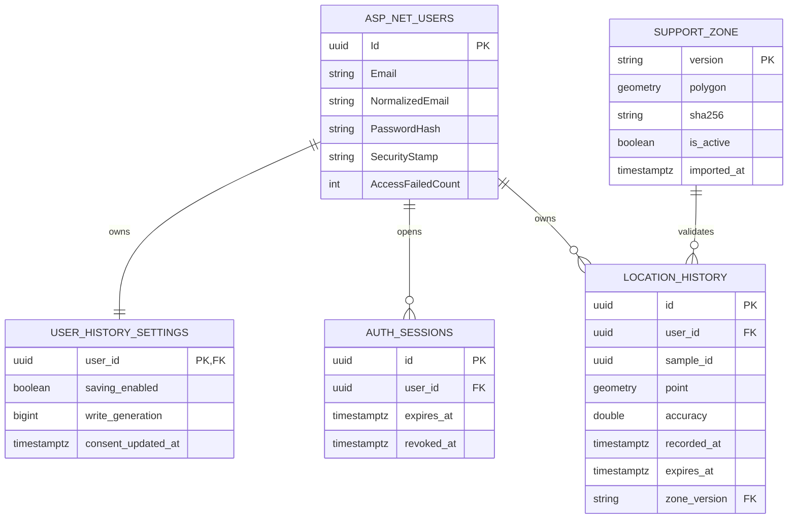

# Data Model: Map/location skeleton

**Ngày**: 2026-10-19. [Plan](plan.md) và [OpenAPI](contracts/openapi.json) là hợp đồng liên quan.
Mọi timestamp là timestamptz UTC; UI chỉ định dạng theo Asia/Ho_Chi_Minh.
Các bảng sau là thiết kế, chưa có migration hoặc DB được tạo.

## ERD

## Identity và phiên

`identity.AspNetUsers` dùng `IdentityUser<Guid>` và toàn bộ bảng Identity chuẩn
(AspNetRoles, AspNetUserRoles, AspNetUserClaims, AspNetRoleClaims, AspNetUserLogins,
AspNetUserTokens) qua IdentityDbContext. Không tự viết hashing/password storage,
không thêm cột consent vào bảng users, không thay user schema khi mở đăng ký.
Email normalized unique index theo quy tắc tài khoản email; seed dùng UserManager.
Danh sách demo accounts lấy secret JSON array, không commit email/password thật;
seed idempotent theo normalized email; không tự reset mật khẩu mỗi startup.
Rotation password là thao tác quản trị riêng có log không chứa giá trị secret.

`app.auth_sessions`: id uuid là sid, user_id FK, created_at, expires_at, revoked_at
nullable; unique active session/user bằng partial index `revoked_at IS NULL` (login
thu hồi row cũ trước INSERT). Bản ghi expired được revoke/cleanup trước tạo phiên mới;
không dùng now() trong predicate partial index. Index(user_id), index(expires_at).
Không lưu JWT/raw signing key. Token validator kiểm sid/user/expiry/revoked ở DB;
write gate kiểm lại dưới khóa, tránh request đã auth trước logout ghi sau logout.

## Cài đặt lưu

`app.user_history_settings`: user_id PK/FK, saving_enabled default false,
write_generation bigint default 0, consent_updated_at nullable.
Một row được seed cùng user. Generation tăng đơn điệu sau mỗi login/logout,
đổi consent và delete-all; PUT có expectedWriteGeneration để tránh lost updates.
Chỉ giao diện bật lưu là hành vi đồng ý, khác GPS permission và tracking.

State: Anonymous -> SignedInSavingOff -> SignedInSavingOn; logout/relogin về Off.
Tắt tracking không tự đổi consent, nhưng không có callback đủ điều kiện để gửi;
đổi sang manual dừng tracking. Tắt saving giữ lịch sử cũ. Delete-all giữ saving
nhưng tăng generation: UI xoá row hiển thị và nói rõ những điểm mới vẫn có thể lưu.
Khi toggle offline: client dừng lưu ngay, không báo server đã xác nhận thay đổi;
GET settings khi phục hồi, giữ local gate tắt tới khi người dùng bật lại thành công.

## Lịch sử vị trí

`app.location_history`:

| Cột | Kiểu/ràng buộc |
|---|---|
| id | uuid PK do server cấp |
| user_id | uuid NOT NULL FK Identity; lấy từ JWT, không tin user_id từ client |
| sample_id | uuid NOT NULL client sinh cho mỗi fix đã chọn gửi; unique(user_id,sample_id) |
| point | geometry(Point,4326) NOT NULL, X=longitude, Y=latitude |
| accuracy | double precision NOT NULL, finite và 0 <= accuracy <=100000 mét |
| recorded_at | timestamptz NOT NULL từ fix; server kiểm tuổi <=15s và tương lai <=5s |
| expires_at | timestamptz NOT NULL, backend tính recorded_at + 30 ngày (UTC) |
| zone_version | text NOT NULL FK support_zone.version để truy vết vùng đã dùng |

Thêm check coordinates [-180,180]/[-90,90], SRID4326, nonempty valid point,
expires_at = recorded_at + interval '30 days' dưới timezone UTC.
Không cột deleted_at, không soft-delete/global filter làm bằng chứng xoá.
Khóa idempotency không dùng tọa độ, không gộp hai fix chỉ vì cùng tọa độ.
Không thể chứng minh điểm thật sự do GPS và không bị giả mạo chỉ từ browser;
source=gps là hợp đồng client, không phải tính năng chống spoofing trong MVP.

Indexes: GIST(point) cho truy vấn không gian tương lai; BTREE(expires_at,id) cho purge;
BTREE(user_id,recorded_at DESC,id DESC) cho history; unique(user_id,sample_id).
Không thêm index cho mỗi cột. Giải thích GIST history là yêu cầu đầu vào, chưa có
search vùng lịch sử trong MVP; đo write cost trước tăng quy mô.

## Vùng hỗ trợ

`app.support_zone`: version text PK, polygon geometry(Polygon,4326) NOT NULL,
sha256 text NOT NULL, imported_at UTC, is_active bool; một active bằng partial unique
index trên is_active WHERE is_active=true. GIST(polygon), check valid/nonempty/SRID.
Không MultiPolygon trong feature này. Bản version đã nhập là bất biến: cùng version
khác checksum phải fail, không ghi đè. Đổi active trong transaction migration/seed
quản trị, không mở endpoint thay zone công khai.

GeoJSON Feature versioned + Polygon ring đóng, [lon,lat]; manifest liên kết version,
checksum và fixture điểm/tuyến. Import kiểm ST_IsValid và Covers tất cả Point cũng
như TOÀN BỘ LineString tuyến demo, không chỉ endpoints. Fixture chưa có được xem là
release blocker dữ liệu, không tự biến dữ liệu mô phỏng thành dữ liệu ngập thật.

Authoritative check: `ST_Covers(zone.polygon, ST_SetSRID(ST_MakePoint(lon,lat),4326))`.
Dùng NTS Covers được Npgsql dịch SQL và assert SQL/kiểm engine trong integration.
Không ST_Contains, không buffer, epsilon hoặc round/snap tọa độ khi ghi.
Client check GeoJSON có point-on-segment trước point-in-polygon; kiểm cùng fixture
biên SQL. Không hứa mọi phép tính float ở client giống DB: DB quyết định cuối.

## Transaction và race conditions

Đồng bộ mọi command của user qua `SELECT ... FOR UPDATE` trên settings, cùng thứ tự
khóa settings -> session -> ghi history để tránh deadlock. READ COMMITTED đủ với
khóa hàng này; mọi handler thay session/settings phải theo cùng protocol.

RecordPoint: xác thực JWT -> khóa settings -> kiểm sid chưa revoke, consent=true,
generation đúng, source=gps, timestamps hợp lệ -> đọc active zone/version -> Covers
-> INSERT -> commit. Unknown field userId/source=manual bị 400; ngoài vùng422;
consent false/generation/zone mismatch409; phiên cũ401. Không log tọa độ khi reject.

ChangeSettings: khóa row, verify session và expected generation, đổi bool, tăng
generation; trả settings mới. Điểm commit trước off là ghi trước lúc off hiệu lực;
request cũ tới sau commit off bị reject. Client abort không thể rollback DB đã commit.

DeleteAll: khóa row, verify session+generation; tăng generation rồi SQL DELETE WHERE
user_id; commit ->204 kèm X-Write-Generation mới. INSERT cũ commit trước bị xoá;
INSERT đợi khóa thấy generation cũ bị409. DELETE lỗi không trả204.
Đây là điểm tuyến tính hoá tại server; không hứa biết thời điểm bấm nút ở offline client.

List: lấy sub, expires_at>DB now(), cursor theo (recorded_at,id), limit default50/max100;
không lộ data user khác, không cache, không trả tổng count đắt khi chưa cần.
GET sau delete dùng connection/transaction mới để kiểm thật, không EF tracked cache.

## Retention và hard delete

expires_at tính từ thời điểm fix, không phải lúc upload. Query luôn lọc hết hạn;
Hangfire recurring job UTC mỗi phút, batch1000, DELETE thật theo id hết hạn, retry
3 lần và catch-up startup. Theo dõi lag = max(0, now-min(expires_at còn sót)); alert
quá5 phút. Một job tại một thời điểm bằng cơ chế lock provider; test restart/idempotent.
Không đưa id người dùng/tọa độ vào job arguments; chỉ cutoff, batch size và aggregate count.

Đúng mốc30 ngày: không còn đọc qua API. Xoá vật lý có độ trễ scheduler/availability,
mục tiêu<=1 phút healthy. Hard-delete không xóa tức thì backup/PITR; với MVP khi
restore DB, xoá TOÀN BỘ location_history trước mở truy cập, reset consent=false,
revoke tất cả sessions, chạy expiry cleanup; chấp nhận mất lịch sử để không phục hồi
điểm người dùng đã xoá. Quản trị backup tuân retention nhà cung cấp, không claim xoá
forensic khỏi WAL/disk ngay khi DELETE.

Kiểm chứng: SQL count theo user=0 sau delete; expired count=0 sau purge; history API
không trả expired khi job dừng; inspect log/trace/job tables không có GPS/token;
test hai tài khoản, row locks và late requests. Không dùng soft-delete filter để che dữ liệu.
