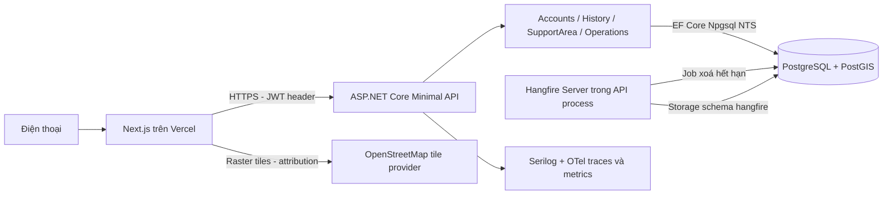
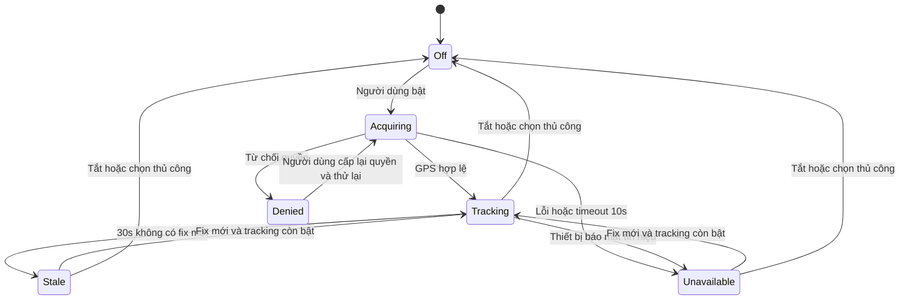

# Implementation Plan: Nền tảng bản đồ và vị trí TP.HCM

**Branch**: `001-map-location-skeleton` là mã feature do Spec Kit trả về, không xác nhận có Git branch.
**Date**: 2026-10-19 | **Spec**: [spec.md](spec.md)
**Input**: Đặc tả hiện hành và các ràng buộc kỹ thuật trong yêu cầu speckit-plan.

## Summary

Walking skeleton có bản đồ di động tiếng Việt, GPS có quyền kiểm soát, vùng demo,
tài khoản demo và lịch sử có đồng ý. Frontend trên Vercel gọi một ASP.NET Core API
trên Azure; PostgreSQL/PostGIS giữ Identity, lịch sử, vùng và Hangfire storage.
Không triển khai chức năng thời tiết, ngập, rủi ro, tìm đường hoặc AI.
Đây là thiết kế để chuyển sang speckit-tasks, chưa phải phần mềm đã triển khai.

## Technical Context

| Thuộc tính | Quyết định |
|---|---|
| Language/Version | C# / net10.0; TypeScript; Node.js 24 LTS; PostgreSQL 17 + PostGIS 3.x tương thích nhà cung cấp |
| Primary Dependencies | Next.js App Router, React, Tailwind, shadcn/ui, MapLibre GL JS; ASP.NET Core Minimal API, EF Core 10, Npgsql EF 10 + NetTopologySuite; Identity + JWT; Hangfire.PostgreSql; Scalar; Serilog; OpenTelemetry |
| Version policy | Chọn stable tương thích khi triển khai; pin patch trong global.json, package-lock.json và NuGet lockfiles; kiểm tra build/spatial/job trước chốt, không nâng major tự động |
| Storage | Azure PostgreSQL Flexible Server cùng region API; schema identity, app, hangfire; GeoJSON có phiên bản trong repo |
| Testing | xUnit + WebApplicationFactory + Testcontainers PostGIS; Playwright mobile + kiểm tra điện thoại thực |
| Target Platform | Mobile web 360px+, Chrome Android và Safari iPhone bản stable hiện hành khi demo; CI kiểm tra Chromium/WebKit, desktop smoke |
| Project Type | Monorepo web + modular monolith API, CQRS-lite bằng handlers trực tiếp qua DI, không mediator hoặc event bus |
| Performance Goals | Theo SC-001–SC-006: bản đồ 5s từ mở link, GPS10s từ bấm lấy vị trí có điều kiện, UI cập nhật <=1s, health <=3s; API CRUD p95 <=500ms ở 20 người thử đồng thời là mục tiêu kỹ thuật bổ sung |
| Constraints | GPS chỉ tiền cảnh; không gửi bù, không lưu mặc định; 30 ngày; ST_Covers; không có hạ tầng ngoài danh sách đã chốt |
| Scale/Scope | Demo 20 người đồng thời; ghi tối đa một điểm/người/10s = 172.800 điểm/ngày nếu liên tục, tối đa 5.184.000/30 ngày; đây là trần ước lượng, không phải tải đã đo |

## Constitution Check

Đã rà trước nghiên cứu và sau thiết kế. Constitution 1.0.0 vẫn là chuẩn.

| Nguyên tắc | Trước / sau thiết kế | Bằng chứng hoặc giới hạn |
|---|---|---|
| I. Demo trước | Pass / Pass | Mốc bàn giao dưới đây; luồng ẩn danh hoạt động độc lập tài khoản |
| II. Rủi ro giải thích được | Không áp dụng feature / Không áp dụng | Không tạo điểm rủi ro; điểm seed chỉ là fixture vùng, không trình bày như dữ liệu ngập thật |
| III. Hạ tầng có lý do | Pass có giải trình / Pass | Hangfire phục vụ xoá 30 ngày, dùng cùng DB/process; PostGIS bảo đảm biên; không thêm queue/cache/service |
| IV. Modular Monolith, AI fallback | Pass / Pass | Module nội bộ, một host; chưa có chức năng AI nên không dựng AI Worker; fallback AI phải thiết kế khi mở feature AI |
| V. Kiểm thử | Pass / Pass | xUnit API/SQL, Playwright demo; chưa có Risk Engine/Python nên chưa phát sinh pytest |
| VI. Log, lỗi, quyết định | Pass / Pass | ProblemDetails, correlation, telemetry không tọa độ; ADR và research đi kèm |

**Các khác biệt phải nói rõ:**
- Hangfire chạy theo phút không thể bảo đảm xoá vật lý tại đúng mili giây đủ 30 ngày,
  nhất là khi DB/API ngừng hoạt động. Mọi truy vấn loại dữ liệu hết hạn ngay;
  job hard delete mỗi phút, mục tiêu dọn trong 1 phút sau hạn khi healthy, cảnh báo
  khi backlog quá 5 phút và chạy bù ngay lúc khởi động. Đây là giới hạn vận hành
  cần đưa vào nghiệm thu, không được tuyên bố đã xoá vật lý đúng hạn khi job lỗi.
- Hard delete là DELETE thật trong DB hoạt động, không phải soft delete. Backup/PITR
  do nhà cung cấp giữ không biến mất ngay; quy trình restore MVP phải xoá toàn bộ history,
  reset consent và thu hồi sessions trước khi mở truy cập. Không hứa xoá tức thì mọi bản backup.
- Nguồn seed ngập/tuyến demo và đa giác thực tế chưa được cung cấp: thiết kế đã chốt
  cách kiểm chứng; chỉ nghiệm thu vùng khi nhóm cung cấp fixture thật và kiểm tra phủ.
  Không tự tạo điểm ngập giả rồi coi là bằng chứng bao phủ dữ liệu của nhóm.
- Checklist spec còn 2 mục về không chứa chi tiết triển khai vì người dùng chủ động
  chốt Identity/PostGIS. Đó là ràng buộc đầu vào, không phải vi phạm constitution.
- Đã đồng bộ US2/SC-002/NFR-001 ngày2026-10-20: tải bản đồ đo từ mở link;
  GPS10s đo từ thao tác bấm lấy vị trí khi bản đồ đã mở, loại thời gian trả lời
  quyền. Không tự lấy GPS chỉ vì người dùng mở ứng dụng.

## Project Structure

### Documentation (this feature)

```text
specs/001-map-location-skeleton/
  spec.md
  plan.md
  research.md
  data-model.md
  quickstart.md
  contracts/openapi.json
  contracts/README.md
  checklists/requirements.md
# tasks.md do speckit-tasks tạo sau; không tạo trong bước này.
GLOSSARY.md
docs/adr/0001-history-consent-and-revocable-jwt.md
```

### Source Code (repository root)

Cây bên dưới là các file/thư mục dự kiến, chưa được tạo trong bước plan.

```text
apps/web/
  src/app/{page.tsx,layout.tsx,history/page.tsx,status/page.tsx}
  src/features/map/{MapCanvas.tsx,SupportZoneLayer.tsx,ManualPoint.tsx}
  src/features/location/{useGeolocation.ts,location-machine.ts,LocationBanner.tsx}
  src/features/auth/{LoginDialog.tsx,auth-session.ts}
  src/features/history/{HistoryPanel.tsx,history-writer.ts,consent-store.ts}
  src/features/operations/client-events.ts
  src/components/ui/                    # shadcn
  src/lib/{api-client.ts,problem-details.ts}
  src/messages/vi.json                  # copy tách sẵn, chưa thêm locale khác
  scripts/package-support-zone.mjs
backend/
  FloodPlatform.sln
  src/Flood.Api/{Program.cs,Flood.Api.csproj}
  src/Flood.Api/Modules/Accounts/
    {Login,Logout,GetSession}/            # Endpoint.cs, Handler.cs, Contracts.cs theo slice
    {ApplicationUser.cs,SessionValidator.cs,DemoUserSeeder.cs}
  src/Flood.Api/Modules/History/
    {GetSettings,ChangeSettings,RecordPoint,ListHistory,DeleteAll}/
    {HistoryWriteGate.cs,RetentionJob.cs}
  src/Flood.Api/Modules/SupportArea/
    {GetZone,CheckPoint}/
    {SupportedAreaLookup.cs,ZoneSeeder.cs}
  src/Flood.Api/Modules/Operations/
    {Health,ClientEvents}/
  src/Flood.Api/Infrastructure/
    {Persistence,Authentication,Errors,Observability}/
  tests/Flood.UnitTests/
  tests/Flood.IntegrationTests/
  tools/Flood.DataValidation/{Program.cs,Flood.DataValidation.csproj}
spikes/{azure-connectivity,vercel-connectivity}/
tests/e2e/{map,gps,offline,auth,history,support-zone}.spec.ts
tests/performance/location-api.js
scripts/{verify-compose.ps1,verify-openapi.mjs}
assets/support-zones/hcm-demo-v1.geojson
assets/demo/{flood-points.geojson,demo-routes.geojson,manifest.json}
infra/{compose.yaml,docker/api.Dockerfile,docker/web.Dockerfile}
infra/azure/app-settings.example.json
infra/database/restore-scrub.sql
docs/validation/                       # bằng chứng từng mốc, spike và nghiệm thu
docs/operations/{deployment.md,restore.md}
.github/workflows/{ci.yml,deploy.yml}
```

**Structure Decision**: Một API project để giảm ceremony. Module sở hữu bảng/handler
của mình; endpoint chỉ binding/ủy quyền/TypedResults. Commands và queries là các
handler có kiểu, không dùng generic repository hoặc CQRS framework. EF context là
hạ tầng chung, không cho slice đọc bảng module khác tùy tiện. Accounts cung cấp
SessionValidator; HistoryWriteGate che transaction/consent; SupportedAreaLookup
cung cấp Covers và version, không lộ truy vấn EF cho caller.

## Kiến trúc tổng thể



Hangfire nằm trong cùng deployment, không phải worker/service riêng. Không cần
Redis/RabbitMQ cho storage. PostgreSQL storage provider là thư viện cộng đồng:
phải có compatibility smoke test trước lock version. Chọn App Service Linux
container .NET10, Basic trở lên, Always On, HTTPS Only; giới hạn một instance MVP.

MapLibre khởi tạo phía client, lazy load để shell không chờ WebGL. Nền OSM raster
qua style source raster 256px, hiển thị attribution. Endpoint tile cấu hình riêng;
không mặc định OSM data đồng nghĩa tile server miễn phí có SLA. Public OSM tiles
chỉ cho demo lưu lượng nhỏ, tuân thủ cache headers/Referer, không prefetch offline.
Nếu cần bảo đảm phục vụ, dùng nhà cung cấp tile dữ liệu OSM có điều khoản phù hợp
trước demo; không tự dựng tile server trong feature này.

## Xác thực, CORS và HTTPS

| Cách | Ưu điểm | Đánh đổi |
|---|---|---|
| JWT trong Authorization header, token chỉ trong RAM (chọn) | Không lệ thuộc third-party cookie giữa Vercel/Azure; không tự đính kèm như cookie | XSS có thể đọc token trong RAM; reload phải đăng nhập lại; cần thu hồi server-side |
| Cookie HttpOnly; SameSite=None; Secure | JS không đọc token | Cookie cross-site có thể bị chặn; cần credentials, CSRF token và CORS credentials; vận hành khó hơn cho hai domain mặc định |

Identity UserManager/SignInManager xác minh mật khẩu, lockout 5 lần sai/5 phút;
không map toàn bộ MapIdentityApi vì sẽ mở đăng ký ngoài phạm vi và bearer có sẵn
không phải JWT chuẩn. Slice Login phát JWT ký RS256, hạn 15 phút, iss/aud/sub/sid/jti,
clock skew 0s để giới hạn phiên đúng15 phút; đồng bộ thời gian host bằng nền tảng. Khóa riêng lấy từ secret; không gửi key hoặc mật khẩu sang web.
Không refresh token MVP. Token chỉ RAM, không localStorage/sessionStorage/cookie/URL.
CSP giới hạn script/connect, không log request body hoặc Authorization.

Seed tối thiểu3 tài khoản demo riêng cho người trình bày và các giám khảo, qua
DemoAccounts__Json secret; phân công tài khoản trước demo, không chia sẻ cùng một
tài khoản trên nhiều thiết bị đồng thời. Giữ thiết kế một phiên hoạt động/tài khoản:
login mới thu hồi phiên trước và đặt saving=false,
tăng write_generation. API xác minh chữ ký và auth_sessions còn hiệu lực ở MỌI request
được bảo vệ, không cache. Logout thu hồi sid trong transaction, tắt lưu và tăng generation;
SignOutAsync đơn thuần không thu hồi JWT. Không sửa schema Identity chuẩn để làm phiên.
Frontend huỷ request, xoá token và thông báo tab khác bằng BroadcastChannel (không gửi
GPS/token qua kênh); token hết hạn về ẩn danh, không tự đăng nhập hoặc bật lưu.

Khi logout offline: dừng thu thập/lưu tại client và xoá token ngay; không thể cam kết
thu hồi server nếu không gửi được. Hiện “Đã đăng xuất trên thiết bị; phiên máy chủ
sẽ hết hạn trong tối đa 15 phút”. Chặn ghi ở client; session cũ hết hạn theo JWT.
Kiểm thử thu hồi server là logout ONLINE; không mô tả offline logout đã thu hồi.

CORS: WithOrigins chỉ origin Vercel production cụ thể và localhost dev; methods
GET/POST/PUT/DELETE/OPTIONS, headers Content-Type/Authorization/X-Correlation-ID,
expose X-Correlation-ID/ETag/X-Write-Generation, không AllowCredentials và không wildcard preview.
Preview dùng staging API + allowlist origin riêng, không dùng secret production.
fetch credentials=omit; CORS không thay authorization. HTTPS/HSTS production,
forwarded headers chỉ tin proxy Azure cấu hình, redirect trước auth; public API URL
không chứa secret. JWT/history/settings responses Cache-Control: no-store.

## Luồng GPS, mạng và ghi lịch sử

Ba trục trạng thái độc lập, tránh trộn permission, network và freshness:
- permission: unknown / granted / denied / unsupported;
- tracking: off / acquiring / tracking / stale / unavailable;
- network: online / offline / api-unavailable. Outside-zone là trạng thái vùng riêng.



watchPosition enableHighAccuracy=true, timeout=10000, maximumAge=0; không hứa callback
đều đặn. UI áp dụng mỗi fix hợp lệ trong <=1s (render không quá 1 lần/giây, giữ fix
mới nhất trong RAM). Vòng accuracy tính bằng mét, tọa độ [longitude,latitude].
Một lần lấy vị trí không tự bật tracking. Mặc định reload tracking=false và saving=false
trên client; quyền granted không tự bắt đầu thu thập, người dùng vẫn phải bấm lấy vị trí.
Mốc GPS10s bắt đầu từ thao tác bấm lấy vị trí khi bản đồ đã mở; không tính thời
gian người dùng chấp thuận quyền, theo US2/SC-002 đã đồng bộ. Không tự lấy GPS chỉ
vì mở trang và trình duyệt từng cấp quyền.

Chỉ gửi điểm mới khi có token + tracking bật + server consent bật + có mạng + trong
vùng + fix mới, tối đa một POST/10s, một request đang chạy, timeout 5s. Không timer
lặp lại tọa độ cũ; không lưu điểm thủ công. Không retry POST khi mất phản hồi; sampleId
chống trùng nếu có gửi lặp do transport. Không queue điểm, không gửi latest offline
fix ngay lúc online: đợi callback mới sau mốc phục hồi. API reject quá cũ >15s hoặc
ở tương lai >5s; máy lệch đồng hồ nhận lỗi dễ hiểu, không âm thầm đổi recorded_at.

navigator.onLine và online/offline events là tín hiệu, không bằng chứng Internet;
fetch lỗi đặt api-unavailable, health probe lại sau 5s khi trang hiển thị. Sự cố API
không tuyên bố thiết bị mất mạng. Tile lỗi có banner riêng. Mạng offline: giữ tile
đã tải trong bộ nhớ/cache HTTP bình thường, không yêu cầu khu vực chưa có; GPS vẫn
hiển thị. GPS stale/unavailable và offline: marker đổi màu, icon/nhãn + aria-live banner,
hiển thị thời điểm cuối. Một banner có thể liệt kê đồng thời nhiều trạng thái.

FR-008 (không gửi GPS khi chưa consent) được giữ: anonymous/local check dùng đa giác
GeoJSON tải về; điểm ngoài biên kiểm tra client có thể sai số số học nên server là
thẩm quyền khi ghi. Public POST check-point chỉ nhận điểm thủ công/fixture;
Trong phạm vi spec 001, GPS thật chỉ gửi tới check/record sau đồng ý lưu lịch sử
và đủ điều kiện ghi; không có luồng gửi GPS của người ẩn danh, không tự gọi server
check cho anonymous GPS. Ngoại lệ chỉ khi spec 002 được triển khai: yêu cầu xử lý
tạm do người dùng chủ động đồng ý theo spec 002 FR-019 (ứng dụng không lưu vị trí
chính xác/không ghi log tọa độ; Open-Meteo có thể giữ log tọa độ làm tròn tối đa
90 ngày theo notice v2), độc lập với đồng ý lưu lịch sử; chỉ gửi khi bấm yêu cầu, theo dõi GPS
không tự gửi vị trí mới.
Client kiểm tra cả biên, không snap/buffer/làm mượt. Ngoài vùng không lưu; dao động
sát biên chấp nhận trong MVP, thông báo không khẳng định toàn TP.HCM đã được phủ.

## Lưu trữ, quyền riêng tư và retention

Chi tiết bảng, transaction và ERD: [data-model.md](data-model.md). Hợp đồng:
[contracts/openapi.json](contracts/openapi.json), [quy tắc API](contracts/README.md).

History/settings/login/logout/delete khóa cùng hàng user_history_settings trước khi
thay đổi. Request record mang writeGeneration; toggle, login/logout và delete tăng
nó để request cũ bị 409. Ghi điểm, kiểm consent, sid, zone, generation và INSERT cùng
transaction. Delete khóa hàng, tăng generation, DELETE toàn bộ user_id rồi commit;
chỉ trả 204 sau commit. Point ghi trước delete bị xoá; point cũ đến sau bị chặn.
Điểm mới sau delete có generation mới vẫn được lưu nếu consent còn bật; UI nói rõ
“Đã xoá lịch sử hiện có; tắt lưu để ngừng ghi mới”. Không tự thay nghĩa tắt lưu.

Đọc lịch sử lọc user từ JWT, expires_at > now, limit 50/max100, cursor; không nhận
user_id từ client. Không cho tải toàn bộ không giới hạn. Disable consent giữ bản ghi
cũ tới hết hạn/xoá. Hangfire job mỗi phút DELETE theo batch 1000 với index expires_at;
job nhận thời điểm/cấu hình, không nhận GPS làm arguments. Idempotent, retry có giới
hạn, chạy catch-up trước ready sau restart; dashboard chỉ development, tắt public.
Ghi metric cleanup lag; retention thất bại không làm mở lại dữ liệu hết hạn.

Tọa độ chỉ nằm trong history đã consent và RAM vị trí hiện tại. Log không có body,
SQL parameter, Authorization, email/mật khẩu hoặc tọa độ. Telemetry route template,
error code và số lượng; không sid/user_id làm nhãn metric. Client giữ vòng log chuyển
trạng thái không tọa độ trong RAM tối đa 100 sự kiện, hết hạn 24h hoặc mất khi đóng
trang; gửi khi online tới endpoint giới hạn body/rate. Đây không phải queue dữ liệu
vị trí. Server log vận hành giữ 7 ngày cấu hình sink; không dùng lỗi làm đường vòng
thu thập vị trí. Thông báo nhà cung cấp tile thấy IP/vùng tile đang xem.

## Logging và quản lý lỗi

Serilog structured console JSON trên Azure; request completion gồm method, route
TEMPLATE, status, duration, traceId/correlationId. Correlation do server tạo/validate
UUID từ header, tránh log injection. AddProblemDetails + IExceptionHandler; mọi lỗi
API gồm type/title/status/detail/code/traceId, thông điệp tiếng Việt, không stack/SQL.
400 validation; 401 session; 409 consent/generation/zone version; 422 outside-zone/stale
GPS; 429 retry-after; 503 DB. Frontend hiện hành động thử lại phù hợp, không tự retry
điểm hoặc báo xoá thành công khi server chưa xác nhận.

OpenTelemetry ASP.NET Core + HttpClient + Npgsql instrumentation nhưng tắt SQL text/
parameters, URL query và header nhạy cảm; traces sampled 10%, lỗi log đầy đủ đã redact.
Tất cả log payload đi qua redact allowlist; không bật EF EnableSensitiveDataLogging.
Metrics: request count/duration/error, DB health, saved/rejected points theo reason
bounded enum, client transition count, purge deleted/lag/last-success. Export OTLP tới
endpoint nếu cấu hình; default console/development và Azure logs. Grafana không dựng
MVP. /health/live không DB; /health/ready thử DB+PostGIS+active zone+schema+cleanup
khởi động, timeout 2s; /status frontend không vẽ chi tiết nội bộ. Scheduler heartbeat
và cleanup lag hiển thị degraded qua log/metric, trả ready=503 nếu quá ngưỡng 5 phút.

## Chiến lược kiểm thử

| Bộ kiểm thử | Nội dung, điều kiện đạt |
|---|---|
| xUnit unit | State/policy valid lat/lon/accuracy, age, generation; TimeProvider giả để kiểm mốc 30s/30 ngày; không giả EF để tuyên bố đã kiểm SQL |
| Integration PostGIS | Testcontainers postgis/postgis bản pin hỗ trợ PostgreSQL17; migrations, Identity seed lặp, NTS -> ST_Covers SQL, trong/ngoài/sát biên hai phía/trên cạnh/đỉnh, SRID/đảo lat-lon/invalid polygon |
| History/privacy | anonymous/consent=false không ghi; manual/outside không ghi; expire đúng cutoff không đọc; purge hard delete bằng SQL raw bỏ global filter; two users không đọc/xoá chéo; DELETE rồi SELECT count=0 |
| Race/revocation | POST vs off/delete/logout với barrier transaction; stale generation 409; login không bật lưu; JWT cũ 401 sau online logout; token expiry, login sai/lockout/rate limit |
| Hangfire | Storage compatibility smoke trên .NET10/Npgsql10; retry/restart catch-up; job không chứa tọa độ; batch purge, failed DB, backlog alert |
| Playwright | Chromium + WebKit viewport360/390: map, permission grant/deny, GPS move, 30s stale, manual, offline/recover không gửi bù, login, consent, list/delete, boundary, API503, reload/logout |
| Thực địa | Chrome Android và Safari iPhone HTTPS: permission, 30–50m đi bộ, 10 lần tải theo spec, WebGL, touch, mất tín hiệu. Mô phỏng không thay kết quả GPS thật |

CI E2E dùng raster fixture tổng hợp do nhóm tạo, không tải hàng loạt tile OSM;
integration cùng DB engine/extensions production. Performance bằng 20 user synthetic,
không tọa độ thật; ghi thiết bị/network/cold load, không tuyên bố đạt nếu chưa chạy.
Ma trận truy vết: US1/FR001,009 -> map; US2/FR002,013 -> gps;
US3/FR003,004 -> state/race; US4/FR005,006,015,016 -> offline/events;
US5/FR007,008,012,017 -> auth/history/privacy; US6/FR010,011 -> health/errors;
FR014/NFR007/SC015 -> support-zone; NFR001–004 -> performance/mobile/e2e;
NFR005–006 -> module review/Identity tests. SC001–015 đều có kiểm chứng ở các bộ trên.

## CI/CD và triển khai

GitHub Actions chỉ được tạo file trong implementation, chưa deploy ở bước plan.
PR: npm ci, lint (eslint CLI), tsc --noEmit, build; dotnet restore --locked-mode,
build, test unit/integration trên Ubuntu Docker; Playwright install --with-deps;
validate OpenAPI + breaking diff; secret scanning và scan package. Job deploy phụ thuộc
mọi check, không chạy production từ fork/PR; permissions mặc định read-only.

Main/release: build API Docker image -> GHCR tag commit SHA -> EF migration bundle
chạy một lần bằng migration identity -> seed zone/demo qua job quản trị -> deploy
App Service container SHA -> ready smoke. Dùng Azure OIDC federated credential
(azure/login), id-token:write chỉ deploy job, RBAC tối thiểu; image pull bằng managed
identity hoặc scoped registry credential, không PAT rộng. Vercel CLI CI dùng project/org
ID và token trong GitHub Environment secrets; build --prod/deploy --prebuilt --prod
sau backend smoke, pin CLI version. Health smoke + Playwright public non-destructive;
xoá lịch sử test chỉ tài khoản test riêng. Production environment có reviewer bảo vệ
nếu nhóm cấu hình, không coi plan là quyền deploy thực tế.

Migrations trước deploy theo expand-contract; rollback image chỉ khi schema tương thích,
không tự down migration phá dữ liệu. Demo fixture version và zone version deploy cùng
release; API kiểm version khi ghi, mismatch409 yêu cầu reload zone.

Local Compose: PostgreSQL/PostGIS + API (Hangfire in-process) + web, volume DB, một job
migration/seed chạy trước API ready. localhost an toàn cho geolocation; điện thoại phải
truy cập URL HTTPS thật/trust được, không dùng HTTP địa chỉ LAN rồi coi GPS lỗi code.
Production: provision Azure DB PostGIS allowlist+extension, TLS VerifyFull, pool nhỏ
MaxPoolSize20/API (tính thêm Hangfire), cùng region; firewall egress App Service được
allowlist, không mở toàn Internet mặc định. App Service Always On và cấu hình secret
references; Vercel production env URL API/zone/tile public. Chi tiết [quickstart](quickstart.md).

Hai DB khả thi: Azure Flexible Server (chọn: cùng Azure/API, kiểm soát vận hành,
PostGIS support có tài liệu) và Supabase PostgreSQL+PostGIS (dự phòng: dễ provision,
nhưng thêm nhà vận hành và kết nối/pooler; không dùng Supabase Auth hoặc Data API).
Không nêu giá cố định; kiểm quota/region/credit và khả dụng extension trước provisioning.

## Quyết định kiến trúc và lý do

| ID | Lựa chọn | Lý do / phương án đã cân nhắc |
|---|---|---|
| D01 | Next App Router + client MapLibre | Stack đã chốt; map không SSR, UI shell load trước |
| D02 | Modular Monolith + slices + handlers DI | Chốt stack; đơn vị deploy ít, không cần mediator/event bus |
| D03 | EF/Npgsql/NTS + PostGIS | Cùng DB cho history/zone; Covers có biên, EF InMemory không chứng minh SQL |
| D04 | Azure Flexible thay Supabase | Cùng vận hành Azure; Supabase là DB thay thế chứ không auth thứ hai |
| D05 | Identity chuẩn + JWT RAM + DB session | Cross-site cookie khó; token có thu hồi để logout đúng; reload cần login |
| D06 | Consent/generation + per-user lock | Tránh request cũ ghi sau off/delete; không thêm distributed lock |
| D07 | Hangfire cùng host/DB | Có nhu cầu hard delete 30 ngày, persisted retry; không thêm worker riêng |
| D08 | GeoJSON version + PostGIS authority | Demo tái hiện, kiểm phủ toàn tuyến; không mở vùng vì sai số GPS |
| D09 | No replay/offline queue | Privacy và MVP; đánh đổi mất điểm offline đã được chốt |
| D10 | OSM raster nguồn cấu hình | MapLibre hỗ trợ raster; attribution/policy và tile SLA phải phân biệt |
| D11 | Serilog + OTel, chưa Grafana | Đủ tra lỗi/trace; dashboard riêng chỉ khi có nhu cầu vận hành đo được |
| D12 | Vercel + App Service container + Actions | Stack đã chốt; .NET runtime được pin trong container, Always On phục vụ retention |

Đánh đổi quan trọng về auth/privacy ghi thêm [ADR](../../docs/adr/0001-history-consent-and-revocable-jwt.md).

## Rủi ro và phương án demo dự phòng

| Rủi ro | Giảm thiểu / cách demo trung thực |
|---|---|
| Mất mạng | Giữ tile đã xem, banner, không gửi bù; có hotspot dự phòng. Mở mới offline không hứa có bản đồ |
| GPS không hoạt động | Chọn điểm thủ công trong vùng, không gán accuracy GPS; demo mock chỉ chế độ test gắn nhãn mô phỏng, không làm giả GPS thực |
| API/DB lỗi | Anonymous map/GPS/local zone vẫn dùng với GeoJSON cùng version đóng gói; lịch sử báo unavailable, không giả login/xoá thành công; Compose local dự phòng chỉ trình bày là local |
| Tile lỗi/WebGL thiếu | Thử mạng/provider hợp lệ khác đã cấu hình; WebGL unsupported hiện hướng dẫn. Không đổi sang ảnh tĩnh rồi tuyên bố map tương tác đạt |
| GPS nhảy biên | State có thể đổi liên tục là known risk; test exact boundary; làm mượt sau MVP |
| Cleanup chết/idle | Always On, startup catch-up, alert5min, query expiry; không hứa hard delete khi DB down |
| JWT bị lấy qua XSS | CSP, dependency scan, không token persistence; 15min+session revoke, không tự làm auth thành OIDC provider production |
| Thiếu fixture/zone | Gate release đòi đủ GeoJSON points/routes/manifest/version và test ST_Covers toàn tuyến; chưa có fixture thì chưa đạt |
| Budget/region/cold start | Verify quota trước demo, cùng region; warm health trước lượt trình diễn, đo cold start riêng |
| Backup chứa dữ liệu đã xoá | Không dùng dữ liệu GPS thật cho demo nếu không cần; quy trình restore scrub, kiểm retention backup, nói rõ giới hạn |

## Lộ trình mở rộng có điều kiện

| Thành phần | Chỉ kích hoạt khi | Điểm nối dự kiến, chưa triển khai |
|---|---|---|
| Tự đăng ký | Sau MVP, cần người dùng thật | Accounts: thêm slice Register/Verify/Reset trên Identity chuẩn |
| Redis | Đo DB/API p95 vượt mục tiêu do đọc lặp hoặc cần rate limit nhiều instance | Cache zone/public config; không cache consent/revocation nếu chưa có bảo đảm invalidation |
| AI Worker Python/FastAPI | Có feature AI được duyệt và nhu cầu GPU/isolation | Module AI client riêng với timeout, fallback deterministic; chưa có endpoint/job AI |
| RabbitMQ | Cần xử lý bền vững nhiều consumer với backpressure được đo | Tách transport sau ADR; không dùng chỉ để gọi AI |
| OSRM/tìm đường | Sau đặc tả routing và dữ liệu đường được duyệt | Module Routing gọi engine qua interface; không dựng stub service hiện tại |
| Tile server riêng | Lưu lượng/giới hạn/SLA hoặc yêu cầu offline khiến provider không đáp ứng | Thay source tile cấu hình sau đánh giá chi phí |
| Grafana | Có người vận hành, OTLP backend và nhu cầu dashboard/alert dài hạn | Dùng telemetry đã có, không thêm để đẹp demo |
| Offline replay, smoothing, toàn TP.HCM | Sau thi, có yêu cầu và kiểm thử riêng | Consent/conflict model, state policy, zone version mới; không lén bật trong MVP |

## Mốc bàn giao cho speckit-tasks

1. **P0 — demo sớm**: Map shell + local zone/fixture validation + anonymous HTTPS smoke.
2. **P0 — demo sớm**: GPS state machine + manual/offline UI + tests quyền/privacy;
   kết thúc mốc2 phải có demo ẩn danh trên điện thoại, chưa cần đăng nhập/lịch sử.
3. **P1 — hoàn tất chức năng**: đầu mốc có T073 spike Hangfire.PostgreSql/.NET10/Npgsql10/PostGIS
   trên Testcontainers và T074 spike Azure–Vercel connectivity (API/PostGIS/CORS/HTTPS/JWT).
   Sau khi mốc1 xong (T011), backend T023–T026 và hai spike chạy song song frontend
   mốc2, không chờ T022; frontend integration và gate T041 vẫn chờ mốc2.
   Tiếp theo API/PostGIS/Identity demo + sessions + settings/record/list/delete
   transactions; giữ JWT RS256, write_generation và khóa user, không rút bỏ bảo vệ dữ liệu.
4. **P1 — bảo đảm dữ liệu**: Hangfire retention, Serilog/ProblemDetails, health API/DB, trang /status,
   integration/race tests và kiểm privacy.
5. **P1 — nghiệm thu**: CI/deploy wiring + Playwright + real-phone acceptance + rehearsal.
6. **P2 — làm cuối**: endpoint ClientEvents, BroadcastChannel giữa các tab
   và OTel traces. Vẫn thuộc plan nhưng có thể hoãn nếu hết thời gian; từng hạng mục
   hoãn phải ghi “chưa làm” kèm lý do trong báo cáo cuối, không được báo đạt hoặc
   coi đã hoàn thành. Toàn bộ P0/P1 vẫn phải đạt.
   Logging sự cố GPS/mạng tại client và health API vẫn có từ các mốc trước;
   metrics cơ bản theo thiết kế, traces hoàn thiện ở mốc cuối.
Mỗi mốc triển khai theo red-green-refactor; test hành vi trước, không tạo test chỉ
soi cấu trúc code. Chưa thực thi các mốc này trong bước lập kế hoạch.

## Chuẩn bị demo và dữ liệu

- Nhóm phải chốt khu vực demo, cung cấp điểm ngập seed/tuyến demo rồi tạo
  assets/support-zones/hcm-demo-v1.geojson và fixture tương ứng có phiên bản.
  Chưa có dữ liệu này: không coi release gate vùng là đạt, không tự chọn thay nhóm.
- Có thể dùng đa giác tổng hợp cho unit/integration test hình học độc lập;
  kiểm thử phủ điểm/tuyến thực và nghiệm thu vùng phải dùng dữ liệu demo đã chốt.
- Giữ token chỉ trong RAM theo ADR. Reload mất đăng nhập; nói trước với giám khảo,
  chuẩn bị tài khoản riêng và bước đăng nhập lại trong kịch bản demo.
- Tài liệu dự thi còn cần kịch bản5–7 phút, bảng so sánh Google Maps/Waze và mô hình
  kinh doanh, làm riêng ngoài spec nền tảng. Chưa có nguyên văn5 tiêu chí BTC nên
  chưa thể xác nhận bao phủ. Mục này chỉ ghi nhận phần còn thiếu, không tạo spec phụ
  hoặc tự viết nội dung thị trường chưa kiểm chứng.

## Complexity Tracking

Không có vi phạm constitution chưa được giải trình. Hangfire và bảng phiên/generation
là độ phức tạp cần thiết cho retention và logout/xoá đúng; cron không persisted retry,
JWT stateless không thu hồi ngay, client-only consent không bảo vệ request đến muộn.
Giới hạn thời điểm xoá vật lý/backup được công khai ở Constitution Check, không che
bằng tuyên bố compliance tuyệt đối.


