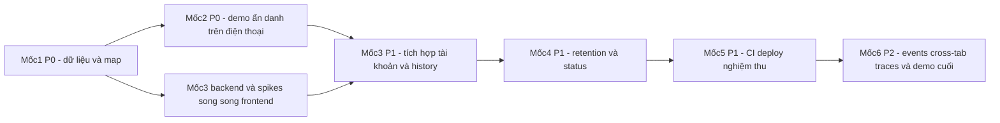

# Tasks: Nền tảng bản đồ và vị trí TP.HCM

**Bàn giao khi tạm dừng**: đã xong T003, T002 chờ Docker, T001 chờ dữ liệu, tiếp theo là T006, T008, T005, T009.

**Ngày tạo**: 2026-10-20. **Feature**: `001-map-location-skeleton`.
**Input**: [spec.md](spec.md), [plan.md](plan.md), [data-model.md](data-model.md),
[research.md](research.md), [quickstart.md](quickstart.md),
[OpenAPI](contracts/openapi.json), [API notes](contracts/README.md), constitution 1.0.0.

## Quy ước

- Dùng đúng 6 mốc và nhãn P0/P1/P2 của plan theo yêu cầu người dùng, thay cách chia
  phase theo story của template. [USn] chỉ truy vết, không dùng Priority của story
  để xếp thứ tự. P2 làm cuối, có thể hoãn nếu hết thời gian; ghi “chưa làm” kèm
  lý do, không tick hoàn thành hoặc báo đạt hạng mục hoãn. P0/P1 phải đạt.
- Mỗi task có file chính, phụ thuộc, tiêu chí hoàn thành và FR/NFR/SC. Độ lớn S/M/L
  và cột người phụ trách ở bảng cuối mỗi mốc; người phụ trách để trống.
  S: thay đổi nhỏ; M: một slice/tích hợp; L: nhiều thành phần hoặc race/security.
- [P] chỉ có thể chạy cùng công việc trên file khác SAU KHI phụ thuộc đã hoàn tất;
  không cho phép vượt phụ thuộc, sửa đồng thời shared file hoặc tự spawn agent.
  Program.cs, lockfiles, migrations và harness chung phải tích hợp tuần tự.
- Test-first: harness chạy được -> test hành vi RED -> cài đặt GREEN -> refactor ->
  chạy lại. Bootstrap/data là prerequisite, không phải cài feature trước test.
  Không nhận thiếu Docker/credentials hoặc compile error làm RED hợp lệ. Hành vi
  đã đúng thì ghi baseline, không phá code để ép RED.
- T001 do NHÓM cung cấp dữ liệu thật; fixture tổng hợp chỉ để test hình học/tile,
  không thay dữ liệu nhóm hoặc bằng chứng bao phủ thực tế.
- Giữ nguyên JWT RS256 có thu hồi, write_generation, khóa theo user và hard delete.
  Không bỏ bảo vệ dữ liệu hoặc race test để demo sớm.
- Đây chỉ là danh sách. Tất cả checkbox chưa hoàn thành; file code được nhắc tới
  là đường dẫn dự kiến, không được tạo bởi lệnh sinh tasks này.
- Không có task cho Redis, RabbitMQ, AI Worker, OSRM, Grafana hoặc soạn kịch bản
  5–7 phút, bảng so sánh Google Maps/Waze, mô hình kinh doanh.

## Mốc 1: P0 — demo sớm

**Mục tiêu**: Map shell + local zone/fixture validation + anonymous HTTPS smoke.
**Checkpoint**: T011 — bản đồ ẩn danh HTTPS và bộ dữ liệu thật được phủ toàn điểm/tuyến.

- [ ] T001 [US1] NHÓM CUNG CẤP DỮ LIỆU — chốt khu vực demo và bàn giao `assets/support-zones/hcm-demo-v1.geojson`, `assets/demo/flood-points.geojson`, `assets/demo/demo-routes.geojson`, `assets/demo/manifest.json`.

  **Phụ thuộc**: Không; cần đầu vào do nhóm xác nhận. **Truy vết**: FR-014; NFR-007; SC-010, SC-015.

  **Hoàn thành**: Nhóm chốt khu vực, nguồn điểm/tuyến; Polygon GeoJSON đóng, tọa độ [longitude,latitude], SRID 4326; manifest ghi version, nguồn và SHA-256 từng file. Không tự bịa dữ liệu ngập/tuyến. Chưa có đầu vào thì ghi BLOCKED; T004 phải chứng minh ST_Covers cho mọi điểm và toàn bộ tuyến trước đóng gate dữ liệu.

- [ ] T002 [US1] RED — dựng harness xUnit/PostGIS và test validator trong `backend/FloodPlatform.sln`, `backend/tests/Flood.IntegrationTests/SupportArea/ZoneDataTests.cs`, `backend/tests/Flood.IntegrationTests/Fixtures/PostgisFixture.cs`.

  **Phụ thuộc**: Không; test tổng hợp độc lập T001. **Truy vết**: FR-014; NFR-004, NFR-005, NFR-007; SC-007, SC-010, SC-015.

  **Hoàn thành**: Harness net10.0/Testcontainers chạy được. Test checksum/version sai, polygon invalid/SRID sai, thiếu fixture và ST_Covers toàn Point/LineString; có tuyến hai đầu trong nhưng đi ra ngoài. RED do thiếu validator, không do thiếu Docker. Test hình học tổng hợp gắn nhãn, không dùng đóng gate dữ liệu thật.

- [x] T003 [P] [US1] RED — dựng Playwright harness và test map tại `apps/web/package.json`, `apps/web/playwright.config.ts`, `tests/e2e/map.spec.ts`, `tests/e2e/fixtures/synthetic-raster.png`.

  **Phụ thuộc**: Không; web harness tách backend T002. **Truy vết**: FR-001, FR-007, FR-012; NFR-001, NFR-002, NFR-004; SC-001, SC-005.

  **Hoàn thành**: Test map TP.HCM ẩn danh không cần quyền GPS/login, kéo/zoom, attribution, 360px không cuộn ngang, nút 44px và tiếng Việt. Tile fixture tự tạo, không tải OSM hàng loạt. RED trước T005; pin toolchain/lockfile, không cài feature trong bootstrap harness.

- [ ] T004 [US1] GREEN — công cụ kiểm dữ liệu thật tại `backend/tools/Flood.DataValidation/Program.cs`, `backend/tools/Flood.DataValidation/Flood.DataValidation.csproj`.

  **Phụ thuộc**: T001, T002. **Truy vết**: FR-014; NFR-007; SC-010, SC-015.

  **Hoàn thành**: PostgreSQL 17/PostGIS bản pin chạy ST_IsValid và ST_Covers cho mọi điểm, TOÀN BỘ hình học tuyến, không chỉ endpoints; checksum/version hợp lệ. Lưu report version/hash/coverage. Invalid data fail rõ; không ST_Contains. T002 green rồi refactor. Thiếu dữ liệu nhóm không được tự thay bằng synthetic.

- [ ] T005 [P] [US1] GREEN — Next App Router và map shell tại `apps/web/src/app/page.tsx`, `apps/web/src/app/layout.tsx`, `apps/web/src/features/map/MapCanvas.tsx`, `apps/web/src/messages/vi.json`.

  **Phụ thuộc**: T003. **Truy vết**: FR-001, FR-007, FR-012; NFR-001, NFR-002; SC-001, SC-005.

  **Hoàn thành**: Next/React/TypeScript/Tailwind/shadcn stable pin theo Node24; MapLibre client-only lazy load, OSM raster256 nguồn cấu hình, attribution/touch/loading/error. Copy vi.json tách sẵn, chưa thêm locale. T003 green, lint/typecheck/build đạt.

- [ ] T006 [P] [US1] RED — local zone/boundary tests tại `tests/e2e/support-zone-local.spec.ts`, `tests/e2e/fixtures/zone-boundary-cases.json`.

  **Phụ thuộc**: T003. **Truy vết**: FR-008, FR-014; NFR-004, NFR-007; SC-008, SC-010.

  **Hoàn thành**: Test trong/ngoài/sát biên hai phía/trên cạnh/đỉnh; accuracy-circle giao vùng không nới phạm vi. Ngoài vùng hiện “chưa hỗ trợ”, anonymous GPS không POST tọa độ lên server. RED trước T007.

- [ ] T007 [US1] GREEN — GeoJSON local và boundary tại `apps/web/src/features/map/SupportZoneLayer.tsx`, `apps/web/src/features/map/support-area.ts`, `apps/web/scripts/package-support-zone.mjs`.

  **Phụ thuộc**: T004, T005, T006. **Truy vết**: FR-008, FR-014; NFR-007; SC-008, SC-010, SC-015.

  **Hoàn thành**: Build dùng cùng file/version/checksum authoritative, không copy tay nguồn thứ hai. Vẽ boundary; point-on-segment rồi point-in-polygon tính cả biên, không snap/buffer. Fixture parity đạt; GPS anonymous check local, DB là thẩm quyền khi ghi.

- [ ] T008 [P] [US1] RED — test lỗi map và public config tại `tests/e2e/map-failures.spec.ts`, `tests/e2e/public-config.spec.ts`.

  **Phụ thuộc**: T003. **Truy vết**: FR-009, FR-011, FR-012; NFR-002, NFR-004; SC-001, SC-008.

  **Hoàn thành**: Tile/WebGL lỗi có hướng dẫn, không fake map thành công; bundle không credential/seed/private key, không prefetch offline, attribution không ẩn. RED trước T009.

- [ ] T009 [US1] GREEN — CSP/public config/fallback tại `apps/web/next.config.ts`, `apps/web/.env.example`, `apps/web/src/features/map/MapFallback.tsx`, `apps/web/src/lib/public-config.ts`.

  **Phụ thuộc**: T005, T008. **Truy vết**: FR-009, FR-011, FR-012; NFR-002; SC-001, SC-008.

  **Hoàn thành**: NEXT_PUBLIC chỉ URL/config công khai; CSP tương thích MapLibre worker và nguồn tile; thông báo provider thấy IP/vùng tile, lỗi dễ hiểu. T008 green; không dựng tile server.

- [ ] T010 [US1] Xác minh map shell anonymous HTTPS tại `docs/validation/milestone-1-https.md`, `apps/web/vercel.json`.

  **Phụ thuộc**: T007, T009. **Truy vết**: FR-001, FR-009; NFR-001, NFR-002; SC-001.

  **Hoàn thành**: Khi có môi trường/quyền triển khai, cấu hình Vercel và mở HTTPS trên điện thoại; ghi URL/build/zone/thiết bị/kết quả. Chưa có môi trường ghi BLOCKED, không dùng URL giả hoặc HTTP LAN. Chưa cần backend history.

- [ ] T011 [US1] REFACTOR/gate mốc1 tại `docs/validation/milestone-1.md`.

  **Phụ thuộc**: T001, T002, T003, T004, T005, T006, T007, T008, T009, T010. **Truy vết**: FR-001, FR-009, FR-014; NFR-004, NFR-005, NFR-007; SC-001, SC-007, SC-015.

  **Hoàn thành**: Validator/PostGIS và Playwright map green, refactor rồi chạy lại. Ghi coverage toàn điểm/tuyến, checksum, HTTPS; T001/T004 thiếu thì gate chưa đạt. Không biến seed thành tính năng ngập/routing.

| Task | Độ lớn | Người phụ trách |
|---|---|---|
| T001 | M |  |
| T002 | M |  |
| T003 | M |  |
| T004 | M |  |
| T005 | M |  |
| T006 | S |  |
| T007 | M |  |
| T008 | S |  |
| T009 | S |  |
| T010 | S |  |
| T011 | S |  |

## Mốc 2: P0 — demo sớm

**Mục tiêu**: GPS state machine + manual/offline UI + tests quyền/privacy.
**Checkpoint**: T022 — bản demo ẩn danh chạy thật trên điện thoại, không chờ auth/history.

- [ ] T012 [US2] RED — GPS/accuracy/tracking tests tại `tests/e2e/gps.spec.ts`.

  **Phụ thuộc**: T011. **Truy vết**: FR-002, FR-003, FR-004, FR-013; NFR-001, NFR-003, NFR-004; SC-002, SC-003, SC-005.

  **Hoàn thành**: Không tự lấy GPS khi mở; bấm mới grant, marker/vòng/met/time. UI <=1s từ fix, GPS <=10s từ bấm trừ thời gian quyền; bật/tắt, reload off, late callback bị bỏ, invalid lat/lon/accuracy không thay điểm tốt. Đo thêm NFR-003 bằng Playwright với mốc trong trang: performance.now() tại sự kiện bắt đầu thao tác kéo thực tế/zoom/bật-tắt làm t0; t1 là khung hình đầu có thay đổi nhìn thấy tương ứng (camera bản đồ hoặc trạng thái nút/nhãn), xác nhận bằng render/DOM observer và requestAnimationFrame. Assert t1-t0 <=1000ms cho từng thao tác, không dùng thời gian từ phía runner làm phép đo. Ghi t0/t1/delta/thao tác vào artifact `test-results/gps-interaction-timing.json` của task; tách khỏi phép đo GPS callback. RED trước T015/T016.

- [ ] T013 [P] [US4] RED — quyền/timeout/manual tests tại `tests/e2e/manual-point.spec.ts`.

  **Phụ thuộc**: T011. **Truy vết**: FR-004, FR-005, FR-006, FR-014; NFR-004; SC-004, SC-010.

  **Hoàn thành**: Deny/unsupported/revoke/timeout10s có hướng dẫn, không prompt lặp; manual <=2 thao tác, không accuracy giả, dừng tracking/bỏ late callback; ngoài vùng thông báo đúng. RED trước T017.

- [ ] T014 [P] [US4] RED — mất GPS/mạng/recovery tests tại `tests/e2e/offline.spec.ts`.

  **Phụ thuộc**: T011. **Truy vết**: FR-005, FR-013, FR-015; NFR-002, NFR-003, NFR-004; SC-005, SC-011.

  **Hoàn thành**: Clock test stale30s, đổi màu+banner chữ; offline giữ tile đã tải, GPS vẫn update nếu có; không replay. Recovery chờ fix mới; API-unavailable khác offline. RED trước T018.

- [ ] T015 [US2] GREEN — adapter tại `apps/web/src/features/location/useGeolocation.ts`.

  **Phụ thuộc**: T012. **Truy vết**: FR-002, FR-003, FR-004, FR-008; NFR-003; SC-002, SC-003, SC-008.

  **Hoàn thành**: getCurrentPosition/watchPosition chủ động, enableHighAccuracy=true/timeout10000/maximumAge0; clearWatch và callback generation khi off/unmount/manual. Không upload hoặc persist tọa độ. Tests adapter green.

- [ ] T016 [US3] GREEN — state/UI tại `apps/web/src/features/location/location-machine.ts`, `apps/web/src/features/location/LocationControls.tsx`, `apps/web/src/features/map/UserLocationLayer.tsx`.

  **Phụ thuộc**: T012, T015. **Truy vết**: FR-002, FR-003, FR-004, FR-013; NFR-002, NFR-003; SC-002, SC-003, SC-005.

  **Hoàn thành**: Permission/tracking/network/zone độc lập; off/acquiring/tracking/stale/unavailable/denied, render không quá1lần/s, fix mới <=1s. Accuracy mét, timestamp, reload off; không diễn giải vị trí thành an toàn. T012 green.

- [ ] T017 [US4] GREEN — manual/fallback tại `apps/web/src/features/map/ManualPoint.tsx`, `apps/web/src/features/location/PermissionHelp.tsx`.

  **Phụ thuộc**: T013, T016, T007. **Truy vết**: FR-004, FR-005, FR-006, FR-014; SC-004, SC-010.

  **Hoàn thành**: T013 green; manual tắt watch, nhãn riêng, không vòng GPS; ngoài vùng “chưa hỗ trợ”; chỉ trở lại GPS theo thao tác, không prompt lặp.

- [ ] T018 [US4] GREEN — network/banner tại `apps/web/src/features/location/LocationBanner.tsx`, `apps/web/src/features/location/network-state.ts`.

  **Phụ thuộc**: T014, T016, T017. **Truy vết**: FR-005, FR-013, FR-015; NFR-002, NFR-003; SC-005, SC-011.

  **Hoàn thành**: navigator.onLine chỉ tín hiệu; fetch lỗi là API-unavailable, có hook probe5s khi API tích hợp; stale30s giữ marker/time, đổi màu+icon/aria-live tiếng Việt, nhiều lỗi cùng lúc. Không hứa offline toàn vùng; T014 green.

- [ ] T019 [P] [US6] RED — local transition log tests tại `tests/e2e/client-events-local.spec.ts`.

  **Phụ thuộc**: T011. **Truy vết**: FR-011, FR-016; NFR-004; SC-008, SC-012.

  **Hoàn thành**: GPS/network lost/recovered ghi event/time cả offline; không GPS/token/email/free message; RAM tối đa100 events/TTL24h, reload mất. Chưa upload server. RED trước T020.

- [ ] T020 [US6] GREEN — local log tại `apps/web/src/features/operations/client-events.ts`.

  **Phụ thuộc**: T019, T018. **Truy vết**: FR-011, FR-016; SC-008, SC-012.

  **Hoàn thành**: Ring/allowlist theo T019; ghi transition một lần không mỗi render, không queue tọa độ. Offline ghi được; upload để mốc6. Tests local green.

- [ ] T021 [US3] REFACTOR/hồi quy mobile/privacy tại `docs/validation/milestone-2-automated.md`.

  **Phụ thuộc**: T015, T016, T017, T018, T020. **Truy vết**: FR-001, FR-002, FR-003, FR-004, FR-005, FR-006, FR-008, FR-015, FR-016; NFR-002, NFR-003, NFR-004; SC-002, SC-003, SC-004, SC-005, SC-008, SC-011, SC-012.

  **Hoàn thành**: Map/GPS/manual/offline/log tests green, intercept network/storage chứng minh anonymous không gửi/lưu GPS; 360px, nút44px, banner không che thao tác. Chạy lại probe Playwright của T012: t0 performance.now() tại sự kiện thao tác trong trang, t1 tại khung hình đầu có thay đổi nhìn thấy xác nhận render/DOM observer và requestAnimationFrame; kéo/zoom/bật-tắt đều delta<=1000ms. Ghi từng t0/t1/delta và đường dẫn artifact vào báo cáo task, không thay bằng thời gian runner hoặc thời gian callback GPS. Refactor chạy lại; chưa coi mock là điện thoại thực.

- [ ] T022 [US2] GATE MỐC2 — DEMO ẨN DANH TRÊN ĐIỆN THOẠI tại `docs/validation/milestone-2-phone-demo.md`.

  **Phụ thuộc**: T010, T011, T021. **Truy vết**: FR-001, FR-002, FR-003, FR-004, FR-005, FR-006, FR-009, FR-014, FR-015; NFR-004; SC-001, SC-002, SC-003, SC-004, SC-005, SC-010, SC-011.

  **Hoàn thành**: HTTPS thật: map/boundary, GPS/accuracy, đi bộ30–50m, bật/tắt, deny/manual/offline banner không cần account/history API. Ghi thiết bị/build/zone/time và bằng chứng; chưa chạy thật thì gate chưa đạt. Không chờ auth để có demo này.

| Task | Độ lớn | Người phụ trách |
|---|---|---|
| T012 | M |  |
| T013 | S |  |
| T014 | M |  |
| T015 | S |  |
| T016 | M |  |
| T017 | S |  |
| T018 | M |  |
| T019 | S |  |
| T020 | S |  |
| T021 | S |  |
| T022 | M |  |

## Mốc 3: P1 — hoàn tất chức năng

**Mục tiêu**: API/PostGIS/Identity demo + sessions + settings/record/list/delete transactions.
**Checkpoint**: T041 — bảo vệ dữ liệu đầy đủ, không giản lược để demo nhanh.

- [ ] T073 [P] [US5] Spike tương thích Hangfire/PostgreSQL tại `backend/tests/Flood.IntegrationTests/Spikes/HangfireCompatibilityTests.cs`, `docs/validation/spikes/hangfire-version-pin.md`.

  **Phụ thuộc**: T011. **Truy vết**: FR-008; NFR-004, NFR-005; SC-007, SC-009.

  **Hoàn thành**: Trên Testcontainers PostgreSQL/PostGIS, chạy harness .NET 10 với Npgsql 10 và Hangfire.PostgreSql; ghi chính xác package/image version đã thử. Kiểm PostGIS query, khởi tạo storage schema, enqueue job vô hại, thực thi/retry/restart và lock không chạy trùng; job không có GPS. Ghi quyết định pin phiên bản cùng kết quả restore/build/runtime thật, không kết luận từ README. Nếu không tương thích ghi BLOCKED và bằng chứng, không tự đổi stack. Chỉ spike, chưa triển khai retention; T046 phải chờ spike này.

- [ ] T074 [P] [US6] Spike Azure–Vercel/API–PostGIS/JWT tại `spikes/azure-connectivity/Program.cs`, `spikes/vercel-connectivity/page.tsx`, `docs/validation/spikes/azure-vercel-connectivity.md`.

  **Phụ thuộc**: T011. **Truy vết**: FR-007, FR-009, FR-010; NFR-005, NFR-007; SC-006, SC-007, SC-014.

  **Hoàn thành**: Khi có quyền và môi trường, deploy API rỗng có /health/live công khai lên Azure, kết nối PostgreSQL bật PostGIS và chạy truy vấn xác nhận extension. Trang Vercel gọi HTTPS, kiểm preflight/exact-origin CORS và JWT RS256 qua Authorization header: token đúng được chấp nhận, thiếu/sai/hết hạn bị từ chối ở probe bảo vệ CHỈ trong spike; /health/live vẫn anonymous. Token/key từ secret, không hardcode/public issuer; probe không trở thành endpoint sản phẩm. Ghi URL/build/config đã redact/kết quả browser để tái sử dụng; thiếu quota/credential/quyền deploy thì BLOCKED, không báo pass. Không triển khai auth/history; T057 phải chờ spike này.

- [ ] T023 [US5] RED — schema tests tại `backend/tests/Flood.IntegrationTests/Persistence/SchemaTests.cs`.

  **Phụ thuộc**: T011. **Truy vết**: FR-007, FR-008, FR-014; NFR-004, NFR-006, NFR-007; SC-009, SC-010, SC-015.

  **Hoàn thành**: Assert Identity chuẩn, PK/FK UUID, consent=false/generation0; Point/Polygon4326, finite accuracy0..100000, UTC expiry+30ngày, GIST/expiry/history/unique sample/active session/active zone indexes. RED trước migration T029.

- [ ] T024 [P] [US5] RED — auth/seed tests tại `backend/tests/Flood.IntegrationTests/Accounts/AuthTests.cs`, `backend/tests/Flood.IntegrationTests/Accounts/DemoSeedTests.cs`.

  **Phụ thuộc**: T011. **Truy vết**: FR-007, FR-008, FR-017; NFR-006; SC-009, SC-013, SC-014.

  **Hoàn thành**: Seed secret idempotent, không reset password/default ngầm. Thêm test thiếu DemoAccounts__Json: seeder dừng riêng tác vụ seed với lỗi cấu hình rõ cho người vận hành, không chứa secret, không tạo tài khoản hoặc sinh mật khẩu mặc định; host API vẫn khởi động, support-zone và health anonymous vẫn thành công khi các phụ thuộc ẩn danh sẵn sàng. Case health được xác minh lại khi T049 hoàn tất. Login không bật lưu. JWT RS256 iss/aud/sub/sid/jti TTL900s/skew0, giả/hết hạn/revoked401; login mới revoke cũ, logout online token cũ401, lockout5lần/5phút. RED trước T031; giữ truy vết SC-013.

- [ ] T025 [P] [US5] RED — history/race tests tại `backend/tests/Flood.IntegrationTests/History/HistoryCommandsTests.cs`, `backend/tests/Flood.IntegrationTests/History/HistoryRaceTests.cs`.

  **Phụ thuộc**: T011. **Truy vết**: FR-004, FR-007, FR-008, FR-014; NFR-004, NFR-005; SC-008, SC-009, SC-010, SC-014.

  **Hoàn thành**: Anonymous/consentOff/manual/outside không ghi, user isolation; row lock/generation409, POST vs off/delete/logout có barrier. DELETE kiểm SQL COUNT=0 bằng connection mới, giữ saving nhưng không cho fix cũ tái tạo. List loại expired đúng cutoff30ngày dù job dừng. RED trước T030/T032/T034–T036.

- [ ] T026 [P] [US5] RED — API contract và Covers tests tại `backend/tests/Flood.IntegrationTests/Contracts/ApiContractTests.cs`, `backend/tests/Flood.IntegrationTests/SupportArea/CoversTests.cs`.

  **Phụ thuộc**: T011. **Truy vết**: FR-007, FR-008, FR-009, FR-012, FR-014; NFR-004, NFR-006, NFR-007; SC-008, SC-009, SC-010, SC-014.

  **Hoàn thành**: Đối chiếu OpenAPI trừ health/client-events làm sau; lon[-180,180]/lat[-90,90], source=gps, unknown field400, tuổi<=15s/tương lai<=5s, sample khác payload409, zone mismatch409. Test Npgsql dịch ST_Covers và trong/ngoài/cạnh/đỉnh thật; auth/CORS/header/no-store/rate limits. RED trước endpoint tương ứng.

- [ ] T027 [P] [US5] RED — auth/reload/logout client tests tại `tests/e2e/auth.spec.ts`.

  **Phụ thuộc**: T022. **Truy vết**: FR-007, FR-008, FR-017; NFR-004; SC-008, SC-013, SC-014.

  **Hoàn thành**: Login đúng/sai, reload mất token, không token trong localStorage/sessionStorage/cookie/URL; không auto consent. Online logout revoke; offline chỉ dừng client/cảnh báo server còn tối đa15phút. Cross-tab để mốc6. RED trước T037.

- [ ] T028 [P] [US5] RED — writer/history UI tests tại `tests/e2e/history.spec.ts`, `tests/e2e/history-writer.spec.ts`.

  **Phụ thuộc**: T022. **Truy vết**: FR-003, FR-004, FR-007, FR-008, FR-014, FR-015; NFR-004; SC-008, SC-009, SC-010, SC-011, SC-014.

  **Hoàn thành**: Chỉ token+tracking+consent+online+in-zone+fresh mới gửi; 1POST/10s, 1inflight/timeout5s, không retry/replay/manual. Toggle/delete huỷ pending/generation; UI chỉ báo xoá khi server xác nhận; điểm mới sau delete khác dữ liệu cũ. RED trước T038/T039.

- [ ] T029 [US5] GREEN — persistence/migrations tại `backend/src/Flood.Api/Infrastructure/Persistence/AppDbContext.cs`, `backend/src/Flood.Api/Infrastructure/Persistence/Migrations`, `backend/src/Flood.Api/Modules/Accounts/ApplicationUser.cs`, `backend/src/Flood.Api/Modules/History/LocationHistory.cs`, `backend/src/Flood.Api/Modules/SupportArea/SupportZone.cs`.

  **Phụ thuộc**: T023. **Truy vết**: FR-007, FR-008, FR-014; NFR-006, NFR-007; SC-009, SC-010, SC-015.

  **Hoàn thành**: Pin EF10/Npgsql10/NTS, IdentityUser<Guid> và mọi bảng Identity chuẩn. Settings user_id PK/FK, saving_enabled=false, write_generation bigint0, nullable consent_updated_at. Sessions uuid/sid/user FK/created_at/expires_at/nullable revoked_at, partial unique revoked_at IS NULL không now(). History server UUID id, UUID sample unique(user_id,sample_id), geometry(Point,4326), accuracy finite0..100000m, recorded_at UTC, expires_at=recorded_at+30days, zone_version FK. Valid nonempty Polygon4326/version PK/hash/imported_at/one-active zone; GIST(point/polygon), BTREE(expires_at,id), BTREE(user_id,recorded_at DESC,id DESC). Không deleted_at; T023 green.

- [ ] T030 [US5] GREEN — user lock/generation gate tại `backend/src/Flood.Api/Infrastructure/Persistence/UserWriteLock.cs`, `backend/src/Flood.Api/Modules/History/HistoryWriteGate.cs`.

  **Phụ thuộc**: T025, T029. **Truy vết**: FR-004, FR-007, FR-008; NFR-005; SC-009, SC-014.

  **Hoàn thành**: SELECT FOR UPDATE settings -> session -> history, READ COMMITTED; kiểm lại sid/expiry/revoked/consent/generation trong transaction, không cache/distributed lock. Login/logout/toggle/delete dùng cùng protocol tăng generation. Tests policy/lock green; race endpoint hoàn tất sau slices, không dựa client abort.

- [ ] T031 [US5] GREEN — Identity seed + JWT + auth slices tại `backend/src/Flood.Api/Modules/Accounts/DemoUserSeeder.cs`, `backend/src/Flood.Api/Modules/Accounts/Login/Endpoint.cs`, `backend/src/Flood.Api/Modules/Accounts/Logout/Endpoint.cs`, `backend/src/Flood.Api/Modules/Accounts/GetSession/Endpoint.cs`, `backend/src/Flood.Api/Modules/Accounts/SessionValidator.cs`.

  **Phụ thuộc**: T024, T026, T029, T030. **Truy vết**: FR-007, FR-008, FR-017; NFR-006; SC-009, SC-013, SC-014.

  **Hoàn thành**: UserManager/SignInManager, secret array idempotent/không hardcode. Thiếu DemoAccounts__Json thì dừng tác vụ seed, không tạo tài khoản/password default; log lỗi cấu hình đã loại secret cho vận hành, không làm lỗi seed dừng host. API vẫn khởi động và support-zone/health anonymous dùng được nếu phụ thuộc ẩn danh sẵn sàng; T024 tương ứng green, case health tích hợp xác minh tại T049. Login JWT chuẩn RS25615phút iss/aud/sub/sid/jti skew0, key secret, không refresh/MapIdentityApi register. Một active session/user; login revoke cũ/savingOff, logout revoke/tắt lưu/tăng generation trong transaction. Mọi protected request kiểm DB. Email<=254/password1..256, lockout5/5phút và login5req/phút/IP; tests auth green. Chạy seed3 account demo thực và phân công ở T069.

- [ ] T032 [US5] GREEN — settings endpoints tại `backend/src/Flood.Api/Modules/History/GetSettings/Endpoint.cs`, `backend/src/Flood.Api/Modules/History/ChangeSettings/Endpoint.cs`.

  **Phụ thuộc**: T025, T026, T030, T031. **Truy vết**: FR-007, FR-008; SC-008, SC-009, SC-014.

  **Hoàn thành**: GET/PUT lấy user từ JWT; expectedWriteGeneration>=0, lock/verify session/đổi bool/tăng generation. Stale409/anonymous401; off giữ lịch sử cũ. HistorySettings/no-store đúng contract; tests consent green.

- [ ] T033 [P] [US1] GREEN — support-zone seed/lookup/endpoints tại `backend/src/Flood.Api/Modules/SupportArea/ZoneSeeder.cs`, `backend/src/Flood.Api/Modules/SupportArea/SupportedAreaLookup.cs`, `backend/src/Flood.Api/Modules/SupportArea/GetZone/Endpoint.cs`, `backend/src/Flood.Api/Modules/SupportArea/CheckPoint/Endpoint.cs`.

  **Phụ thuộc**: T004, T026, T029. **Truy vết**: FR-001, FR-008, FR-014; NFR-007; SC-008, SC-010, SC-015.

  **Hoàn thành**: Import bất biến version/hash, đổi active transaction; cùng version khác checksum fail. GET Feature GeoJSON+ETag/304; POST check không lưu, Covers gồm biên, ngoài200 supported=false/message “chưa hỗ trợ”, version sai409. Integration SQL/parity và bao phủ toàn tuyến đạt; anonymous GPS vẫn chỉ local.

- [ ] T034 [US5] GREEN — record GPS tại `backend/src/Flood.Api/Modules/History/RecordPoint/Endpoint.cs`, `backend/src/Flood.Api/Modules/History/RecordPoint/Handler.cs`.

  **Phụ thuộc**: T025, T026, T030, T031, T032, T033. **Truy vết**: FR-007, FR-008, FR-014, FR-015; NFR-007; SC-008, SC-009, SC-010, SC-011.

  **Hoàn thành**: Atomic gate sid/consent/generation/source=gps, tuple2 [lon,lat], accuracy finite0..100000, recordedAt tuổi<=15s/tương lai<=5s, zoneVersion1..64/active. ST_Covers gồm biên, ngoài422; server expiry+30days. UUID sample mới201, lặp payload khớp200 SAU gate, khác409. 12req/phút/user; không replay/log GPS; tests record/race đạt.

- [ ] T035 [P] [US5] GREEN — list history tại `backend/src/Flood.Api/Modules/History/ListHistory/Endpoint.cs`, `backend/src/Flood.Api/Modules/History/ListHistory/Handler.cs`.

  **Phụ thuộc**: T025, T026, T029, T031. **Truy vết**: FR-007, FR-008; SC-008, SC-009.

  **Hoàn thành**: WHERE user_id=sub AND expires_at>DB now(), cursor(recorded_at,id), default50/max100, cursor<=1024; no-store, không userId client, không total-count toàn bảng. Không leak expired/user khác; tests list green.

- [ ] T036 [US5] GREEN — hard DELETE tại `backend/src/Flood.Api/Modules/History/DeleteAll/Endpoint.cs`, `backend/src/Flood.Api/Modules/History/DeleteAll/Handler.cs`.

  **Phụ thuộc**: T025, T026, T030, T031, T034. **Truy vết**: FR-007, FR-008; NFR-005; SC-009, SC-014.

  **Hoàn thành**: Body expectedWriteGeneration>=0, khóa/verify sid, tăng generation rồi SQL DELETE user thật; commit mới204 + X-Write-Generation mới. Giữ consent; stale POST409, SQL count0 connection mới, lỗi DB không báo thành công. Không soft-delete/global-filter; race tests green.

- [ ] T037 [US5] GREEN — web auth tại `apps/web/src/features/auth/LoginDialog.tsx`, `apps/web/src/features/auth/auth-session.ts`, `apps/web/src/lib/api-client.ts`.

  **Phụ thuộc**: T027, T031. **Truy vết**: FR-007, FR-008, FR-017; SC-008, SC-013, SC-014.

  **Hoàn thành**: Header Bearer/credentials=omit, token chỉ RAM, TTL/reload về anonymous và savingOff. Online logout revoke; offline xoá local/cảnh báo server chưa revoke; map vẫn dùng. Không tự retry POST; T027 green, BroadcastChannel để mốc6.

- [ ] T038 [US5] GREEN — writer/consent tại `apps/web/src/features/history/history-writer.ts`, `apps/web/src/features/history/consent-store.ts`.

  **Phụ thuộc**: T028, T032, T033, T034, T036, T037. **Truy vết**: FR-003, FR-004, FR-007, FR-008, FR-014, FR-015; SC-008, SC-009, SC-010, SC-011.

  **Hoàn thành**: Đủ gates mới gửi callback GPS mới, 1POST/10s/1inflight/timeout5s; UUID sample/fix, không queue/retry. Recovery chờ callback mới; off/delete abort/invalidate generation; offline off giữ local gate tắt tới bật lại được xác nhận. API409 refresh settings/zone nhưng không replay fix; T028 writer green.

- [ ] T039 [US5] GREEN — consent/list/delete UI tại `apps/web/src/features/history/HistoryPanel.tsx`, `apps/web/src/app/history/page.tsx`.

  **Phụ thuộc**: T028, T035, T036, T038. **Truy vết**: FR-007, FR-008; NFR-002; SC-008, SC-009, SC-014.

  **Hoàn thành**: Bật lưu rõ ràng, list phân trang, delete chờ204/generation mới; hiện “Đã xoá lịch sử hiện có; tắt lưu để ngừng ghi mới”. Không xoá từng điểm/đăng ký; không coi lịch sử là GPS hiện tại. T028 UI green.

- [ ] T040 [US5] GREEN — host/OpenAPI/Scalar/CORS tại `backend/src/Flood.Api/Program.cs`, `backend/src/Flood.Api/Infrastructure/Authentication/CorsOptions.cs`, `backend/src/Flood.Api/Infrastructure/OpenApi/ConfigureOpenApi.cs`.

  **Phụ thuộc**: T026, T031, T032, T033, T034, T035, T036. **Truy vết**: FR-007, FR-008, FR-009, FR-012; NFR-005, NFR-006; SC-008, SC-009, SC-014.

  **Hoàn thành**: CQRS-lite handlers DI/slices, không mediator/generic repository. Exact origins, GET/POST/PUT/DELETE/OPTIONS, Content-Type/Authorization/X-Correlation-ID; expose X-Correlation-ID/ETag/X-Write-Generation, không credentials/wildcard preview. HTTPS/HSTS/trusted proxy, no-store; Scalar dev/protected, contract match trừ health/events pending. Lỗi validation/auth/business đã có ProblemDetails và header correlation tối thiểu theo contract để T026 green; handler tập trung/redaction đầy đủ hoàn thiện ở mốc4. User endpoints khác60/phút, check60/phút/IP/body16KB,429 Retry-After. Tests HTTP green.

- [ ] T041 [US5] REFACTOR/gate mốc3 tại `docs/validation/milestone-3.md`.

  **Phụ thuộc**: T029, T030, T031, T032, T033, T034, T035, T036, T037, T038, T039, T040. **Truy vết**: FR-007, FR-008, FR-014, FR-017; NFR-004, NFR-005, NFR-006, NFR-007; SC-008, SC-009, SC-010, SC-013, SC-014, SC-015.

  **Hoàn thành**: Toàn bộ xUnit/PostGIS/race và Playwright mốc3 green; chứng minh loginOff/in-zone record/list/hardDelete/user isolation/offline no-replay. Giữ nguyên RS256/revocation/generation/row lock. Health/events còn pending được ghi rõ; refactor và rerun.

| Task | Độ lớn | Người phụ trách |
|---|---|---|
| T073 | S |  |
| T074 | S |  |
| T023 | M |  |
| T024 | M |  |
| T025 | L |  |
| T026 | M |  |
| T027 | S |  |
| T028 | M |  |
| T029 | L |  |
| T030 | M |  |
| T031 | L |  |
| T032 | M |  |
| T033 | M |  |
| T034 | L |  |
| T035 | S |  |
| T036 | M |  |
| T037 | M |  |
| T038 | M |  |
| T039 | M |  |
| T040 | M |  |
| T041 | M |  |

## Mốc 4: P1 — bảo đảm dữ liệu

**Mục tiêu**: Hangfire retention, Serilog/ProblemDetails, health API/DB, trang /status,
integration/race tests và kiểm privacy. **Checkpoint**: T053, bao gồm /status tại mốc4.

- [ ] T042 [US5] RED — retention/storage/restore tests tại `backend/tests/Flood.IntegrationTests/History/RetentionTests.cs`, `backend/tests/Flood.IntegrationTests/Operations/RestoreScrubTests.cs`.

  **Phụ thuộc**: T041. **Truy vết**: FR-007, FR-008; NFR-004, NFR-005; SC-009, SC-014.

  **Hoàn thành**: TimeProvider test cutoff30ngày, list loại expired dù job dừng; raw purge count0/batch1000/retry3/idempotent, storage same DB/schema hangfire không GPS arguments, restart catch-up/lag>5phút. Restore scrub/reset consent/revoke trước mở API. RED trước T046/T051.

- [ ] T043 [P] [US6] RED — errors/redaction/metrics tests tại `backend/tests/Flood.IntegrationTests/Operations/ErrorsPrivacyTests.cs`.

  **Phụ thuộc**: T041. **Truy vết**: FR-008, FR-011, FR-016; NFR-005; SC-007, SC-008, SC-012.

  **Hoàn thành**: ProblemDetails400/401/409/422/429/503 code/title/status/traceId, correlation UUID valid/invalid, no stack/SQL. Capture log/metrics không tọa độ/token/email/body/SQL params, metric labels bounded. RED trước T047/T048.

- [ ] T044 [P] [US6] RED — health và /status tests tại `backend/tests/Flood.IntegrationTests/Operations/HealthTests.cs`, `tests/e2e/status.spec.ts`.

  **Phụ thuộc**: T041. **Truy vết**: FR-010, FR-011; NFR-004; SC-006, SC-007.

  **Hoàn thành**: live200 khi DB down; ready503 khi DB/PostGIS/zone/schema/catch-up thiếu hoặc cleanup lag>5phút, DB timeout2s. /status status/time<=3s, lỗi không fake healthy/secret. RED trước T049/T050.

- [ ] T045 [P] [US5] RED — bổ sung fault/race tests trước tinh chỉnh tại `backend/tests/Flood.IntegrationTests/History/HistoryFaultTests.cs`.

  **Phụ thuộc**: T041. **Truy vết**: FR-004, FR-007, FR-008; NFR-004, NFR-005; SC-009, SC-014.

  **Hoàn thành**: Barrier write/off/delete/logout/login mới; DB rollback/deadlock retry hữu hạn, token hết hạn khi chờ khóa. Case thiếu RED trước T052; case đã đúng ghi baseline, không phá code. SQL/session sau commit phải đúng, không skip race test.

- [ ] T046 [US5] GREEN — Hangfire retention tại `backend/src/Flood.Api/Modules/History/RetentionJob.cs`, `backend/src/Flood.Api/Infrastructure/Jobs/ConfigureHangfire.cs`.

  **Phụ thuộc**: T042, T073. **Truy vết**: FR-008; NFR-005; SC-009.

  **Hoàn thành**: Smoke .NET10/Npgsql10/Hangfire.PostgreSql rồi pin provider. Cùng API/DB, schema riêng, cron mỗi phút UTC/batch1000/retry3/catch-up/one-job lock, DELETE thật, dashboard không public. API không trả expired đúng30ngày; physical<=1phút healthy, không hứa downtime/backup. Storage/restart/purge tests green.

- [ ] T047 [US6] GREEN — Serilog/ProblemDetails tại `backend/src/Flood.Api/Infrastructure/Errors/GlobalExceptionHandler.cs`, `backend/src/Flood.Api/Infrastructure/Observability/ConfigureSerilog.cs`.

  **Phụ thuộc**: T043. **Truy vết**: FR-008, FR-011, FR-016; NFR-005; SC-007, SC-008, SC-012.

  **Hoàn thành**: JSON log method/route TEMPLATE/status/duration/correlation, UUID header validate tránh injection. AddProblemDetails/IExceptionHandler/code stable/tiếng Việt; không stack/SQL/body/auth header, tắt EF sensitive logging; sink operational retention7ngày. T043 redaction/correlation green.

- [ ] T048 [US6] GREEN — metrics cơ bản tại `backend/src/Flood.Api/Infrastructure/Observability/PlatformMetrics.cs`.

  **Phụ thuộc**: T043, T046, T047. **Truy vết**: FR-010, FR-011; NFR-005; SC-006, SC-008.

  **Hoàn thành**: Request count/error/duration, saved/rejected theo reason enum, DB health, purge count/lag/last-success. Không user/sid/GPS làm labels; export theo config không dựng dashboard/collector. Metric tests green; traces mốc6.

- [ ] T049 [US6] GREEN — health endpoints tại `backend/src/Flood.Api/Modules/Operations/Health/Endpoints.cs`, `backend/src/Flood.Api/Modules/Operations/Health/DatabaseReadinessCheck.cs`.

  **Phụ thuộc**: T044, T046, T047, T048. **Truy vết**: FR-010, FR-011; NFR-004; SC-006.

  **Hoàn thành**: GET /health/live process; /health/ready DB/PostGIS/zone/schema/catch-up và lag<=5phút, timeout2s. Public status/checkedAt200/503, không chi tiết hạ tầng. Thiếu DemoAccounts__Json là warning của check cấu hình tài khoản, ghi log/metric vận hành không chứa secret; không tự làm ready trả503 hoặc sập host khi các phụ thuộc ẩn danh vẫn sẵn sàng. Giữ schema phản hồi public hiện có; warning chi tiết chỉ ở log/metric vận hành. Trước cài đặt thêm case vào HealthTests.cs: thiếu cấu hình demo vẫn live200/ready200, support-zone200, không có tài khoản mới và có warning đã redact; xác minh lại T024. Nếu DB/zone lỗi thật thì ready vẫn503. Tests health green.

- [ ] T050 [US6] GREEN — TRANG /status tại `apps/web/src/app/status/page.tsx`, `apps/web/src/features/operations/SystemStatus.tsx`.

  **Phụ thuộc**: T044, T049. **Truy vết**: FR-010, FR-011; NFR-002; SC-006, SC-007.

  **Hoàn thành**: Tiếng Việt hoạt động/chưa sẵn sàng/time<=3s, API lỗi có hướng dẫn/retry không fake healthy/secret. Playwright T044 green; trang hoàn tất tại mốc4, không dời P2.

- [ ] T051 [US5] GREEN — restore scrub tại `infra/database/restore-scrub.sql`, `docs/operations/restore.md`.

  **Phụ thuộc**: T042, T046, T047. **Truy vết**: FR-007, FR-008; NFR-005; SC-008, SC-009, SC-014.

  **Hoàn thành**: Khi restore giữ API đóng, xoá mọi location_history/reset consent/revoke sessions/catch-up rồi mở; test raw SQL/session đạt. Nêu hard delete khác backup/PITR/WAL, không hứa forensic instant erase. Không chạy production lúc sinh tasks.

- [ ] T052 [US5] GREEN/REFACTOR — khép lỗi race tại `backend/src/Flood.Api/Modules/History/HistoryWriteGate.cs`, `backend/src/Flood.Api/Infrastructure/Persistence/UserWriteLock.cs`, `backend/src/Flood.Api/Modules/Accounts/SessionValidator.cs`.

  **Phụ thuộc**: T045, T046, T047. **Truy vết**: FR-004, FR-007, FR-008; NFR-005; SC-009, SC-014.

  **Hoàn thành**: T045 green không skip, chỉ sửa failure thật; nếu đã đúng ghi bằng chứng. Giữ lock order/atomic transaction/RS256 revocation/generation/hard delete, không client-only guard.

- [ ] T053 [US6] GATE mốc4 vận hành/privacy tại `docs/validation/milestone-4.md`.

  **Phụ thuộc**: T046, T047, T048, T049, T050, T051, T052. **Truy vết**: FR-007, FR-008, FR-010, FR-011; NFR-004, NFR-005; SC-006, SC-007, SC-008, SC-009, SC-014.

  **Hoàn thành**: xUnit integration/race và Playwright status green; raw expired/deleted count đúng, log/job không GPS/token, /status đúng200/503. Review module/ADR và giới hạn retention, refactor rerun; chưa tuyên bố traces/events đã làm.

| Task | Độ lớn | Người phụ trách |
|---|---|---|
| T042 | M |  |
| T043 | M |  |
| T044 | M |  |
| T045 | M |  |
| T046 | M |  |
| T047 | M |  |
| T048 | S |  |
| T049 | M |  |
| T050 | S |  |
| T051 | S |  |
| T052 | M |  |
| T053 | M |  |

## Mốc 5: P1 — nghiệm thu

**Mục tiêu**: CI/deploy wiring + Playwright + real-phone acceptance + rehearsal.
**Checkpoint**: T060 — P1 đã nghiệm thu; cuối mốc6 chạy lại toàn bộ sau khi tích hợp P2.

- [ ] T054 [US6] Test-first — release/container/performance tests tại `tests/e2e/release-smoke.spec.ts`, `tests/performance/location-api.js`, `scripts/verify-compose.ps1`.

  **Phụ thuộc**: T053. **Truy vết**: FR-001, FR-009, FR-010; NFR-001, NFR-003, NFR-004; SC-001, SC-002, SC-006, SC-007.

  **Hoàn thành**: Test public HTTPS/map/auth/history/status, container ready/init và OpenAPI drift. Load20 synthetic users p95CRUD<=500ms, cold map10lần theo mạng spec và GPS từ bấm. Kiểm phần wiring còn thiếu RED trước T055–T057; không coi thiếu credential là RED hợp lệ. Không GPS thật/tải tile OSM hàng loạt trong load test.

- [ ] T055 [P] [US6] GREEN — CI tại `.github/workflows/ci.yml`.

  **Phụ thuộc**: T054. **Truy vết**: FR-009; NFR-004, NFR-005; SC-007, SC-008.

  **Hoàn thành**: PR npm ci/lint/tsc/build, dotnet locked restore/build/unit/PostGIS tests Docker, Playwright Chromium/WebKit, OpenAPI validation/drift, secret/package scan. Pin actions/package, permissions read-only mặc định, fork không có production secret; fail check chặn deploy. Report sạch PII; không viết test chỉ soi YAML.

- [ ] T056 [P] [US6] GREEN — Compose/dev containers tại `infra/compose.yaml`, `infra/docker/api.Dockerfile`, `infra/docker/web.Dockerfile`, `.env.example`.

  **Phụ thuộc**: T054. **Truy vết**: FR-009, FR-010, FR-017; NFR-005, NFR-007; SC-006, SC-007, SC-013, SC-015.

  **Hoàn thành**: DB PostGIS17 pin/volume/health, init job migration/zone/demo secret seed trước API ready; API chứa Hangfire, web3000/API8080. Runtime không CREATE EXTENSION, migration role riêng. Verify-compose đạt môi trường sạch; không commit secret hoặc down -v làm mất chứng cứ.

- [ ] T057 [US6] GREEN — deploy wiring tại `.github/workflows/deploy.yml`, `docs/operations/deployment.md`, `infra/azure/app-settings.example.json`.

  **Phụ thuộc**: T054, T055, T056, T074. **Truy vết**: FR-009, FR-010, FR-017; NFR-005, NFR-007; SC-006, SC-007, SC-013, SC-015.

  **Hoàn thành**: Azure Flexible PostGIS allowlist/extension; App Service Linux Basic+/AlwaysOn/HTTPSOnly, TLS VerifyFull/pool20+tính Hangfire/firewall egress. Actions Azure OIDC/RBAC tối thiểu, image SHA/registry pull scoped; migration bundle/init một lần -> API ready -> Vercel prebuilt production sau checks. Exact CORS staging/prod, seed/key trong secret không NEXT_PUBLIC, rollback expand-contract. Quota/credential thiếu ghi BLOCKED, không tự đổi DB.

- [ ] T058 [US6] Deploy/smoke có kiểm soát tại `docs/validation/deployment-smoke.md`.

  **Phụ thuộc**: T055, T056, T057. **Truy vết**: FR-007, FR-008, FR-009, FR-010; NFR-005; SC-006, SC-007, SC-008, SC-014, SC-015.

  **Hoàn thành**: Khi có quyền triển khai và môi trường, chạy pipeline; ghi image/commit/public URL/zone, live/ready/status và CORS Vercel->Azure. Login/record/delete smoke chỉ dùng account test riêng, không dữ liệu người khác. Rollback smoke tương thích; chỉ build không được báo deploy thành công.

- [ ] T059 [US1] Nghiệm thu thiết bị/hiệu năng và rehearsal P1 tại `docs/validation/performance.md`, `docs/validation/milestone-5-device-baseline.md`.

  **Phụ thuộc**: T054, T058. **Truy vết**: FR-001, FR-002, FR-005, FR-006, FR-009, FR-010, FR-015; NFR-001, NFR-002, NFR-003, NFR-004; SC-001, SC-002, SC-003, SC-004, SC-005, SC-006, SC-011.

  **Hoàn thành**: Chrome Android và Safari iPhone thật trên HTTPS >=360px; đi bộ30–50m, deny/manual/offline/API lỗi. Đo10 cold loads mạng>=10Mbps down/2Mbps up/latency<=100ms; >=9/10 map<=5s từ mở, GPS<=10s từ bấm có điều kiện, update<=1s. Đo NFR-003 trên từng điện thoại bằng cùng probe mốc thời gian trong trang của T012 trên build kiểm thử: người kiểm thử kéo/zoom/bật-tắt bằng cảm ứng thật, t0 tại sự kiện thao tác, t1 tại khung hình đầu có thay đổi nhìn thấy; xuất t0/t1/delta cho từng thao tác, yêu cầu <=1000ms. Ghi build/thiết bị/trình duyệt và kết quả vào báo cáo task; có thể đối chiếu video khung hình, không dùng Playwright giả lập thay phép đo điện thoại thật. Load20 users synthetic và p95CRUD<=500ms. Ghi kết quả thật; tối ưu bottleneck có bằng chứng, không thêm infrastructure. Sau P2 còn chạy lại T070/T071.

- [ ] T060 [US6] GATE mốc5 và ghi phần P2 còn thiếu tại `docs/validation/milestone-5.md`.

  **Phụ thuộc**: T055, T056, T057, T058, T059. **Truy vết**: FR-009, FR-010, FR-011; NFR-004, NFR-005; SC-006, SC-007, SC-008.

  **Hoàn thành**: CI/deploy/local runbook/P1 device baseline đạt, privacy/status hồi quy green. Ghi ClientEvents upload/cross-tab/traces chưa hoàn tất; không tuyên bố toàn scope hoặc toàn15SC đã đạt. Các hạng mục P2 có thể hoãn kèm lý do; regression và báo cáo/nghiệm thu demo cuối mốc6 vẫn bắt buộc.

| Task | Độ lớn | Người phụ trách |
|---|---|---|
| T054 | M |  |
| T055 | M |  |
| T056 | M |  |
| T057 | L |  |
| T058 | M |  |
| T059 | M |  |
| T060 | S |  |

## Mốc 6: P2 — làm cuối

**Mục tiêu**: Endpoint ClientEvents, BroadcastChannel giữa các tab và OTel traces;
sau đó chuẩn bị/nghiệm thu demo cuối. **Checkpoint**: T072 — P0/P1 đạt, P2 đạt hoặc
ghi rõ hoãn kèm lý do, và báo cáo đủ15 SC không nhận vơ phần chưa làm.

T061–T067 là các hạng mục P2 được phép hoãn nếu hết thời gian; không tick những task
đó khi hoãn. T068 kiểm hồi quy bản thực tế theo nhánh tương ứng; T069–T072 chuẩn bị
và nghiệm thu/báo cáo cuối vẫn thực hiện, không được bỏ vì nằm dưới tiêu đề mốc6.

- [ ] T061 [US6] RED — ClientEvents contract/privacy tests tại `backend/tests/Flood.IntegrationTests/Operations/ClientEventsTests.cs`, `tests/e2e/client-events-upload.spec.ts`.

  **Phụ thuộc**: T060. **Truy vết**: FR-011, FR-016; NFR-004; SC-007, SC-008, SC-012.

  **Hoàn thành**: Allowlist eventId UUID/event enum/occurredAt, events1..100/body<=16KB,30batches/phút/IP; reject unknown GPS/token/email/message. Offline RAM100/TTL24h, online chỉ upload metadata, không replay tọa độ. RED trước T064/T065.

- [ ] T062 [P] [US5] RED — cross-tab tests tại `tests/e2e/auth-cross-tab.spec.ts`.

  **Phụ thuộc**: T060. **Truy vết**: FR-004, FR-007, FR-008; NFR-004; SC-008, SC-009, SC-014.

  **Hoàn thành**: Logout/toggle/delete invalidation tới tab khác, không token/GPS qua channel; tab ngừng writer/đồng bộ generation khi cần. Reload mất login, login không bật lưu, account riêng tránh đá phiên. RED trước T066.

- [ ] T063 [P] [US6] RED — tracing redaction/correlation tests tại `backend/tests/Flood.IntegrationTests/Operations/TracingPrivacyTests.cs`.

  **Phụ thuộc**: T060. **Truy vết**: FR-008, FR-011; NFR-005; SC-007, SC-008.

  **Hoàn thành**: In-memory exporter kiểm HTTP/DB trace correlation, không SQL text/params/query/headers/token/GPS; bounded route labels/sampling10% và error log đã scrub. Không dựng collector/dashboard để test. RED trước T067.

- [ ] T064 [US6] GREEN — ClientEvents endpoint tại `backend/src/Flood.Api/Modules/Operations/ClientEvents/Endpoint.cs`, `backend/src/Flood.Api/Modules/Operations/ClientEvents/Contracts.cs`.

  **Phụ thuộc**: T061. **Truy vết**: FR-011, FR-016; SC-007, SC-008, SC-012.

  **Hoàn thành**: Public POST202 theo contract; enum gps_lost/gps_recovered/network_offline/network_recovered/api_unavailable/api_recovered, body/batch/rate giới hạn. Unknown fields400; event/time log không GPS/token; T061 backend green.

- [ ] T065 [US6] GREEN — log upload tại `apps/web/src/features/operations/client-event-uploader.ts`, `apps/web/src/features/operations/client-events.ts`.

  **Phụ thuộc**: T061, T064, T020. **Truy vết**: FR-011, FR-015, FR-016; SC-008, SC-011, SC-012.

  **Hoàn thành**: Chỉ flush allowlist RAM metadata100/24h, không token/email/point replay; có recovery event, lỗi upload không chặn GPS/demo/loop spam. Local log vẫn hoạt động offline, T061 E2E green.

- [ ] T066 [P] [US5] GREEN — channel signals tại `apps/web/src/features/auth/auth-channel.ts`, `apps/web/src/features/history/cross-tab-invalidation.ts`.

  **Phụ thuộc**: T062. **Truy vết**: FR-004, FR-007, FR-008; SC-008, SC-009, SC-014.

  **Hoàn thành**: Signal session-ended/settings-invalidated/history-deleted, không GPS/JWT; tab khác abort writer/refresh settings/generation, không auto consent. Module callback gắn auth/history, không sửa file uploader cùng lúc; T062 green.

- [ ] T067 [P] [US6] GREEN — OTel traces tại `backend/src/Flood.Api/Infrastructure/Observability/ConfigureTracing.cs`.

  **Phụ thuộc**: T063. **Truy vết**: FR-008, FR-011; NFR-005; SC-007, SC-008.

  **Hoàn thành**: ASP.NET/HttpClient/Npgsql spans/correlation/sampling10%, tắt query/SQL params/header nhạy cảm. OTLP khi có endpoint, console/test exporter khi không; giữ metrics mốc4, không dựng infrastructure ngoài scope. T063 green.

- [ ] T068 [US6] REFACTOR/full regression và contract drift tại `docs/validation/full-regression.md`, `scripts/verify-openapi.mjs`.

  **Phụ thuộc**: T064, T065, T066, T067 nếu triển khai P2; nếu hoãn P2, T060 và bản ghi “chưa làm”/lý do cho từng hạng mục thay điều kiện chờ P2. **Truy vết**: FR-007, FR-008, FR-010, FR-011, FR-016; NFR-004, NFR-005; SC-006, SC-007, SC-008, SC-009, SC-012, SC-014.

  **Hoàn thành**: xUnit/PostGIS/race/Playwright Chromium+WebKit của chức năng thực tế triển khai green. Nếu P2 đạt, generated OpenAPI đủ13operations/10paths đúng security/schema/status/header, kiểm logs/traces/job/channel không GPS/token và deploy/smoke build bằng pipeline T057/T058 khi được quyền. Nếu P2 hoãn, kiểm hồi quy P0/P1 trên bản thực tế, ghi endpoint/test P2 còn thiếu và lý do “chưa làm”; không tick T061–T067, không xoá test để giả đủ13operations hoặc báo đạt phần hoãn. Refactor green và ghi bằng chứng để T069–T072 tiếp tục; không bỏ tests của P0/P1.

- [ ] T069 [US5] Chuẩn bị demo cuối — seed3 tài khoản secret và phân công tại `docs/validation/demo-account-allocation.md`.

  **Phụ thuộc**: T031, T058, T068. **Truy vết**: FR-007, FR-008, FR-017; NFR-006; SC-008, SC-013, SC-014.

  **Hoàn thành**: Chạy seeder idempotent trên môi trường demo, ít nhất3 account từ DemoAccounts__Json, không hardcode/log secret. Phân công alias/vai trò người trình bày/giám khảo, credential cấp ngoài repo; không dùng account chung đồng thời. Ghi loginOff/reload phải login lại; không đổi thiết kế một phiên.

- [ ] T070 [US4] Diễn tập sự cố và phục hồi tại `docs/validation/demo-failure-rehearsal.md`.

  **Phụ thuộc**: T068, T069. **Truy vết**: FR-005, FR-006, FR-008, FR-011, FR-015, FR-016; NFR-004; SC-004, SC-008, SC-011, SC-012, SC-014.

  **Hoàn thành**: Diễn tập mất mạng/GPS lỗi/API503, marker/banner/log mất-phục hồi; hotspot/manual/local Compose dự phòng gắn nhãn trung thực. Không fake login/save/delete, không gửi bù, không hứa map mới offline; logout offline đúng giới hạn, recovery tôn trọng off/consent.

- [ ] T071 [US2] Nghiệm thu cuối trên Chrome Android/Safari iPhone tại `docs/validation/real-device-acceptance.md`.

  **Phụ thuộc**: T068, T069, T070, T059. **Truy vết**: FR-001, FR-002, FR-003, FR-004, FR-005, FR-006, FR-007, FR-008, FR-009, FR-010, FR-014, FR-015; NFR-001, NFR-002, NFR-003, NFR-004; SC-001, SC-002, SC-003, SC-004, SC-005, SC-006, SC-010, SC-011, SC-014.

  **Hoàn thành**: Cả hai điện thoại thật HTTPS>=360px:10 cold loads, GPS từ bấm, đi bộ30–50m, deny/manual/offline, login/consent/list/delete/status/boundary/isolation. Lặp phép đo NFR-003 của T059 trên bản nghiệm thu: cảm ứng thật cho kéo/zoom/bật-tắt, performance.now() trong trang tại sự kiện thao tác làm t0, khung hình đầu có thay đổi nhìn thấy làm t1 (render/DOM observer và requestAnimationFrame); từng delta<=1000ms. Ghi t0/t1/delta/thao tác cùng OS/browser/build/network/zone vào báo cáo task, tách khỏi độ trễ GPS và thời gian runner. WebKit mô phỏng không thay Safari iPhone. Fail/blocked ghi đúng, không sửa số liệu.

- [ ] T072 [US6] GATE CUỐI — báo cáo SC-001 đến SC-015 tại `docs/validation/acceptance-sc-001-015.md`.

  **Phụ thuộc**: T004, T053, T058, T059, T068, T069, T070, T071. **Truy vết**: FR-001, FR-002, FR-003, FR-004, FR-005, FR-006, FR-007, FR-008, FR-009, FR-010, FR-011, FR-012, FR-013, FR-014, FR-015, FR-016, FR-017; NFR-001, NFR-002, NFR-003, NFR-004, NFR-005, NFR-006, NFR-007; SC-001, SC-002, SC-003, SC-004, SC-005, SC-006, SC-007, SC-008, SC-009, SC-010, SC-011, SC-012, SC-013, SC-014, SC-015.

  **Hoàn thành**: Toàn bộ P0/P1 phải đạt; P2 hoặc đạt hoặc ghi rõ “hoãn — chưa làm” kèm lý do từng hạng mục. Bảng đủ15SC, mỗi dòng pass/fail/blocked/chưa xác minh/chưa làm do hoãn + bằng chứng/lệnh/ngày/build/zone; tách tự động và điện thoại thật. SC bị ảnh hưởng bởi P2 hoãn không được tự đánh pass; không coi hạng mục hoãn đã hoàn thành hay tuyên bố toàn scope đã đạt. Kiểm SQL hard-delete/expiry, log redaction, session revoke, manifest phủ toàn tuyến; ghi physical purge SLA/backup và biên chưa smoothing. Điều kiện T068 dùng nhánh hồi quy thực tế nếu hoãn P2, T069–T071 và báo cáo cuối vẫn bắt buộc. Không tạo nội dung dự thi ngoài spec.

| Task | Độ lớn | Người phụ trách |
|---|---|---|
| T061 | S |  |
| T062 | S |  |
| T063 | S |  |
| T064 | S |  |
| T065 | S |  |
| T066 | S |  |
| T067 | S |  |
| T068 | M |  |
| T069 | S |  |
| T070 | M |  |
| T071 | M |  |
| T072 | M |  |

## Phụ thuộc và thứ tự thực hiện

- T001 chặn T004/T007/T011 và release, nhưng T002/T003/test synthetic có thể chuẩn
  bị trước. Không thay đầu vào nhóm bằng hình tổng hợp để đóng gate thật.
- Mốc1–2 tạo lát cắt demo ẩn danh, không hứa đã có lưu history. Mốc3–4 hoàn thiện
  dữ liệu/vận hành; /status phải ở mốc4. Mốc5 kiểm P1 và các thiết bị, sau đó mốc6
  hoàn thiện P2 nếu còn thời gian hoặc ghi rõ hoãn/lý do; vẫn lặp rehearsal/điện thoại
  và báo cáo cuối, không báo đạt phần chưa làm.
- Sau T011, backend T023–T026 và spikes T073/T074 chạy song song frontend mốc2.
  Theo phụ thuộc bắc cầu, T029–T036 và T040 không còn chờ T022; chỉ chạy khi các
  test/phụ thuộc backend trực tiếp đã xong. T027/T028 vẫn chờ T022, nên T037–T039
  và gate tích hợp T041 vẫn đợi frontend mốc2. Không bỏ gate tích hợp.
- T046 chờ cả T042/T073; T057 chờ T054/T055/T056/T074. ID T073/T074 nối tiếp để giữ
  nguyên số hiệu cũ, không có nghĩa làm sau T072: hai spike ở đầu mốc3. Thiếu quota
  hoặc credential ở spike cloud thì BLOCKED, không bỏ qua phụ thuộc này.
- Các phụ thuộc trực tiếp ở từng task là điều kiện bắt buộc; phụ thuộc bắc cầu
  cũng phải xong, ngoại trừ nhánh hoãn P2 được ghi rõ tại T068/T072. Không xếp lại
  theo Priority story; bản P0/P1 có P2 hoãn không được gọi là đạt toàn scope.
- Danh sách không tự thực thi code, tạo issue hoặc deploy. Deploy/provision chỉ
  thực hiện trong bước triển khai được yêu cầu và có quyền/credentials/môi trường.

## Ví dụ công việc song song

| Mốc | Sau phụ thuộc | Task có thể ghép | Điều kiện |
|---|---|---|---|
| 1 | Bắt đầu | T002 với T003 | Backend và web harness khác file |
| 1 | T003 | T005, T006, T008 | UI và test local/privacy tách file |
| 2 | T011 | T012, T013, T014, T019 | Test files riêng, harness sẵn |
| 2 + 3 | T011 | T012–T014/T019 với T023–T026 | Frontend mốc2 và backend mốc3 khác file, backend không chờ T022 |
| 3 | T011 | T073 với T074 và T023–T026 | Spike test/probe tách file; không sửa harness/lockfile chung đồng thời |
| 3 | T022 | T027 với T028 | Chỉ test tích hợp frontend vẫn chờ demo mốc2 |
| 3 | T029/T031 và tests riêng | T033 với T035 | Zone và list độc lập; record chờ zone |
| 4 | T041 | T042–T045 | Retention/errors/health/fault test files riêng |
| 5 | T054 | T055 với T056 | CI và Docker/Compose khác file |
| 6 | T060 | T061–T063 | Events/channel/traces test files riêng |
| 6 | Tests tương ứng | T066 với T067 | Web channel/backend tracing; tích hợp shared host tuần tự |

## Truy vết story và kiểm chứng độc lập

| Story — không dùng để xếp ưu tiên | Task chính | Kiểm chứng độc lập |
|---|---|---|
| US1 | T001–T011, T033 | Map ẩn danh HTTPS/360px, versioned zone/Covers toàn fixture |
| US2 | T012, T015–T016, T022, T071 | GPS từ bấm/accuracy/time và điện thoại thật |
| US3 | T016, T021, T038, T052 | Bật/tắt/late callback/race không ghi lén |
| US4 | T013–T014, T017–T018, T070 | Deny/manual<=2 thao tác/stale30s/offline no replay |
| US5 | T023–T041, T042/T046/T051/T052, T062/T066/T069 | Identity/RS256/session/consent/isolation/DELETE SQL/expiry |
| US6 | T019–T020, T043–T050, T055–T058, T061–T068 | Local log/upload/status mốc4/correlation/telemetry sạch |

## Ma trận SC cho báo cáo cuối T072

| Success criterion | Task tạo bằng chứng trước T072 |
|---|---|
| SC-001 | T003, T010, T022, T054, T059, T071 |
| SC-002 | T012, T015, T016, T022, T059, T071 |
| SC-003 | T012, T016, T021, T022, T071 |
| SC-004 | T013, T017, T022, T070, T071 |
| SC-005 | T003, T014, T016, T018, T021, T071 |
| SC-006 | T044, T049, T050, T053, T058, T059, T071 |
| SC-007 | T011, T021, T041, T053, T055, T068 |
| SC-008 | T006, T008, T019, T025–T028, T043, T047, T061–T068 |
| SC-009 | T025, T029–T032, T034–T036, T038–T039, T042, T046, T051–T052 |
| SC-010 | T002, T004, T006–T007, T026, T033–T034, T071 |
| SC-011 | T014, T018, T028, T038, T059, T065, T070–T071 |
| SC-012 | T019–T020, T043, T047, T061, T064–T065, T070 |
| SC-013 | T024, T031, T056–T057, T069 |
| SC-014 | T024–T028, T030–T031, T036–T037, T045, T052, T062, T066, T069, T071 |
| SC-015 | T001–T004, T007, T029, T033, T056–T058 |

## Cách đánh dấu hoàn tất

- Chỉ tick sau khi tiêu chí task và tests liên quan đạt; lưu lệnh/kết quả RED/GREEN,
  build SHA/zone version. Mock GPS không thay đo thực địa; chưa có đầu vào ghi BLOCKED.
- Sửa logic theo red-green-refactor ở từng hành vi; không giảm auth/generation/lock/
  hard delete. Module boundaries và mọi quyết định mới theo constitution/ADR hiện hành.
- Mốc6 chuẩn bị demo chỉ gồm tài khoản, rehearsal sự cố và nghiệm thu chức năng;
  không mở rộng sang tài liệu thị trường/kinh doanh hoặc hạ tầng ngoài scope.
