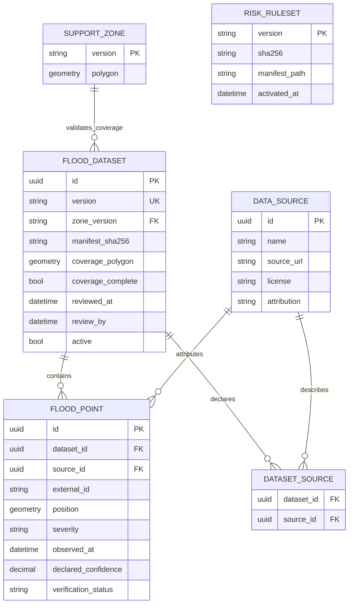

# Data model và pipeline — spec 002

Chỉ bảng mới trong schema `flood`; users/history/consent/auth_sessions/support_zone
của001 dùng nguyên contract. Query vị trí và kết quả đánh giá không persist, không
liên kết tài khoản; dữ liệu ngập lịch sử là bộ dữ liệu nhóm, không phải lịch sử người dùng.

## ERD



RISK_RULESET trong ERD là catalog version/checksum (file source of truth); không bắt
buộc table DB, không liên kết users. Snapshot thời tiết/risk/route/evidence chỉ RAM
request hoặc response tab; không bảng rain_requests/route_history/images/sim_sessions.
Dataset có source không có points vẫn khai báo DATASET_SOURCE để chứng minh coverage
rỗng đã khảo sát, không tự suy ra toàn khu không ngập.

## Trường và ràng buộc

- `flood.dataset`: uuid PK, version unique immutable, zone_version tham chiếu phiên
  bản support-zone001 qua import contract; manifest_sha256 lowercase64hex, imported_at
  timestamptz, reviewed_at/review_by, coverage_complete, coverage_polygon Polygon hoặc
  MultiPolygon4326, active bool. Unique partial index active=true chỉ một dataset;
  importer lock transaction, không đổi active giữa request snapshot.
- `flood.source`: uuid, tên/URL/license/attribution không trống; không URL từ client
  runtime, không URL có key bí mật, bound lengths name200/url2048/license500.
- `flood.dataset_source`: PK(dataset_id,source_id), FK restrict; metadata nguồn phải
  có trước points, cũng dùng khi dataset zero-points.
- `flood.point`: uuid PK; dataset/sourceFK; external_id<=200; unique(dataset_id,
  source_id,external_id); geometry(Point,4326) required, generated geography(Point,4326)
  `position_geog` hoặc expression index cast tương đương. lon[-180,180],lat[-90,90],
  finite, not empty; ST_Covers active dataset zone. `severity` enum low/medium/high/
  severe/unknown; `observed_at` timestamptz nullable nếu nguồn thiếu, display unknown,
  không lấy importedAt làm recorded time; `declared_confidence` nullable[0,1];
  `verification_status` verified/unverified/unknown. Nguồn thiếu field thành unknown
  và quarantine/report; không silently set verified. Coverage và rules quyết định
  missing, không biến null thành0. `description`<=1000 đã sanitize plain text.
- Unknown confidence không tự nhận1: Hmissing nếu không thể tính reliability. Metadata
  không đủ vẫn có thể hiển thị với nhãn thiếu; Risk nêu missing, không drop để giả H0.
- `flood.point`: GiST(position_geog), Btree(dataset_id,observed_at), indexes FK.
  Dữ liệu bất biến theo version; cập nhật thực chất tạo dataset mới, không sửa dữ liệu
  đã gắn checksum. Không áp30ngày lịch sử cá nhân cho dữ liệu lịch sử công khai này.
- `source` URL và description chỉ output đã sanitize, UI không render HTML; ngăn XSS.

## Geography 1.000 m và dung sai

PostGIS `ST_DWithin(geography,geography,meters,true)` spheroid, không NTS.Distance
geometry4326 hoặc degrees. Query prefilter dùng GiST `ST_DWithin(position_geog,
point_geog,1000.001,true)` rồi `ST_Distance(...,true) <= 1000 + 0.001`.
Dung sai **1 mm chỉ cho sai số số học**, không buffer sản phẩm/accuracy GPS hoặc làm
mượt vùng. Khoảng(1000,1000.001] xem tương đương biên số học và nêu rõ trong test;
ngoài band phải loại. Nếu sản phẩm cần phân biệt dưới1mm thì đổi thuật toán/version,
không gọi band này là phạm vi1km mở rộng. UI hiển thị distanceMeters chưa dùng làm
điều kiện dựa trên số đã round. Đúng1km được bao gồm, risk distance factor tại biên0.

Ranh giới test tạo q tại lon106.7,lat10.77 (synthetic public reference),
`ST_Project(q::geography,1000,azimuth)` với nhiều azimuth, kiểm distance1000±.001,
expect include. Test 999.99 include,1000.01 exclude,1000.0005 band include và test
999/1001 rõ ràng; SPHEROID true cả generator/query. Test ở geodesic geog4326 thật,
không mockEF. Longitude/latitude đảo, SRID sai, invalid polygon đều fail import.
Công bố tolerance trong rules/config; đổi tolerance đổi rule version.

```sql
-- Thiết kế truy vấn, không phải migration đã triển khai.
SELECT id, ST_Distance(position_geog, @p::geography, true) AS distance_m
FROM flood.point
WHERE dataset_id = @dataset
  AND ST_DWithin(position_geog, @p::geography, 1000.001, true)
  AND ST_Distance(position_geog, @p::geography, true) <= 1000.001;
```

Truy vấn radius trả <=500điểm theo distance,id ổn định; nếu hơn phải trả truncation
và không coi subset là toàn facts: Risk riêng query MAX/batch trên **tất cả** điểm
trong bán kính, không dựa trang UI bị truncate. Cap input.dataset100.000points/demo,
đo EXPLAIN ANALYZE; không ghi coordinates/SQLparams vào artifacts public.
SupportZone(ST_Covers) không áp dung sai1mm radius, giữ nguyên contract biên001.

## Pipeline offline GeoPandas/Shapely

1. Nhóm cấp raw input có quyền sử dụng và area/routes của001; không tạo points thật
   từ dữ liệu giả hoặc dùng OSM tag thay lịch sử được kiểm chứng. Chưa có là BLOCKED.
2. `prepare.py`: đọc CRS khai báo (không tự đoán khi thiếu); GeoPandas `.to_crs(4326)`;
   kiểm lat/lon, time UTC, source/license, severity mapping định nghĩa trước, confidence,
   verification. Chuyển đổi/bỏ/duplicate có report inputRowID/reason; không tự sửa
   geometry hợp lệ rồi che thay đổi. Shapely kiểm topology; phép đo mét phải geography
   SQL hoặc pyproj.Geod tương đương, không `.distance`4326 làm mét.
3. Nhóm duyệt quarantine/mapping/coverage; điểm không biết mức vẫn unknown, không
   xóa khỏi coverage để báo nguồn đầy đủ. Output GeoJSON4326 version, sources.json,
   coverage.geojson, report, manifest. Manifest sorted file paths+SHA256 exact bytes,
   datasetVersion/zoneVersion/ruleCompatibility, source/license/date/CRS/count,
   reviewedAt/reviewBy/coverageComplete; raw private dataset không commit nếu không có quyền.
4. `validate.py` + pytest offline check checksum/source/timestamps/enums/duplicates/
   bounds/coverage và repeatability; Testcontainers PostGIS kiểm ST_Covers toàn điểm,
   coverage và tuyến demo do001 cung cấp, không chỉ endpoints. Không có Docker thì
   SQL validation BLOCKED, không tick import/release. SHA mismatch/version reused fails.
5. Importer .NET có quyền quản trị chạy offline/deploy job, không endpoint anonymous
   upload dataset. Staging → transactional insert → validate indexes/count/source →
   set active; concurrent request giữ version snapshot. FK zone_version phải tồn tại
   và checksum khớp. Same version/same bytes idempotent; same version khác hash fail.
6. Publish dataset attribution và coverage/freshness trên UI; rollback active version
   đã validate trong transaction, không sửa file có checksum cũ.

GeoPandas/Python chỉ script offline, lock packages và image CI; worker Florence dùng
lockfile riêng. GeoJSON là nhóm cung cấp/bản đã chuẩn hoá, không output mock production.

## Snapshot thời tiết trong response

`WeatherSnapshot` là giá trị bất biến đã dùng tính toán, không phải bảng hoặc mã
snapshot tra cứu máy chủ: capturedAt, source với dataTime/fetchedAt, current rate/
interval/validTime, ba giờ dự báo, trạng thái/chất lượng và mode/scenarioId.
`RiskResponse.weatherSnapshot` trả đầy đủ giá trị đó; UI mưa/biểu đồ sau risk chỉ
dùng payload này. `WeatherResponse.weatherSnapshot` dùng cùng schema cho US1 trước
khi tính risk. Cache hết hạn giữa hai lời gọi không làm UI ghép mưa cũ với risk mới.

`RouteResponse.weatherSnapshots` chứa tối đa12 ô mưa đã dùng; mỗi phần tử có rounded
cell và WeatherSnapshot, kể cả snapshot unavailable với các giá trị thiếu rõ ràng.
`RouteSegment.weatherSnapshotIndexes` tham chiếu các phần tử ngay trong mảng response,
không tạo kho/mã snapshot ở RAM hoặc DB. Cùng một ô dùng cùng snapshot trong request.
UI chi tiết tuyến dùng chính payload tuyến; không gọi lại weather endpoint để giải
thích bằng mưa khác. Snapshot chỉ trong RAM request/response tab, no-store và không log.

## Ephemeral state và lifecycle

| Dữ liệu | Nơi sống | Hết hiệu lực |
|---|---|---|
| Temporary consent + epoch | bộ nhớ tab | thu hồi/reload/đóng tab |
| Scenario selection | bộ nhớ tab + request DTO | tắt/reload/đóng tab; server không session |
| Exact point, OD, segments, explanations | RAM request/response tab | request kết thúc, đổi điểm, thu hồi; no-store |
| Public rounded weather cell | bounded RAM cache, không user link |5phút fresh, tối đa60phút kể fetchedAt, không sliding |
| Rule/dataset catalog | files+immutable DB metadata | đổi release version, giữ bản để tái hiện công thức |
| Image buffers | RAM streaming/process only | finally success/error/timeout/cancel, không disk |
| Evidence token/manual value | RAM tab, token signed stateless |5phút/đổi điểm/đóng tab, không history |

Nhà cung cấp ngoài có retention riêng; người dùng chấp thuận công bố theo FR019/
notice v2 và ADR-002: Open-Meteo có thể giữ log tọa độ làm tròn tối đa90ngày. Thu hồi
hoặc xoá lịch sử ứng dụng không xoá tức thì log upstream bằng vòng đời local này. Không phát sinh dữ liệu vị trí trong backup DB
002 vì không ghi request coords vào DB; các bảng001 giữ nguyên retention/backup commitments.
