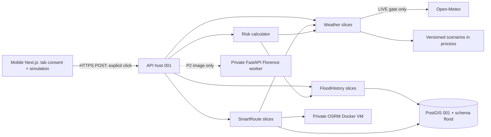

# Implementation Plan: Mưa, rủi ro ngập và tuyến đường tham khảo

**Branch**: `main` hiện tại; feature key `002-flood-risk-routing` do Spec Kit resolve.
**Date**: 2026-10-20 | **Spec**: [spec.md](spec.md)
**Status**: Thiết kế hoàn tất, quyết định riêng tư đã chốt; đã có tasks, chưa triển khai hoặc chạy spike.

## Summary

Mở rộng đúng US1–US6: thời tiết, lịch sử ngập, rủi ro giải thích được, mô phỏng,
xếp hạng ứng viên tuyến và ảnh tuỳ chọn. US1–US5 bắt buộc; US6 hoãn được và phải báo
“chưa làm” kèm lý do. Không coi nền tảng spec 001 đã xong: T001 chờ dữ liệu, T002
chờ Docker, chỉ T003 đã tick. Điểm nối nền tảng phải đạt trước nghiệm thu tích hợp.

**Quyết định riêng tư đã chốt**: Người dùng cho phép sửa cam kết/notice để công bố
Open-Meteo có thể giữ log yêu cầu chứa tọa độ làm tròn tối đa 90 ngày. Cổng thiết kế
FR-019 đã được giải quyết, không còn đòi xác nhận zero-retention. Ứng dụng vẫn không
lưu vị trí chính xác mặc định hoặc ghi tọa độ vào log; cơ chế lịch sử001 giữ nguyên.
Trước LIVE phải triển khai/kiểm thử [notice v2](privacy-notice.md), consent và redaction,
kiểm điều kiện sử dụng/quota qua spike C; chưa chạy thì không báo nghiệm thu US1.
Đây là điều kiện thực thi/kiểm thử, không còn là quyết định sản phẩm chưa chốt.

## Technical Context

| Mục | Lựa chọn |
|---|---|
| Ngôn ngữ | .NET 10/C#, TypeScript/React/Next.js; Python 3.12 cho offline và worker P2 |
| Web | Tailwind, shadcn/ui, MapLibre GL JS từ 001; thêm Recharts lazy-load dự báo |
| API | Minimal API, Vertical Slice, CQRS-lite; EF Core/Npgsql/NTS theo lockfile 001 |
| Core 3 Weather | Typed HttpClient Open-Meteo; RAM cache dữ liệu ô công khai, không cache vị trí/yêu cầu người dùng |
| Core 4 FloodHistory | PostgreSQL/PostGIS; GeoPandas/Shapely offline, không thêm Python service |
| Core 5 Risk | .NET pure calculator + batch truy vấn PostGIS; immutable rule snapshot |
| Core 6 SmartRoute | OSRM/OSM trên Linux VM Docker cùng vùng Azure, API gọi riêng; NTS/PostGIS chấm tuyến |
| Core 1 FieldEvidence | P2: FastAPI/Docker, Florence-2-base, PyTorch/Transformers/OpenCV/Pillow |
| Kiểm thử | xUnit unit + Testcontainers PostGIS; pytest pipeline/worker; Playwright Chromium/WebKit + điện thoại thật |
| Vận hành | Tái dùng App Service, Vercel, PostGIS, Serilog/OTel, ProblemDetails, CORS, Actions của 001 |
| Mục tiêu | Mưa/rủi ro <=3s, tuyến <=5s, ảnh hoặc fallback <=15s; đo từ thao tác đến UI |
| Quy mô thiết kế | 20 người demo; routing toàn hệ thống <=5 đang chạy, ảnh <=1/worker; cần đo, chưa bảo đảm tải |

Không đổi stack khi spike thất bại. Dependency mới phải pin version/digest/model revision
sau smoke tương thích; không dùng `latest` cho release hoặc cho rằng .NET10 tương thích tự động.

## Constitution Check

| Nguyên tắc | Trước research | Sau thiết kế / cổng thực thi |
|---|---|---|
| I. MVP/demo trước | Pass | US1–5 bắt buộc; ảnh hoãn được; mốc P0 có demo risk mô phỏng |
| II. Rủi ro giải thích | Pass thiết kế | Công thức/trọng số/chuẩn hoá/ngưỡng, checksum, bảng kỳ vọng trong risk-rules.md; chưa xác nhận độ chính xác thực địa |
| III. Hạ tầng có lý do | Pass có giải trình | OSRM cần graph chuyên dụng; worker riêng chỉ khi làm US6; RAM cache đủ demo; không queue/cache server |
| IV. Monolith/slice + AI fallback | Pass | Core .NET chung host; worker riêng private, deadline/fallback; không gọi chéo nội bộ DB module |
| V. Kiểm thử | Pass thiết kế | Red-green-refactor tại mỗi mốc; xUnit/pytest/E2E và đo thật là cổng hoàn thành, chưa chạy |
| VI. Log/lỗi/ADR | Pass thiết kế | Allowlist route-template, no coordinate/body/query, ADR; provider retention đã công bố trong notice v2; kiểm thử thực thi chưa chạy |

Không có ngoại lệ constitution được tự cấp. Constitution Check là kiểm tra thiết kế,
không chứng nhận triển khai. FR-019 đã được người dùng chấp thuận sửa theo ADR-002;
release LIVE vẫn cần notice v2, redaction và spike C đạt, không tự báo kết quả kiểm thử.

## Project Structure

### Documentation (this feature)

```text
specs/002-flood-risk-routing/
  spec.md                    # giữ nguyên yêu cầu đã clarify
  plan.md
  research.md
  risk-rules.md              # công thức, bảng kỳ vọng, risk/tuyến
  data-model.md              # ERD, geography, pipeline
  quickstart.md              # hướng dẫn validation tương lai
  privacy-notice.md          # nội dung đồng ý v2 và giới hạn retention nhà cung cấp
  contracts/
    openapi.json             # phần mở rộng public API
    worker-openapi.json      # internal P2, không public
    README.md
    risk-rules-v1.json       # artifact thiết kế, chưa phải config production
    manifest.json            # SHA256 exact bytes rule file
  checklists/requirements.md
```

### Source Code (repository root — dự kiến, chưa tạo mã)

```text
apps/web/src/features/
  temporary-consent/         # tab RAM, request generation, AbortController
  weather/                   # chart Recharts + nguồn/giờ
  flood-history/
  risk/
  demo-simulation/            # banner tại app layout
  routing/
  field-evidence/             # P2, không bundle khi tắt
backend/src/Flood.Api/Modules/
  Weather/{GetAtPoint,Contracts,OpenMeteoClient}/
  FloodHistory/{SearchNearby,Import,Contracts}/
  Risk/{Evaluate,Rules,Contracts}/
  SmartRoute/{FindRoutes,Segmentation,Ranking,Contracts}/
  FieldEvidence/{AssessImage,ManualEvidence,Contracts}/
backend/tests/{Flood.UnitTests,Flood.IntegrationTests}/
workers/flood-vision/{app,tests,Dockerfile,requirements.lock}  # P2
scripts/flood-data/{prepare.py,validate.py,requirements.lock}
assets/{risk-rules,flood-history,simulation,osm}/
spikes/{florence,osrm,open-meteo}/
tests/{e2e,performance}/
infra/{compose,azure}/        # mở rộng cấu hình 001, không viết lại
docs/{validation/002,operations/002,adr}/
```

**Structure Decision**: Mỗi slice gồm endpoint/validator/handler/DTO/tests; DI trực tiếp,
không mediator/bus. Weather có `GetSnapshotAsync` với hai adapter thật và mô phỏng;
Risk công khai `Evaluate(snapshot,rules)` thuần, không I/O; FloodHistory trả batch
facts; SmartRoute chỉ công khai `FindAsync`, che graph/sampling/ranking. Test cùng
seam với caller; fake chỉ external I/O, không mock PostGIS để chứng minh geography.
Không truy cập DbSet riêng module khác; support zone qua contract của 001.

## Kiến trúc và điểm nối spec 001



001 sở hữu vùng/version/ST_Covers, auth/history/cleanup, lỗi, health, CORS/deploy.
002 đọc active zone bằng contract, không sửa bảng Identity/history/write_generation.
Không dùng Hangfire cho weather/inference, không lưu snapshot cá nhân vào job.
Thêm health component OSRM/Weather/AI dạng degraded: API sống, lỗi tính năng không
kéo sập bản đồ; readiness nền tảng giữ nguyên. Rule/dataset thiếu làm riêng risk unavailable.

## Client, đồng ý và mô phỏng

Consent `{allowed,epoch}` chỉ React memory trong tab, khởi đầu false. Modal nói điểm
sẽ gửi tới ứng dụng, tọa độ làm tròn gửi Open-Meteo, mục đích xử lý, log của nhà
cung cấp tối đa 90 ngày và link chính sách; không hứa họ không lưu. Dùng notice v2
trong privacy-notice.md; người dùng phải đồng ý bản này trước khi gửi. Điểm hiện rõ trên hành động trước mỗi click. Cùng consent cho GPS/
manual và anonymous/logged-in, không sửa consent lịch sử. Theo dõi GPS chỉ đổi UI,
không effect gọi weather/risk/route, không interval background. Load catalog/rules/zone
không mang tọa độ; prefetch có điểm bị cấm. Consent xử lý ảnh không đồng nghĩa lưu ảnh.

Mỗi click snapshot điểm/zone/rule/scenario/evidence vào request; chỉ có một request
cùng luồng. Thu hồi/tắt mô phỏng/đổi điểm tăng epoch, abort pending; response chỉ dùng
nếu epoch khớp. Thu hồi không thể lấy lại dữ liệu đã truyền; không báo đã làm điều đó.
Reload/đóng tab mất consent và simulation. Backend đòi `temporaryConsent=true`,
consentNoticeVersion=temporary-processing-v2, ruleVersion, zoneVersion nhưng không lưu consent cá nhân;
đây là kiểm soát giao thức, không chứng minh sự đồng ý nếu client bị giả mạo.

Simulation là `{mode: simulation, scenarioId}` trên từng request, từ catalog read-only
ký bằng checksum rule bundle; server chỉ nhận ID allowlist, không nhận rain tùy ý.
Không cookie/session/DB flag/global mutable state. Nhánh mô phỏng chạy trước adapter
Weather và tuyệt đối không khởi tạo outbound call, kể cả routing. Chỉ override mưa;
dataset lịch sử/vùng/map vẫn thật. Banner layout cố định “Đang dùng mưa mô phỏng:
<tên kịch bản>” + nút tắt, padding không che controls; response có mode/scenario và
mọi card/risk/route chịu ảnh hưởng có nhãn MÔ PHỎNG. Cache thật và mô phỏng tách,
không đưa kết quả mô phỏng vào cache thật hoặc lịch sử.

## Bộ quy tắc, lịch sử và weather

Chi tiết có tính quyết định ở [risk-rules.md](risk-rules.md), [data-model.md](data-model.md).
File cấu hình/manifest SHA256 được kiểm exact bytes; đổi bất kỳ giá trị có ý nghĩa
phải đổi version. Capture snapshot bất biến đầu request; mismatch 409, không trộn
rule/zone/dataset khi deploy. Mô hình là heuristic demo, chưa hiệu chuẩn dự báo ngập.

Weather LIVE: Open-Meteo current.rain (mm trong interval) đổi mm/h; hourly.rain ba
khung giờ trọn tiếp theo, UTC nội bộ/Asia-Ho_Chi_Minh hiển thị. Current là sản phẩm
mô hình, không gọi là đo từ trạm. Gửi tâm ô làm tròn 0,01 độ, không gửi điểm chính
xác, IP/user/token thiết bị. Vị trí rounded vẫn có thể là dữ liệu vị trí, không bảo đảm
ẩn danh; provider có thể giữ log như notice v2 đã công bố. Dùng typed HttpClient fixed-host, timeout1,5s,
không retry đường nóng; single-flight mỗi ô, tối đa4 outbound đồng thời, cap nhà cung
cấp 500/phút, 4.000/giờ, 8.000/ngày (thấp hơn free quota); vượt cap trả stale/missing.

Cache RAM tối đa128 ô, payload weather và rounded grid ID, không exact point/user/
origin-destination/evidence; TTL reuse5phút, stale-window từ fetchedAt <=60phút,
không sliding refresh. Không background prewarm bằng điểm cá nhân. Cache là weather
công khai dùng tạm, không lịch sử người dùng; nếu cần hiểu “không lưu” bao gồm mọi
RAM cache thì tắt cache bằng config và đo lại, không âm thầm lưu DB.
Current validTime lệch quá30phút hoặc hourly không phủ đủ3giờ: trường thiếu; dữ liệu
fetch>5phút <=60phút có nhãn cũ, hệ số chất lượng .5; quá60phút bỏ. fetchedAt không
thay model validTime; không bịa modelRunTime nếu upstream không trả. Nguồn lỗi có
cache hợp lệ thì 200 degraded, không có thì weather unavailable; Risk giảm confidence.
Attribution Open-Meteo + license/link và nguồn lịch sử trên UI; US1 không được coi
đạt khi LIVE gate còn chặn. Điều kiện free/commercial có dẫn nguồn trong research.

## Routing: OSRM và ngân sách 5 giây

OSRM extract từ PBF nhóm cấp nguồn/ngày/license/hash; vùng demo buffer kỹ thuật2km
để giữ ways/turn restrictions, không mở rộng vùng hỗ trợ. Chạy MLD: extract car.lua,
partition, customize, routed. Pin digest/profile/hash/PBF/buffer. Spike khởi đầu
preprocess4vCPU/8GiB, runtime2vCPU/4GiB (cấu hình thử, không số đo); đo RSS từng bước,
disk, cold/warm route và bảo đảm headroom30%. Chọn Linux VM cùng region, disk graph
read-only, port5000 chỉ API/private ingress, tắt access URL logs; không public demo OSRM.
API App Service VNet/private path phải nằm trong spike/quota/budget, không mặc định có.
Giữ attribution OpenStreetMap contributors và link ODbL trên map/tuyến, lưu nguồn
PBF/ngày; nếu phân phối graph/dataset phải kiểm nghĩa vụ license trước release.

Route API `alternatives=2&geometries=geojson&overview=full&annotations=distance,duration`:
primary + tối đa2 alternatives, có thể chỉ1. Dedupe geometry, không tạo tuyến giả để
đủ3. car.lua là tuyến ô tô tham khảo, không phải xe máy; UI ghi rõ giới hạn profile,
không gọi bike.lua là xe máy, không khẳng định phù hợp mọi đường cấm phương tiện.
So sánh trong tập ứng viên, không tối ưu toàn graph theo ngập. OSRM không nhận polygon
ngập động qua exclude. Thay profile cần extract lại và bộ test đường cấm.

Validate endpoints, snap distance<=50m, snapped points và full LineString bằng
ST_Covers(zone,geometry). Không cắt tuyến ngoài vùng để tạo đường giả. Bỏ ứng viên
ra ngoài; tất cả ngoài trả422 route_outside_support_zone, UI vẫn có các tính năng khác.
Tuyến nhanh nhất là nhanh nhất trong các ứng viên hợp lệ còn lại. Ngưỡng eligible
`duration <= min(1.5*Tfastest,Tfastest+600s)`; đúng ngưỡng được tính. Thứ tự tăng dần:
`highVeryHighMeters, routeRiskScore, missingMeters, durationSeconds`, stable tie ID.
“Ít nguy cơ hơn” là bộ đôi đầu nhỏ hơn theo thứ tự so với tuyến nhanh nhất trong tập;
không có cải thiện trong ngưỡng thì trả tuyến nhanh nhất + no_lower_risk_within_budget.
Giữ cảnh báo all_routes_high, unknown_data và disclaimer. Không gọi thấp là chắc chắn an toàn.

Segment geography<=50m, midpoint + hai endpoints, lấy nguy cơ lớn nhất các mẫu đủ
điều kiện; mẫu thiếu khiến cả segment missing (bảo thủ). Segmentize là xấp xỉ, không
chứng minh không có ngập giữa mẫu. Query history batch, weather theo ô làm tròn tối
đa12 ô/candidate-set; tối đa3.000 segments/set, chiều dài mỗi tuyến<=50km. Vượt giới
hạn trả422 route_evaluation_limit, không bỏ mẫu âm thầm hoặc đánh đoạn chưa xử lý là0.
Một batch weather tối đa12ô với cap4song song và hard deadline1,5s tổng; không gọi
per-segment. Chưa lấy được ô trước deadline là thiếu dữ liệu, trả độ dài missing.
Chi tiết aggregate/unknown/null tại risk-rules.md; không thay unknown bằng0.

Budget thiết kế end-to-end: network+UI500ms, OSRM1500ms, weather/history1500ms,
risk/rank500ms, serialize300ms, margin700ms =5000ms. History facts và weather có thể
bắt đầu sau geometry; mọi phần có linked cancellation, API hard deadline4,3s từ nhận
request, browser deadline5s. Không retry trong đường nóng. Benchmark gồm cold/warm,
5 route đồng thời, cache miss, cả UI; không chỉ đo OSRM. Nếu vượt thì giảm vùng
extract/số ô có lý do bằng phiên bản quy tắc hoặc điều chỉnh nguồn lực, không báo đạt giả.

## AI Worker: P2 có thể hoãn

Florence-2-base là caption/detection đa dụng, không model ngập đã kiểm định. Prompt cố
định, max128tokens/beam1, pin model revision/package; ưu tiên Transformers native
Florence2, không tải remote code main lúc runtime. Caption không phải confidence
hiệu chuẩn; ánh xạ bảo thủ flood_signs/no_clear_signs/uncertain, mô tả tiếng Việt từ
template, không đưa output model thành lệnh/quy tắc. Bằng chứng chỉ positive bonus
hoặc unknown, không làm giảm rủi ro nếu ảnh không rõ.

| Nơi chạy cùng FastAPI Docker | Chi phí/độ trễ và quyết định |
|---|---|
| Azure Container Apps CPU, 4vCPU/8GiB thử | Không phí GPU; trả tài nguyên runtime; RAM/latency chưa đo, cold start phải đo, chỉ chọn nếu đáp ứng budget |
| Azure Container Apps GPU T4 | GPU theo tài nguyên/region/quota, có thể scale-zero gây cold start; ưu tiên nếu CPU không đạt và có quota/budget |

Không báo giá Azure cố định khi chưa có vùng/quota. Spike ghi báo giá ngày đo,
region/SKU, giờ×đơn giá, idle/min-replica cost và giới hạn chi tiêu. CPU mặc định chỉ
là phương án thử; chọn CPU/GPU dựa kết quả. Không có quota hoặc chưa chứng minh chất
lượng thì US6 “chưa làm”, không đổi Florence sang model khác. Worker tách riêng
được constitution yêu cầu, không phải lý do thêm queue hoặc storage.

Browser gửi raw image/jpeg|png tới .NET rồi stream bounded tới worker, <=5MiB,
<=12MP decoded, cấm animated/URL/custom prompt; kiểm magic+decode, strip metadata,
resize longest<=1024. Không IFormFile/UploadFile/multipart mặc định vì có thể spool
disk. Chỉ RAM, không volume ảnh/cache/bodylogs, no core dumps/swap tại worker;
finally dispose input/output kể cả reject/error/cancel, inference subprocess kill
khi deadline để không giữ buffer vô hạn. Không hứa xoá vật lý tuyệt đối RAM.

Worker deadline12s, .NET tổng14s, client hiện nhập tay chậm nhất15s từ gửi; timeout
truyền X-Request-Timeout-Ms<=12000. Warm model readiness trước demo, 1 inference/replica,
không queue, bận trả429. Private HTTPS/service bearer secret luân chuyển, API không
đưa worker key lên web; caption/bằng chứng không log. Response evidence token HMAC
ngắn hạn5phút, ký stateless mức/nguồn/model/expiry, không điểm/ảnh/user; .NET xác minh
khi dùng risk, không nhận AI score tùy ý từ client. Nhập tay rõ nguồn người dùng,
không giả verified; same-tab RAM, ảnh không có storage ID/public URL.

## API, chống lạm dụng và quan sát

[OpenAPI public](contracts/openapi.json), [worker](contracts/worker-openapi.json).
Chỉ bổ sung endpoints 002, không viết lại health/auth/history/zone của001. POST body
cho mọi truy vấn có tọa độ, không query string/URL coordinates. `Cache-Control:no-store`
cho request-specific responses, không CDN cache personalized result.

Tái dùng exact-origin CORS001, không wildcard/credentials cho anonymous, cho POST/GET/
OPTIONS và Content-Type/X-Correlation-ID; ảnh P2 thêm X-Temporary-Consent và
X-Consent-Notice-Version vào allowlist headers; Authorization kế thừa001. Optional JWT không tạo điều kiện đăng nhập.
Internal worker không CORS công khai. Server dùng HTTPS, allowlist HttpClient hosts,
không nhận URL upstream từ browser; SSRF guard. Gọi OSRM nội bộ không ra public API.

Built-in .NET rate limiting: IP nguồn qua trusted proxy (không tin XFF tùy ý), key
HMAC ephemeral RAM không log IP thô. Weather/history/risk30req/phút/IP; route6/phút/IP;
image2/phút/IP, JSON<=16KiB, global routing concurrency5, image1/worker, queue0;
metadata GET60/phút/IP. 429 Retry-After, 413/415/422 ProblemDetails. Đây là cấu hình
1API replica demo; scale nhiều replica cần đo tổng quota và giải pháp theo roadmap.
Không coi CORS hoặc consent flag là chống bot. Có global provider cap và circuit
cooldown30s sau5lỗi/30s; không khoá các tính năng khác.

ProblemDetails cùng shape001 `{type,title,status,detail,code,traceId}`; 400 invalid,
403 consent_required, 409 rule_or_zone_version_mismatch, 422 outside/route-limit,
429 rate, 503 provider/privacy_gate/router/worker unavailable, 504 deadline. Missing
weather/risk insufficient-data là domain200 có status/quality, không dựng số0.

Serilog/OTel chỉ method + route template + bounded code + duration + versions +
provider name. Không body, URL query/path OSRM chứa tọa độ, DB params/text, exception
message raw từ HttpClient, evidence/caption, correlation có PII. Sanitize exported
Activity url.full/http.url/server.address theo allowlist; redaction phải xảy ra trước
mọi sink, tắt AppService HTTP detail/proxy access logs chứa query và worker/OSRM
access URL. Test fake exporter + log sink + Azure configuration, không chỉ app logger.
Metrics request_latency/error/missing ratio/provider latency/cache hits/OSRM RSS,
không gridId/point/user/prompt labels. Extension health degraded theo component;
reuse OTel pipeline001, không triển khai Grafana.

## Spike đo được — đầu kế hoạch

| Spike | Phép đo và gate | Trạng thái hiện tại |
|---|---|---|
| A Florence CPU/GPU | >=10ảnh nhãn nhóm cấp ×3 lần warm/môi trường; cold load, p50/p95/max, RSS/VRAM, concurrency1/2, timeout/fallback<=15s, sai/uncertain theo nhãn; pin revision/deps | NOT RUN; Docker/ảnh/GPU/quota thiếu thì BLOCKED riêng từng môi trường; không chặn US1–5 |
| B OSRM vùng demo | PBF+zone+profile/hash; peak RSS/disk/từng preprocessing, 30cặp×3cold/warm, concurrency1/5; API+UI<=5s, số candidates/outside | NOT RUN; thiếu dữ liệu/Docker/VM/quota thì BLOCKED, chặn US5 |
| C Open-Meteo | nguồn terms/privacy chụp ngày; >=30requests ô công khai không vị trí người dùng, latency/cap/429/stale parsing, caller egress; notice v2/consent/redaction | Quyết định FR-019 RESOLVED; latency/terms applicability/quota tests NOT RUN; thiếu quyền/quota thì BLOCKED |

Báo cáo ở docs/validation/002/spikes/*.md, mọi số liệu có lệnh, cấu hình, raw artifact
đã loại tọa độ cá nhân, PASS/FAIL/BLOCKED. Plan không phải báo cáo benchmark đã chạy.
Không provision/deploy/gọi ảnh người dùng trong bước này. Thiếu quyền/quota ghi rõ,
không thay thế stack. Docker thiếu từ001 chưa được kiểm chứng đã khắc phục.

## Mốc bàn giao

Nhãn P0/P1/P2 là mốc thực thi, không thay Priority story trong spec.

| Mốc | Nhãn | US, thứ tự và cổng |
|---|---|---|
| 1. Khả thi và đầu vào | P0 | Spike A/B/C đầu tiên, A không chặn core; xác nhận gates001, dữ liệu nhóm/zone/manifest, rule config/hash và kiểm thử trước cài đặt; quyết định privacy đã chốt, kiểm thử notice v2 trước LIVE |
| 2. Lịch sử + Risk + mô phỏng | P0 | US2 → US3 → US4 với weather adapter fixture/mô phỏng; xUnit kỳ vọng rồi GREEN; điện thoại ẩn danh chọn điểm→mô phỏng→risk, chưa báo đạt toàn MVP |
| 3. Thời tiết thật | P1 | US1 sau kiểm thử notice v2/consent và xác nhận terms; stale/missing/cap/consent tests trước adapter/UI; không thể nghiệm thu US1 bằng fixture |
| 4. Tuyến tham khảo | P1 | US5 bắt buộc, OSRM + ranking + explanations, threshold/boundary/perf tests rồi implementation; simulation→risk→route trên điện thoại |
| 5. Tích hợp và nghiệm thu | P1 | abuse/privacy/errors/CI/deploy002, xUnit+pytest pipeline+Playwright rồi fix; Chrome Android/Safari iPhone, SC001–012 từng phần; US1–US5 phải đạt |
| 6. Ảnh và kiểm tra cuối | P2 | US6 nếu có thời gian/quota/spike đạt: pytest/contract/fallback trước implementation; nếu hoãn ghi “chưa làm” kèm lý do, SC004 và phần ảnh SC008/011 chưa đạt; không gọi toàn spec hoàn tất |

P0/P1 không hoãn được trong nghiệm thu MVP. Chưa giải quyết blocker hoặc chưa đạt
latency phải báo chưa đạt. Không tạo task IDs ở bước plan.

## Kiểm thử, CI/CD và triển khai

Red-green-refactor từng mốc, unit fake TimeProvider/snapshot, integration thật PostGIS
cùng engine001. xUnit: công thức/monotonic/version/hash/ngưỡng; geography inclusive1km;
ST_Covers toàn tuyến; ranking lexicographic/threshold/null/unknown/fallback; stateless
simulation không gọi weather, không bleed người dùng; body cap/rate/consent/version.
pytest: offline invalid CRS/geometry/source/hash/duplicates; worker memory/error/
timeout/malformed/decompression-bomb/negative ảnh/cancellation và no-disk assertions.
Không chạy pipeline Python như service.

Playwright: consent cả auth states/GPS/manual/revoke/reload; GPS moves không request;
mock mưa0/thiếu/stale; preset banner mọi screen; simulation source network zero;
US4→3→5 và all-high/unknown/outside; API lỗi vẫn map. Unit thuần không thay integration.
Performance synthetic20người, route5concurrent và cold/warm; report từng SC với thiết bị,
network, versions, timestamps, không coi fallback là thành công mưa thật/tuyến thật.
AI hoãn thì tests ảnh ghi NOT IMPLEMENTED không tự skip thành PASS.

Mở rộng pipeline001: validate OpenAPI public+worker, JSON schema/rule checksum và golden
cases, offline Python pytest, .NET locked restore/unit/PostGIS, web lint/typecheck/
build/E2E, image builds OSRM runtime/worker(P2) và vulnerability/license checks.
Provider network/benchmarks không chạy mỗi PR; job manual có quota và không gửi điểm
thực, không print URI. Release bắt buộc dataset/license/rule zone parity và privacy gate.

Deploy theo quy trình001: migration flood schema + seed manifest atomic, API imageSHA
AppService, frontend Vercel; OSRM graph digest riêng private VM, smoke health/route
không tọa độ cá nhân; AI ContainerApps private nếu P2. Mỗi release pin rule/dataset/
zone/graph/profile/model revisions, backward compatible DTO. OIDC/secret store001;
OpenMeteo key, worker bearer, HMAC key chỉ backend secret. Không đổi auth hoặc cleanup001.
Khởi động rollback bằng image+compatible rule/dataset version cũ; không down-migrate
phá dữ liệu. Quickstart có trình tự local và validation; không deploy ở plan.

## Rủi ro và demo dự phòng

| Rủi ro | Giảm thiểu / hành vi demo |
|---|---|
| Provider giữ log sau thu hồi | Notice v2 nêu tối đa90ngày, không hứa xoá log ngay; chỉ gửi rounded cell sau consent/click, no device identity; demo mô phỏng không báo đạt US1 thật |
| Dữ liệu nhóm/vùng/PBF chưa có | Release blocker; không tự bịa dữ liệu thật, chỉ synthetic tests gắn nhãn |
| OSRM không đủ ứng viên/ra vùng | Một tuyến hợp lệ là đủ, cảnh báo, không cắt tuyến; không hứa global-optimal |
| Ngập thay đổi nhanh/heuristic | Source/time/confidence/disclaimer; nhãn model weather, thiếu không=0, chưa validation thực địa |
| Mạng/API lỗi | Giữ map tải sẵn, banner offline; hotspot/local Compose đã rehearsal; không giả upstream thành công, không hứa map offline |
| GPS lỗi | Chọn điểm demo thủ công, consent chủ động; không thay GPS thật bằng fake không nhãn |
| Ảnh chậm/sai/GPU thiếu | Nhập tay<=15s, evidence không giảm nguy cơ, hoãn US6 nếu chưa chứng minh, không lưu ảnh |
| Log middleware/proxy lộ vị trí | POST coords, redact HttpClient/OTel/OSRM URL trước sink, test sink/exporter và host config |
| Vùng sát biên/1km roundoff | ST_Covers và dung sai chỉ số học, test hai phía; không buffer vùng; geography query ranh giới |

## ADR — quyết định kiến trúc và lý do

| ID | Lựa chọn, đánh đổi |
|---|---|
| ADR-002 | Open-Meteo retention disclosure: người dùng chấp thuận sửa FR019/notice; không thay cam kết history001 [chi tiết](../../docs/adr/0002-provider-privacy-gate.md) |
| ADR-003 | Rerank OSRM candidates thay graph flood-aware: giữ MVP/RAM; công bố giới hạn và profile ô tô [chi tiết](../../docs/adr/0003-risk-rules-and-route-candidates.md) |
| 002-D04 | Stateless scenarioID: no global state, không gọi source thật; loại free-form rain để kết quả tái hiện |
| 002-D05 | Versioned heuristic config/hash: dễ giải thích, có golden cases; chưa phải mô hình thủy văn đã hiệu chuẩn |
| 002-D06 | In-process weather cache: đủ demo, tránh Redis; không exact user coords hoặc user history |
| 002-D07 | Offline GeoPandas: xử lý CRS/quality trước import; không cần Python runtime service core |
| 002-D08 | Raw bounded image RAM + process timeout: tránh temp upload disk và inference giữ RAM; giới hạn1, không queue |
| 002-D09 | POST spatial queries/no-store: tránh browser/proxy query logs; cache tạm weather cell riêng, không cache request |

## Complexity Tracking

Không có vi phạm constitution được chấp thuận; không tự tạo ngoại lệ. Các bổ sung
bắt buộc có chi phí cần giải trình:

| Thành phần / cổng | Vì sao cần | Phương án đơn giản hơn và lý do không chọn |
|---|---|---|
| OSRM VM+graph | SmartRoute và stack đã chốt; cần route thật | Tuyến thẳng/fixture giả không đáp ứng US5; public demo server không cam kết |
| Worker riêng P2 | Constitution IV, Python Florence phụ thuộc nặng | Nhúng model vào API làm core phụ thuộc latency/RAM; hoãn worker nếu thiếu thời gian |
| GeoPandas offline | CRS/quality/manifests dữ liệu nhóm | Sửa tay không đủ tái hiện/kiểm tra; không dựng service |
| Provider retention disclosure | Chính sách bên nhận có log khác cam kết của ứng dụng | Người dùng đã chấp thuận notice v2; không tự hứa zero-retention hoặc coi paid plan tự xoá log |

## Lộ trình mở rộng có điều kiện

Không triển khai Redis/RabbitMQ/Grafana/tile server trong feature này. Chỉ mở đề xuất
khi có số liệu + ADR: Redis khi >1API replica và cần cache/quota phối hợp mà RAM
cache gây vượt provider quota; RabbitMQ khi có workload async bền vững/backlog được
chấp thuận ngoài SLA tương tác (không queue ảnh để né15s); Grafana khi Azure logs/
metrics không đủ truy lỗi đa thành phần với mục tiêu vận hành cụ thể; tile server
riêng khi tải/license/availability nhà cung cấp tile không đáp ứng và có người vận hành.
Ảnh không lưu: không Cloudflare R2/Supabase Storage. Mọi mở rộng là phạm vi riêng.

