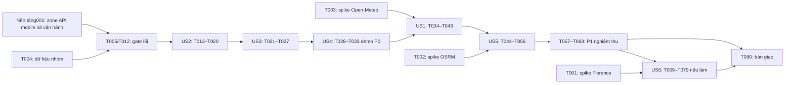

# Tasks: Mưa, rủi ro ngập và tuyến đường tham khảo — spec 002

**Ngày tạo**: 2026-10-20. **Feature**: `002-flood-risk-routing`.
**Input**: [spec](spec.md), [plan](plan.md), [data model](data-model.md), [research](research.md),
[risk rules](risk-rules.md), [quickstart](quickstart.md), [notice v2](privacy-notice.md),
[public OpenAPI](contracts/openapi.json), [worker OpenAPI](contracts/worker-openapi.json),
[rule bundle/manifest](contracts/manifest.json), [constitution](../../.specify/memory/constitution.md).

## Quy ước thực thi

- Chia đúng **6 mốc P0/P1/P2 của plan**, trong mỗi mốc phân đoạn theo user story.
  Không dùng Priority story để đổi mốc: US5 là story P2 nhưng thuộc mốc4/P1 và bắt buộc;
  US6 là story P3 thuộc mốc6/P2 và hoãn được.
- ID T001–T080 chỉ thuộc **spec002**; không phải ID cùng tên trong spec001.
  Phụ thuộc ngoài ghi `001:Txxx` và dẫn tới [tasks001](../001-map-location-skeleton/tasks.md).
  Không sửa, tick hoặc tự triển khai task001 khi thực hiện task002.
- `[P]` nghĩa có thể làm song song **sau khi mọi phụ thuộc của task đã xong**, ở file riêng.
  Không sửa cùng lockfile, layout, migration hoặc middleware chung đồng thời.
  Cỡ S: một đầu ra nhỏ; M: một slice hoặc nhóm kiểm thử; L: tích hợp/nhiều thành phần.
  Người phụ trách để trống để nhóm phân công.
- Test-first theo constitution/plan: runner/build/smoke phải chạy được, viết test hành vi,
  chạy và ghi **RED do thiếu cài đặt**, rồi GREEN, rồi refactor và chạy lại.
  Thiếu Docker/dữ liệu/quota/credential là **BLOCKED**, không RED và không PASS.
  Chỉ tick khi tiêu chí hoàn thành đạt, có lệnh/kết quả/artifact; test bị skip không thành đạt.
- Rule/config/version/checksum và data-model.md là ràng buộc chuẩn, không tự thay thiết kế.
  Các mốc prototype dùng dữ liệu synthetic có nhãn; chỉ dữ liệu nhóm đủ nguồn/quyền mới đóng release gate.
- Quyết định provider-retention đã chốt ở ADR002: notice `temporary-processing-v2`
  nói Open-Meteo có thể giữ log tọa độ làm tròn tối đa90ngày; ứng dụng không log tọa độ,
  không tự lưu history, consent chỉ RAM tab/click, GPS tracking không tự gửi.
  Spike/quota/terms, notice và kiểm thử runtime vẫn phải đạt trước LIVE, không hỏi lại quyết định này.
- Không thêm Redis, RabbitMQ, Grafana, object storage, tile server hoặc chức năng ngoài spec.
  Không tạo queue ảnh; GeoPandas chỉ offline, core Modular Monolith và worker P2 riêng.
  Không thay JWT RS256/thu hồi, write_generation/khoá theo user/hard delete/30ngày của001.
- Luồng sớm: mốc2 demo mô phỏng → risk trên điện thoại. **MVP nghiệm thu: US1–US5**,
  gồm tuyến thật; không báo đạt SC001/003/toàn SC005 chỉ vì demo mô phỏng chạy.

## Mốc 1 — P0 — Khả thi và đầu vào

Setup và nền tảng dùng chung: ba spike đứng đầu, dữ liệu nhóm, harness, rule bundle và consent v2. Spike Florence chỉ chặn US6; OSRM/Weather chặn các nhánh tương ứng, không được gọi BLOCKED là PASS.

### Setup/spikes và dữ liệu

- [ ] T001 [P] SPIKE A — đo Florence-2 CPU/GPU, chốt môi trường P2 tại `spikes/florence/benchmark.py`, `docs/validation/002/spikes/florence.md`.

  **Cỡ**: M. **Người phụ trách**: . **Phụ thuộc**: Không (đầu vào/quyền môi trường áp dụng như tiêu chí dưới đây). **Truy vết**: FR-014–FR-016; NFR-002–NFR-004; SC-004.

  **Hoàn thành**: Dùng >=10 ảnh có nhãn/quyền do nhóm cấp ×3 warm/CPU FP32 và GPU FP16; đo cold load, p50/p95/max, RSS/VRAM, concurrency1/2, lỗi/uncertain và UI fallback<=15s. Pin model revision, Transformers/PyTorch/OpenCV/Pillow, prompt/128tokens/beam1. So sánh quote ngày/vùng/SKU CPU ContainerApps với T4 GPU, idle/min-replica cost; thiếu Docker/ảnh/quota/credential ghi BLOCKED riêng từng môi trường, không đổi model. Báo cáo quyết định CPU/GPU hoặc hoãn US6; không chặn core US1–5.

- [ ] T002 [P] SPIKE B — chuẩn bị graph OSRM và đo khả thi tuyến tại `spikes/osrm/benchmark.ps1`, `docs/validation/002/spikes/osrm.md`.

  **Cỡ**: L. **Người phụ trách**: . **Phụ thuộc**: Không (đầu vào/quyền môi trường áp dụng như tiêu chí dưới đây). **Truy vết**: FR-001, FR-011–FR-013, FR-017; NFR-002, NFR-004; SC-003, SC-010.

  **Hoàn thành**: Nhóm cấp zone/PBF/tuyến demo, nguồn/license/ngày/hash; extract buffer2km complete_ways, car.lua→MLD extract/partition/customize/routed. Pin image digest/profile/PBF hash. Thử preprocess4vCPU8GiB/runtime2vCPU4GiB; ghi RSS từng bước/disk/coldstart/headroom>=30%, 30 cặp×3 cold/warm concurrency1/5, candidates/outside và budget E2E5s cần kiểm lại T055. Xác nhận private network AppService→VM, quota/chi phí; thiếu đầu vào/quyền ghi BLOCKED, không đổi stack/public demo router.

- [ ] T003 [P] SPIKE C — xác minh Open-Meteo latency, điều khoản và quota tại `spikes/open-meteo/probe.ps1`, `docs/validation/002/spikes/open-meteo.md`.

  **Cỡ**: M. **Người phụ trách**: . **Phụ thuộc**: Không (đầu vào/quyền môi trường áp dụng như tiêu chí dưới đây). **Truy vết**: FR-002, FR-003, FR-018, FR-019; NFR-002, NFR-004; SC-001, SC-008, SC-011.

  **Hoàn thành**: >=30 calls điểm công khai synthetic không gắn người dùng; ghi thời gian từng call/p50/p95/max,429,timeout,parse interval/hourly và source timestamps, không log URL tọa độ hoặc key. Lưu terms/privacy ngày kiểm; quyết định non-commercial/free hay paid cho hoạt động dự thi/quảng bá, attribution CC-BY, cap500/phút/4000/giờ/8000/ngày. Notice v2/ADR002 đã được chấp thuận: không đòi zero-retention lại. Thiếu quota/credential/điều kiện dùng phù hợp ghi BLOCKED, không mua dịch vụ/đổi nguồn ngầm.

- [ ] T004 [P] NHÓM CUNG CẤP DỮ LIỆU — bàn giao và duyệt dữ liệu thật tại `assets/flood-history/manifest.json`, `assets/flood-history/points.geojson`, `assets/flood-history/sources.json`, `assets/flood-history/coverage.geojson`, `assets/osm/manifest.json`.

  **Cỡ**: M. **Người phụ trách**: . **Phụ thuộc**: Không (đầu vào/quyền môi trường áp dụng như tiêu chí dưới đây). **Truy vết**: FR-001, FR-004, FR-005, FR-007, FR-011; SC-006, SC-007, SC-010.

  **Hoàn thành**: Nhóm chốt raw data có quyền, observed time/nguồn/mức độ/confidence/verification, coverageComplete/reviewedAt/reviewBy; zoneVersion đúng001 và OSM PBF/profile/tuyến demo. Không tự bịa điểm/ảnh/tuyến thật, không lấy fixture synthetic để đóng release gate. Manifest version/path/SHA256/count/CRS/date/license/ruleCompatibility; chưa có ghi BLOCKED. Ảnh có nhãn cho T001 là input P2 riêng, thiếu ảnh không chặn bàn giao dữ liệu core.

- [ ] T005 [P] Kiểm tra điểm nối nền tảng001, không viết lại chức năng nền tại `docs/validation/002/foundation-001-readiness.md`.

  **Cỡ**: S. **Người phụ trách**: . **Phụ thuộc**: Không (đầu vào/quyền môi trường áp dụng như tiêu chí dưới đây). **Truy vết**: FR-001, FR-018, FR-019; SC-010, SC-011.

  **Hoàn thành**: Ghi trạng thái thực tế001, hiện T003 đã tick/T001,T002 chưa; kiểm support-zone/version/ST_Covers, API host/schema/CORS/ProblemDetails/health và mobile map/GPS. Lập gate tham chiếu 001:T011,T022,T029,T033,T049; auth001:T031,T041 cần trước kiểm hai trạng thái tài khoản tại T061. Không tick/sửa tasks001 hoặc tự thực thi task001; thiếu nền tảng ghi BLOCKED chỉ nhánh tích hợp, unit/harness/spikes độc lập vẫn được chuẩn bị.

### Foundational: test harness → RED → GREEN → gate

- [ ] T006 [P] Dựng harness kiểm thử và khóa dependency bổ sung tại `backend/tests/Flood.UnitTests/Flood.UnitTests.csproj`, `backend/tests/Flood.IntegrationTests/Feature002Fixture.cs`, `scripts/flood-data/requirements.lock`, `apps/web/playwright.config.ts`.

  **Cỡ**: M. **Người phụ trách**: . **Phụ thuộc**: Không (đầu vào/quyền môi trường áp dụng như tiêu chí dưới đây). **Truy vết**: NFR-001–NFR-004; SC-001–SC-012.

  **Hoàn thành**: Dùng SDK/npm/solution/Testcontainers001, thêm seam test doubles nguồn/TimeProvider và pytest offline, không dựng API/feature giả trong harness. Smoke build/runner đạt rồi mới chạy tests RED; RED do thiếu hành vi, không do compile/import lỗi hoặc thiếu Docker. Test DB thiếu engine ghi BLOCKED, không gọi PASS/RED. Pin deps mới tương thích, không đổi lockfile/toolchain001 ngầm; không cài worker vào Python offline environment.

- [ ] T007 [P] RED — hợp đồng rule bundle/version/checksum tại `backend/tests/Flood.UnitTests/Rules/RuleBundleTests.cs`.

  **Cỡ**: M. **Người phụ trách**: . **Phụ thuộc**: `T006`. **Truy vết**: FR-007; NFR-003; SC-002, SC-006.

  **Hoàn thành**: Test weights sum1, bounds finite, 3giờ/1000m/inclusive1mm, four levels+insufficient, preset allowlist và routing limits; sai bytes/hash, dùng lại version với config khác hoặc mismatch request fail. Expected lấy độc lập từ design bundle, không tự sửa weight để tests pass; chạy RED thiếu loader trước T008.

- [ ] T008 GREEN — loader bất biến và cấu hình công bố tại `assets/risk-rules/risk-rules-v1.json`, `assets/risk-rules/manifest.json`, `assets/risk-rules/.gitattributes`, `backend/src/Flood.Api/Modules/Risk/Rules/RuleBundleLoader.cs`.

  **Cỡ**: M. **Người phụ trách**: . **Phụ thuộc**: `T007`. **Truy vết**: FR-007; NFR-003; SC-006.

  **Hoàn thành**: Copy có kiểm exact bytes từ contracts/risk-rules-v1.json+manifest, giữ Git không chuyển newline. Load validate/hash/schema, capture immutable snapshot/version; same version khác hash fail, mismatch409. Không env override trọng số giữ version cũ. T007 GREEN, không triển khai calculator ở task này.

- [ ] T009 [P] GREEN — DTO và điểm nối contract002 sau kiểm thử contract RED tại `backend/tests/Flood.IntegrationTests/Contracts/Feature002ContractsTests.cs`, `backend/src/Flood.Api/Feature002Contracts.cs`.

  **Cỡ**: M. **Người phụ trách**: . **Phụ thuộc**: `T006`. **Truy vết**: FR-001, FR-018–FR-020; NFR-004; SC-008, SC-010, SC-011.

  **Hoàn thành**: Viết/chạy contract RED trước DTO: 7 public ops/1 private P2, JSON16KiB, coords chỉ body POST, rule/zone versions, temporaryConsent và notice temporary-processing-v2. Bind vào reused001 contracts, không endpoint history/auth mới. DTO GREEN không cài Weather/Risk logic; headers ảnh P2 theo worker contract. Nếu host001 thiếu ghi BLOCKED phần HTTP, schema/unit không báo tích hợp đã đạt.

- [ ] T010 [P] RED — notice v2, tab memory và explicit click tại `tests/e2e/temporary-consent.spec.ts`, `backend/tests/Flood.IntegrationTests/Privacy/TemporaryConsentTests.cs`.

  **Cỡ**: M. **Người phụ trách**: . **Phụ thuộc**: `T006`, `T009`. **Truy vết**: FR-018, FR-019; NFR-004; SC-011.

  **Hoàn thành**: Test anonymous/logged-in ×GPS/manual/OD; notice nêu exactpoint→ứng dụng, rounded0.01độ→Open-Meteo/log90ngày, RAMweather<=60phút, revoke không xoá providerlog. Chưa đồng ý403, notice v1/thiếu400 consent_notice_outdated trước outbound; reload/close mất consent; GPS tracking không gửi, click mới gửi, abort/epoch bỏ kết quả muộn. Ghi RED hành vi trước T011; hai trạng thái tài khoản tích hợp đủ nền001 xác minh lại T061.

- [ ] T011 GREEN — consent v2 và request coordinator dùng chung tại `apps/web/src/features/temporary-consent/TemporaryConsentProvider.tsx`, `apps/web/src/features/temporary-consent/useExplicitRequest.ts`, `backend/src/Flood.Api/TemporaryConsentFilter.cs`.

  **Cỡ**: M. **Người phụ trách**: . **Phụ thuộc**: `T010`. **Truy vết**: FR-018, FR-019; SC-011.

  **Hoàn thành**: Dùng đúng privacy-notice.md, không tick sẵn, không local/sessionStorage/cookie/DB; điểm/OD hiện trước click, independent history saving. Filter yêu cầu noticev2/consent trước I/O; một request/luồng, AbortController+epoch khi revoke/đổi điểm/reload, không background GPS upload. T010 GREEN, không bật LIVE chỉ vì client gửi true.

- [ ] T012 GATE lõi mốc1 và ghi riêng trạng thái ba spike tại `docs/validation/002/milestone-1.md`.

  **Cỡ**: S. **Người phụ trách**: . **Phụ thuộc**: `T004`, `T005`, `T008`, `T009`, `T011`. **Truy vết**: FR-001, FR-007, FR-018, FR-019; NFR-003; SC-006, SC-010, SC-011.

  **Hoàn thành**: Đầu vào core/001 contracts/hash/consent harness đủ cho mốc2; liệt kê từng spike A/B/C PASS/FAIL/BLOCKED/NOT RUN, không báo cả mốc hoàn tất nếu B/C còn chặn. A không phải phụ thuộc lõi; T002 bắt buộc trước OSRM runtime, T003 bắt buộc trước LIVE. Test RED đúng thiếu hành vi/green có lệnh/artifact; dữ liệu thiếu thì gate không đạt.

## Mốc 2 — P0 — Lịch sử + Risk + mô phỏng

Thứ tự lát cắt US2 → US3 → US4 như plan; các unit tests có thể chuẩn bị sớm sau harness. Kết thúc bằng demo risk mô phỏng trên điện thoại, chưa phải MVP đầy đủ.

### US2 — Lịch sử ngập: kiểm thử độc lập bằng dataset/điểm đã biết, không cần thời tiết trực tiếp

- [ ] T013 [P] [US2] RED — schema, geography và import PostGIS tại `backend/tests/Flood.IntegrationTests/FloodHistory/SchemaTests.cs`, `backend/tests/Flood.IntegrationTests/FloodHistory/RadiusTests.cs`.

  **Cỡ**: M. **Người phụ trách**: . **Phụ thuộc**: `T006`. **Truy vết**: FR-001, FR-004, FR-005; NFR-003; SC-007, SC-010.

  **Hoàn thành**: Kiểm field constraints data-model.md, FK/unique/active partial index/GiST; ST_Project sinh1000m nhiều hướng,999.99 include/1000 include/1000.0005 numeric-band include/1000.01 exclude, geography spheroidtrue và tolerance1mm, không NTS degrees. Bao phủ invalid4326/đảo latlon/geometry/zone biên. RED do schema/query chưa cài, DB không có thì BLOCKED chứ không RED.

- [ ] T014 [P] [US2] RED — dữ liệu offline và manifest tại `scripts/flood-data/tests/test_prepare.py`, `scripts/flood-data/tests/test_validate.py`.

  **Cỡ**: M. **Người phụ trách**: . **Phụ thuộc**: `T006`. **Truy vết**: FR-004, FR-005, FR-007; NFR-003; SC-006, SC-007.

  **Hoàn thành**: pytest synthetic fixtures ghi nhãn, không data thật giả; unknown/missing severity/confidence/time, CRS thiếu/sai, duplicate, future time, source/license/coverage/hash/version và roundtrip repeatability. Expected nguồn thiếu không tự verified hoặc1; RED trước T016.

- [ ] T015 [US2] GREEN — mapping flood schema và migration tại `backend/src/Flood.Api/Modules/FloodHistory/Persistence/FloodHistoryMappings.cs`, `backend/src/Flood.Api/Infrastructure/Persistence/Migrations/Feature002FloodHistory.cs`.

  **Cỡ**: M. **Người phụ trách**: . **Phụ thuộc**: `T012`, `T013`. **Truy vết**: FR-004, FR-005; SC-007, SC-010.

  **Hoàn thành**: Trích ràng buộc: “uuid PK”, “version unique immutable”, “manifest_sha256 lowercase64hex”, “coverage_polygon Polygon hoặc MultiPolygon4326”, unique partial active=true; source “name200/url2048/license500”, “PK(dataset_id,source_id), FK restrict”. point “external_id<=200”, “unique(dataset_id,source_id,external_id)”, “geometry(Point,4326) required”, generated geography hoặc cast-index, lon[-180,180]/lat[-90,90] finite/nonempty; enum low/medium/high/severe/unknown; observed_at nullable timestamptz, declared_confidence nullable[0,1], verification verified/unverified/unknown, “description<=1000” plain text. GiST geog/Btree dataset+observed_at/FK indexes, không sửa bảng001; schema tests GREEN. Dataset có imported_at/reviewed_at/review_by timestamptz và coverage_complete; source tên/URL/license/attribution không trống, không URL có secret hoặc từ client runtime. Source URL và description chỉ xuất plain text đã sanitize. Bộ dữ liệu bất biến theo version; không áp retention30ngày của lịch sử cá nhân cho lịch sử ngập công khai.

- [ ] T016 [P] [US2] GREEN — GeoPandas/Shapely offline pipeline tại `scripts/flood-data/prepare.py`, `scripts/flood-data/validate.py`, `scripts/flood-data/requirements.lock`.

  **Cỡ**: M. **Người phụ trách**: . **Phụ thuộc**: `T004`, `T014`. **Truy vết**: FR-004, FR-005, FR-007; SC-006, SC-007.

  **Hoàn thành**: Đọc CRS khai báo rồi to_crs4326, không đoán CRS/đo mét bằng .distance4326; source/license/date/mapping/coverage/unknown và quarantine report được nhóm duyệt. Xuất points/sources/coverage GeoJSON/JSON + manifest sortedpaths/exactSHA256/zoneVersion/ruleCompatibility/reviewedAt/reviewBy, metadata thiếu vẫn unknown, không tạo data thật. T014 GREEN; đây là script offline, không thêm service.

- [ ] T017 [US2] GREEN — seed có kiểm checksum và transaction active dataset tại `backend/src/Flood.Api/Modules/FloodHistory/Import/ImportDataset.cs`, `backend/tests/Flood.IntegrationTests/FloodHistory/ImportTests.cs`.

  **Cỡ**: L. **Người phụ trách**: . **Phụ thuộc**: `T015`, `T016`. **Truy vết**: FR-001, FR-004, FR-005, FR-007; SC-007, SC-010.

  **Hoàn thành**: Viết và chạy RED cho import trước khi cài đặt. Validate checksum, nguồn, zone version và ST_Covers cho toàn bộ điểm/coverage/tuyến demo; không chỉ kiểm endpoints. Staging, khoá và chuyển active dataset trong transaction; mỗi request giữ snapshot. Cùng version/cùng bytes idempotent, khác bytes phải lỗi. Unknown vẫn có nhãn, không bỏ điểm để giả coverage đầy đủ. Chỉ admin/deploy job được import, không endpoint anonymous; cap 100.000 điểm/demo. Fixture không thay dữ liệu thật để đóng gate.

- [ ] T018 [US2] GREEN — truy vấn radius và endpoint history tại `backend/src/Flood.Api/Modules/FloodHistory/SearchNearby/Endpoint.cs`, `backend/src/Flood.Api/Modules/FloodHistory/SearchNearby/HistoryFacts.cs`.

  **Cỡ**: L. **Người phụ trách**: . **Phụ thuộc**: `T013`, `T017`, `T009`, `T011`. **Truy vết**: FR-001, FR-004, FR-005, FR-018, FR-019; SC-007, SC-010, SC-011.

  **Hoàn thành**: POST body, no-store, notice v2, rule/zone/dataset snapshot và outside422. Truy vấn geography spheroid true, ST_DWithin/ST_Distance <=1000.001m với GiST; dung sai1mm chỉ số học. UI tối đa500 điểm theo distance/id, có truncated flag; Risk facts truy vấn tất cả điểm trong bán kính, không dùng trang UI làm toàn bộ dữ liệu. Null confidence => Hmissing, không gán1. Tests RED đã có ở T013, chuyển GREEN; lưu EXPLAIN ANALYZE đã loại dữ liệu vị trí.

- [ ] T019 [P] [US2] RED→GREEN — lớp lịch sử và chi tiết nguồn trên mobile tại `tests/e2e/flood-history.spec.ts`, `apps/web/src/features/flood-history/FloodHistoryLayer.tsx`, `apps/web/src/features/flood-history/HistoryPointDetails.tsx`.

  **Cỡ**: M. **Người phụ trách**: . **Phụ thuộc**: `T018`. **Truy vết**: FR-004, FR-005, FR-017; NFR-001; SC-007, SC-010, SC-012.

  **Hoàn thành**: Chạy RED UI rồi cài layer/detail: bán kính1km, mức/ngày/nguồn/verification/confidence hoặc nhãn thiếu. Không có điểm không có nghĩa không có nguy cơ; source URL/description được sanitize, không render HTML. Chọn tay không lưu lịch sử. Giao diện360px, banner không che controls; lịch sử vẫn thật khi mô phỏng mưa. Tests UI GREEN.

- [ ] T020 [US2] GATE US2 độc lập tại `docs/validation/002/us2-history.md`.

  **Cỡ**: S. **Người phụ trách**: . **Phụ thuộc**: `T018`, `T019`. **Truy vết**: FR-004, FR-005; SC-007, SC-010.

  **Hoàn thành**: Chạy SQL tests thật/pytest/UI trên dataset version đã cấp và bộ fixtures; ghi trong/ngoài/trên1km/zone biên, unknown/truncation và source. Không cần weather/route/AI để chứng minh US2; không đạt nếu thiếu Docker/dataset. Refactor chỉ sau GREEN.

### US3 — Risk: kiểm thử độc lập bằng snapshot/golden cases, không cần routing/AI

- [ ] T021 [P] [US3] RED — công thức/golden cases/đơn điệu tại `backend/tests/Flood.UnitTests/Risk/RiskCalculatorTests.cs`, `backend/tests/Flood.UnitTests/Risk/MonotonicityTests.cs`.

  **Cỡ**: M. **Người phụ trách**: . **Phụ thuộc**: `T006`, `T008`. **Truy vết**: FR-006–FR-008; NFR-003; SC-002, SC-006.

  **Hoàn thành**: Chạy RED các ca R01–R15: trọng số C=.4/F=.3/H=.3; 5mm/900s =>20mm/h; max3giờ dự báo; H lấy max severity×reliability×distance factor. Kiểm null khác0, uncertainty reserve, score interval, confidence fresh1/stale.5/missing0, min available=.6 và confidence30. Ngưỡng25/50/75 và +/-1e-6, clamp100, cùng đầu vào tái hiện và đơn điệu khi availability/freshness cố định. Evidence optional chưa cần worker; expected độc lập với calculator.

- [ ] T022 [P] [US3] RED — Risk API và giải thích tiếng Việt tại `backend/tests/Flood.IntegrationTests/Risk/EvaluateTests.cs`, `tests/e2e/risk-explanation.spec.ts`.

  **Cỡ**: M. **Người phụ trách**: . **Phụ thuộc**: `T006`, `T009`, `T011`. **Truy vết**: FR-001, FR-006–FR-008, FR-017–FR-020; NFR-002; SC-002, SC-006, SC-008, SC-011, SC-012.

  **Hoàn thành**: Fake nguồn mưa fresh/zero/stale/missing; kiểm đóng góp cộng dự phòng bất định khớp score, source dataTime khác fetchedAt, cùng input/version cùng kết quả. Insufficient_data trả200, score/level null, không giả low. Mismatch409, outside422 trước upstream, notice v2 và disclaimer bắt buộc. Đo click đến frame có đủ kết quả <=3s; RED trước T025/T026. Contract bắt buộc RiskResponse.weatherSnapshot dùng chung schema với weather response: thời điểm, nguồn, current/ba giờ dự báo và nhãn mode/scenario; risk dùng đúng snapshot trả về kể cả insufficient. RED ca US1 W1→cache hết hạn→risk W2: UI sau risk phải dùng W2, response W1 về muộn không được ghi đè.

- [ ] T023 [P] [US3] GREEN — pure Risk calculator tại `backend/src/Flood.Api/Modules/Risk/Evaluate/RiskCalculator.cs`, `backend/src/Flood.Api/Modules/Risk/Evaluate/RiskExplanation.cs`.

  **Cỡ**: M. **Người phụ trách**: . **Phụ thuộc**: `T021`. **Truy vết**: FR-006–FR-008; NFR-003; SC-002, SC-006.

  **Hoàn thành**: Cài đúng risk-rules.md và bundle đã kiểm hash: calculator thuần không HTTP/DB, không chia lại trọng số khi thiếu. Factor thiếu null, reserve/interval tách riêng; quality chỉ giảm confidence, không nhân giảm nguy cơ. Áp min available/confidence và4mức. Evidence dương tối đa10, ảnh không rõ không trừ điểm; không cần worker để core chạy. T021 GREEN.

- [ ] T024 [US3] GREEN — facts/snapshot orchestration dùng seams thật và fake kiểm thử tại `backend/src/Flood.Api/Modules/Risk/Evaluate/RiskSnapshotBuilder.cs`, `backend/src/Flood.Api/Modules/Weather/Contracts/IWeatherSnapshots.cs`.

  **Cỡ**: M. **Người phụ trách**: . **Phụ thuộc**: `T018`, `T023`. **Truy vết**: FR-006–FR-008, FR-020; SC-002, SC-006, SC-008.

  **Hoàn thành**: Batch facts trên tất cả điểm1km, coverageComplete mới cho H=0; severity/confidence không rõ phải thể hiện missing. Capture rule/zone/dataset snapshot; reviewedAt/reviewBy180ngày điều khiển stale quality. Weather seam có adapter fake/mô phỏng/LIVE; chưa có LIVE phải unavailable, không dữ liệu thật giả. Không truy cập DbSet module khác, không lưu point/yêu cầu người dùng. Giữ nguyên WeatherSnapshot sau khi lấy dữ liệu cho toàn phép tính; chuyển chính giá trị đã dùng vào kết quả, không dựng lại từ cache hoặc cấp mã snapshot để lookup.

- [ ] T025 [US3] GREEN — endpoint đánh giá tại `backend/src/Flood.Api/Modules/Risk/Evaluate/Endpoint.cs`.

  **Cỡ**: M. **Người phụ trách**: . **Phụ thuộc**: `T022`, `T024`, `T009`, `T011`. **Truy vết**: FR-006–FR-008, FR-017–FR-020; SC-002, SC-006, SC-008, SC-011, SC-012.

  **Hoàn thành**: Map POST risk/evaluate theo DTO/OpenAPI, no-store và guard notice v2/zone/rule trước I/O. Trả source/factor/interval/reserve/confidence/mode/version/checksum/disclaimer, core không phụ thuộc AI. Linked cancellation và log không có point/body/query/SQL params. T022 contract GREEN; fake external I/O không chứng minh SLA production. Trả kèm weatherSnapshot đầy đủ đúng đầu vào calculator theo schema dùng chung, kể cả unavailable với null rõ ràng; không mã snapshot/server lookup hoặc đọc lại cache để dựng response.

- [ ] T026 [P] [US3] GREEN — risk card và bảng phân rã tại `apps/web/src/features/risk/RiskPanel.tsx`, `apps/web/src/features/risk/FactorBreakdown.tsx`.

  **Cỡ**: M. **Người phụ trách**: . **Phụ thuộc**: `T022`, `T025`. **Truy vết**: FR-006–FR-008, FR-017; NFR-001; SC-002, SC-006, SC-012.

  **Hoàn thành**: Hiển thị4mức hoặc trạng thái không đủ dữ liệu riêng, confidence, đóng góp và reserve, source/time/version, giải thích tiếng Việt và lưu ý tham khảo. Null không thành0 hoặc low. Chỉ fetch khi bấm qua coordinator, bỏ response cũ khi đổi điểm, không trình bày GPS stale như vị trí hiện tại đã xác nhận. Tests UI từ T022 GREEN. Kết quả risk là nguồn mưa có thẩm quyền cho panel: nhận WeatherSnapshot nhúng để hiển thị current/ba giờ/source/time/mode và truyền cho chart dùng chung ở T040. Không ghép hoặc gọi weather endpoint riêng sau khi có risk; bỏ response weather độc lập trả muộn, giữ snapshot gắn đúng point/epoch.

- [ ] T027 [US3] GATE US3 độc lập với nguồn weather trực tiếp tại `docs/validation/002/us3-risk.md`.

  **Cỡ**: S. **Người phụ trách**: . **Phụ thuộc**: `T023`, `T025`, `T026`. **Truy vết**: FR-006–FR-008; NFR-002, NFR-003; SC-002, SC-006.

  **Hoàn thành**: Chạy unit/golden/monotonic/contract/UI với fixtures nguồn có nhãn; ghi expected/actual, reasons, config hash và click đến UI <=3s, cả max và các ca vượt. Không suy diễn độ chính xác dự báo thực địa. Refactor sau GREEN, nghiệm thu LIVE riêng ở mốc3.

### US4 — Mô phỏng: kiểm thử độc lập preset, vòng đời tab và không gọi provider

- [ ] T028 [P] [US4] RED — catalog và scenario theo từng request tại `backend/tests/Flood.IntegrationTests/Simulation/StatelessScenarioTests.cs`.

  **Cỡ**: M. **Người phụ trách**: . **Phụ thuộc**: `T006`, `T008`, `T009`. **Truy vết**: FR-009, FR-010, FR-018; NFR-003; SC-005, SC-009, SC-011.

  **Hoàn thành**: RED cho catalog preset có tên/ID allowlist; không free-form rain; live có scenarioID hoặc simulation thiếu ID phải400. Chỉ thay mưa, history/zone/map giữ thật. Hai phiên đồng thời không lẫn state/cache; mô phỏng không gọi nhà cung cấp kể cả routing qua seam, không DB/cookie selection. Tắt không dùng lại simulated result như LIVE; route thật kiểm lại T052.

- [ ] T029 [P] [US4] RED — banner cố định và vòng đời tab tại `tests/e2e/simulation-controls.spec.ts`.

  **Cỡ**: M. **Người phụ trách**: . **Phụ thuộc**: `T006`, `T011`. **Truy vết**: FR-009, FR-010, FR-017; NFR-001; SC-005, SC-009, SC-012.

  **Hoàn thành**: RED cho anonymous/logged-in: mở Demo mô phỏng, chỉ chọn preset; mọi màn hình có banner cố định đúng tên kịch bản và nút tắt, mọi kết quả bị ảnh hưởng có nhãn MÔ PHỎNG. Không gắn nhãn mô phỏng sai cho dữ liệu lịch sử/zone/map. Reload/close về LIVE; đổi mode/revoke bỏ response cũ, không tự gọi spatial request. Kiểm tuyến/ảnh thêm khi các màn hình đó có.

- [ ] T030 [US4] GREEN — Scenario adapter và metadata endpoints tại `backend/src/Flood.Api/Modules/Weather/Simulation/ScenarioSnapshots.cs`, `backend/src/Flood.Api/Modules/Risk/Rules/GetRules/Endpoint.cs`, `backend/src/Flood.Api/Modules/Weather/Simulation/GetScenarios/Endpoint.cs`.

  **Cỡ**: M. **Người phụ trách**: . **Phụ thuộc**: `T028`, `T008`, `T025`. **Truy vết**: FR-007, FR-009, FR-010; SC-006, SC-009.

  **Hoàn thành**: GET rules trả config/hash/version, GET scenarios trả named presets. Nhánh mô phỏng resolve allowlist trước adapter HTTP/cache LIVE và không gọi upstream. Không global mutable flag, session hoặc DB lưu selection. Giữ source thật của history/zone, trả mode/scenario và thời gian có nhãn. T028 GREEN; nguồn LIVE chưa có phải unavailable.

- [ ] T031 [US4] GREEN — controls và banner dùng app layout tại `apps/web/src/features/demo-simulation/SimulationProvider.tsx`, `apps/web/src/features/demo-simulation/SimulationBanner.tsx`, `apps/web/src/app/layout.tsx`.

  **Cỡ**: M. **Người phụ trách**: . **Phụ thuộc**: `T029`, `T030`, `T011`. **Truy vết**: FR-009, FR-010, FR-017; SC-005, SC-009, SC-012.

  **Hoàn thành**: Chỉ RAM tab; bất kỳ ai được bật preset. Banner cố định đúng chuỗi, nút tắt và padding không che CTA/map360px. Propagate mode/labels đến card/risk, các màn hình tuyến reuse sau. Không cookie/localStorage/server mutation; tắt tăng epoch, abort pending và bỏ response cũ. T029 GREEN; chưa báo demo tuyến đã hoàn tất.

- [ ] T032 [US4] E2E tích hợp P0 — history→risk→simulation và refactor tại `tests/e2e/demo-risk-simulation.spec.ts`, `docs/validation/002/milestone-2-automated.md`.

  **Cỡ**: M. **Người phụ trách**: . **Phụ thuộc**: `T020`, `T027`, `T031`. **Truy vết**: FR-004–FR-010, FR-017–FR-020; NFR-001–NFR-004; SC-002, SC-005–SC-012.

  **Hoàn thành**: Chạy Chromium/WebKit: consent v2, GPS/manual, các preset dry/rain/heavy, source history thật, risk theo rule, banner mọi màn hình hiện có, tắt/reload/revoke và response muộn. Provider calls trong mô phỏng bằng0. Các test T022/T028/T029 phải RED trước implementation rồi GREEN; ghi SC005 mới đạt phần P0 chưa có tuyến, không báo toàn SC005.

- [ ] T033 [US4] GATE mốc2 — demo risk mô phỏng trên điện thoại tại `docs/validation/002/milestone-2-phone-demo.md`.

  **Cỡ**: M. **Người phụ trách**: . **Phụ thuộc**: `T012`, `T032`. **Truy vết**: FR-006–FR-010, FR-017–FR-019; NFR-001, NFR-002; SC-002, SC-005, SC-009, SC-011.

  **Hoàn thành**: Chạy HTTPS trên Chrome Android/Safari iPhone: chọn GPS hoặc điểm tay, đồng ý v2, preset đến risk có giải thích. Ghi thiết bị/mạng/hash/timestamps và từng ca <=3s; nguồn/nhãn trung thực, không gọi weather provider trong mô phỏng. Đây là demo P0; US1 LIVE và US5 tuyến vẫn bắt buộc, chưa đạt toàn MVP/SC005.

## Mốc 3 — P1 — Thời tiết thật

US1 kiểm thử độc lập bằng điểm trong vùng với nguồn thật sau spike C và notice v2. Không coi mô phỏng/fallback là nghiệm thu LIVE.

### US1 — RED parsing/cache/privacy → GREEN adapter/UI → đo thật

- [ ] T034 [P] [US1] RED — Open-Meteo parsing, timestamps, timeout và missing tại `backend/tests/Flood.UnitTests/Weather/OpenMeteoClientTests.cs`, `backend/tests/Flood.IntegrationTests/Weather/WeatherContractTests.cs`.

  **Cỡ**: M. **Người phụ trách**: . **Phụ thuộc**: `T006`, `T009`, `T008`. **Truy vết**: FR-002, FR-003, FR-007, FR-020; NFR-002; SC-001, SC-008.

  **Hoàn thành**: FakeHttpMessageHandler kiểm current.rain theo interval chuyển mm/h, không gọi model estimate là đo tại trạm. Trả đúng3giờ trọn tiếp theo, UTC nội bộ/Asia_Ho_Chi_Minh hiển thị; zero khác null, invalid/negative/NaN là thiếu. Timeout1.5s tổng, không retry; current valid age>30phút là missing, thiếu1giờ =>Fmissing; không bịa modelRunTime. RED trước T037. RED hợp đồng WeatherSnapshot dùng chung: capturedAt/source dataTime/fetchedAt, current/ba slot, status/quality và mode/scenario; WeatherResponse.weatherSnapshot cho US1 và RiskResponse.weatherSnapshot dùng cùng cấu trúc, không snapshot ID.

- [ ] T035 [P] [US1] RED — weather cache, quota và degraded fallback tại `backend/tests/Flood.UnitTests/Weather/WeatherCacheTests.cs`, `backend/tests/Flood.UnitTests/Weather/WeatherBudgetTests.cs`.

  **Cỡ**: M. **Người phụ trách**: . **Phụ thuộc**: `T006`, `T008`. **Truy vết**: FR-002, FR-003, FR-008, FR-020; NFR-002, NFR-004; SC-001, SC-002, SC-008, SC-011.

  **Hoàn thành**: TimeProvider kiểm biên5phút/60phút, tối đa128 rounded cells, không sliding TTL, stale quality=.5 và current valid age30phút. Single-flight mỗi ô, tối đa4calls đồng thời, cap500/phút/4000/giờ/8000/ngày, cooldown30s sau5lỗi/30s. Không background refresh theo vị trí. Upstream lỗi chỉ dùng stale có nguồn/thời điểm hoặc missing, không0; simulation tách cache LIVE. RED trước T038.

- [ ] T036 [P] [US1] RED — dữ liệu gửi provider và redaction toàn outgoing telemetry tại `backend/tests/Flood.IntegrationTests/Privacy/WeatherDisclosureTests.cs`, `backend/tests/Flood.UnitTests/Observability/WeatherTelemetryTests.cs`.

  **Cỡ**: M. **Người phụ trách**: . **Phụ thuộc**: `T006`, `T011`, `T009`. **Truy vết**: FR-018, FR-019; NFR-004; SC-011.

  **Hoàn thành**: RED kiểm notice v2; fake outgoing handler xác nhận chỉ gửi rounded0.01độ theo config, không exact point/device IP/account/JWT, fixed host không nhận URL từ client. Capture HttpClient logs/Activity exporter/exception path: không query/key/coords; chỉ allowlist provider/code/duration/version. Consent false/cũ/thiếu bị chặn trước provider. Không đòi ứng dụng xoá ngay log Open-Meteo.

- [ ] T037 [US1] GREEN — typed HttpClient và Weather LIVE adapter tại `backend/src/Flood.Api/Modules/Weather/OpenMeteoClient/OpenMeteoClient.cs`, `backend/src/Flood.Api/Modules/Weather/OpenMeteoClient/WeatherTelemetrySanitizer.cs`.

  **Cỡ**: L. **Người phụ trách**: . **Phụ thuộc**: `T034`, `T036`, `T003`. **Truy vết**: FR-002, FR-003, FR-018–FR-020; NFR-002, NFR-004; SC-001, SC-008, SC-011.

  **Hoàn thành**: Cài typed client theo source semantics, rounding/fixed host/timeout1.5s/cancellation, không retry đường nóng hoặc gửi danh tính thiết bị. Sanitize trước mọi logger/exporter, không raw exception URI. Capture interval/validTime/fetchedAt và3slots; T034/T036 GREEN. Chưa đủ terms/quota/spike C thì không bật LIVE, không dùng fixture thay kết quả thật.

- [ ] T038 [P] [US1] GREEN — RAM cache và provider budget/cooldown tại `backend/src/Flood.Api/Modules/Weather/OpenMeteoClient/WeatherCache.cs`, `backend/src/Flood.Api/Modules/Weather/OpenMeteoClient/ProviderBudget.cs`.

  **Cỡ**: M. **Người phụ trách**: . **Phụ thuộc**: `T035`, `T037`. **Truy vết**: FR-002, FR-003, FR-008, FR-020; SC-001, SC-002, SC-008, SC-011.

  **Hoàn thành**: Cài cap/TTL/quality đúng rule version, cache chỉ public rounded weather cells, không exact point/user/OD/evidence, không DB/Redis. Bounded single-flight, cancellation không giữ dữ liệu cá nhân. Nguồn thiếu giữ null/reason; quota/cooldown có fallback rõ. T035 GREEN, kiểm bộ nhớ không tăng vô hạn.

- [ ] T039 [US1] GREEN — endpoint mưa và release guard LIVE tại `backend/src/Flood.Api/Modules/Weather/GetAtPoint/Endpoint.cs`, `backend/src/Flood.Api/Modules/Weather/GetAtPoint/WeatherAvailability.cs`.

  **Cỡ**: M. **Người phụ trách**: . **Phụ thuộc**: `T011`, `T037`, `T038`. **Truy vết**: FR-001–FR-003, FR-018–FR-020; SC-001, SC-008, SC-010, SC-011.

  **Hoàn thành**: POST weather/at-point, guard notice v2/ST_Covers/versions trước HTTP, no-store. LiveEnabled chỉ bật khi spike C/terms/notice/redaction đã kiểm chứng; disabled trả503 rõ, không empty success. Simulation resolve preset trước LIVE adapter, không upstream call. Response available/degraded/unavailable có source/time/mode; T034 contract GREEN, lỗi nguồn không chặn map/risk độc lập. WeatherResponse trả weatherSnapshot theo schema dùng chung; frontend chỉ gọi endpoint này cho US1 khi chưa tính risk, không dùng nó để giải thích risk/route đã có.

- [ ] T040 [P] [US1] RED→GREEN — biểu đồ mưa3giờ và trạng thái nguồn tại `tests/e2e/weather.spec.ts`, `apps/web/src/features/weather/WeatherPanel.tsx`, `apps/web/src/features/weather/HourlyRainChart.tsx`.

  **Cỡ**: M. **Người phụ trách**: . **Phụ thuộc**: `T039`, `T031`. **Truy vết**: FR-002, FR-003, FR-009, FR-017; NFR-001, NFR-002; SC-001, SC-008, SC-009, SC-012.

  **Hoàn thành**: Chạy RED UI rồi cài Recharts lazy-load: current rate/interval,3giờ rain mm, nguồn model estimate, dataTime/fetchedAt, attribution Open-Meteo và license. Zero/missing/stale có nhãn riêng, giữ banner và nhãn mô phỏng. Mobile360px, fetch chỉ khi click qua coordinator, không chart dữ liệu giả. Tests GREEN. Chart/WeatherPanel nhận WeatherSnapshot qua props: trước risk lấy WeatherResponse.weatherSnapshot, sau risk bắt buộc lấy RiskResponse.weatherSnapshot. RED rồi GREEN ca W1→cache hết hạn→risk W2 và W1 trả muộn: số mưa, giờ, nguồn, chất lượng và nhãn phải khớp W2; không tự gọi endpoint mưa khi đã có risk.

- [ ] T041 [US1] Nối LIVE weather vào Risk snapshot, kiểm suy giảm độc lập tại `backend/tests/Flood.IntegrationTests/Risk/LiveWeatherIntegrationTests.cs`, `backend/src/Flood.Api/Modules/Risk/Evaluate/RiskSnapshotBuilder.cs`.

  **Cỡ**: M. **Người phụ trách**: . **Phụ thuộc**: `T027`, `T039`, `T040`. **Truy vết**: FR-002, FR-003, FR-006–FR-008, FR-020; SC-001, SC-002, SC-006, SC-008.

  **Hoàn thành**: RED integration trước khi nối LIVE adapter vào seam: weather/risk dùng snapshot nhất quán, source time/quality/version tương ứng. Cache cold/warm, source error/stale, history missing/coverage thiếu phải giảm confidence hoặc insufficient, không low giả. Lỗi một nguồn không chặn history/map; simulation không HTTP. GREEN rồi refactor, không tuyên bố độ chính xác thực địa. Chạy RED rồi GREEN cache hết hạn giữa hai lời gọi: US1 trả W1, risk tính bằng W2 và trả W2 trong weatherSnapshot; UI mưa/chart theo W2, không ghép W1 hoặc dữ liệu fetch sau đó. Calculator và serializer dùng chính snapshot bất biến đã chụp; không snapshot ID lưu/lookup RAM. Đo lại response/time/mode/quality và cả case weather W1 trả muộn.

- [ ] T042 [US1] Đo thời tiết/risk thật và privacy trace đã redaction tại `tests/performance/weather-risk-benchmark.ts`, `docs/validation/002/weather-risk-performance.md`.

  **Cỡ**: M. **Người phụ trách**: . **Phụ thuộc**: `T003`, `T033`, `T041`. **Truy vết**: FR-002, FR-003, FR-006–FR-008, FR-018, FR-019; NFR-002, NFR-004; SC-001, SC-002, SC-008, SC-011.

  **Hoàn thành**: >=30clicks mỗi trạng thái cold/warm khi nguồn sẵn sàng và tải synthetic20người. Đo performance.now tại click đến frame đủ kết quả, báo từng ca/max/p50/p95 và ca vượt3s; lỗi/fallback tách riêng. Dùng dữ liệu công khai có quyền, không ghi tọa độ/URL/key vào artifacts. Không dùng fixture hoặc fallback để báo US1 LIVE đạt; thiếu môi trường/quota ghi BLOCKED.

- [ ] T043 [US1] GATE mốc3/US1 thật tại `docs/validation/002/milestone-3-weather.md`.

  **Cỡ**: S. **Người phụ trách**: . **Phụ thuộc**: `T003`, `T036`, `T039`, `T040`, `T041`, `T042`. **Truy vết**: FR-002, FR-003, FR-018–FR-020; NFR-002; SC-001, SC-002, SC-008, SC-011.

  **Hoàn thành**: Đối chiếu bằng chứng latency/quota/terms/notice v2/rounding/redaction, model/source timestamps và3giờ dự báo, stale/missing và không tự gửi GPS. Quyết định FR019 đã RESOLVED, không hỏi lại; gate thực thi chỉ đạt khi tests và nguồn thật đạt. Ghi PASS/FAIL/BLOCKED từng SC, không dùng dữ liệu giả cho LIVE.

## Mốc 4 — P1 — Tuyến tham khảo

US5 bắt buộc cho MVP dù story Priority P2. Ranker/segment tests dùng oracle độc lập; nghiệm thu tích hợp dùng graph OSRM thật và dataset nhóm.

### US5 — RED candidates/geometry/ranking/UI → GREEN OSRM/batch/rank/API/UI → E2E và đo

- [ ] T044 [P] [US5] RED — OSRM candidates và ranh giới toàn tuyến tại `backend/tests/Flood.IntegrationTests/SmartRoute/OsrmContractTests.cs`, `backend/tests/Flood.IntegrationTests/SmartRoute/RouteCoverageTests.cs`.

  **Cỡ**: M. **Người phụ trách**: . **Phụ thuộc**: `T006`, `T009`, `T012`. **Truy vết**: FR-001, FR-011, FR-013; SC-003, SC-008, SC-010.

  **Hoàn thành**: RED cho alternatives2 chỉ tối đa3candidates, có1tuyến vẫn hợp lệ, dedupe/full GeoJSON, NoRoute/malformed/timeout. ST_Covers input/snapped points và toàn LineString; endpoints trong nhưng giữa tuyến ngoài phải loại, không clip; snap>50m reject, tất cả ngoài trả422. Buffer graph không mở vùng; profile car không phải xe máy.

- [ ] T045 [P] [US5] RED — xếp hạng, ngưỡng và thiếu dữ liệu tại `backend/tests/Flood.UnitTests/SmartRoute/RouteRankingTests.cs`.

  **Cỡ**: M. **Người phụ trách**: . **Phụ thuộc**: `T006`, `T008`. **Truy vết**: FR-011–FR-013, FR-017; NFR-003; SC-003, SC-006, SC-012.

  **Hoàn thành**: RED các ca Q01–Q09: eligible<=min(1.5Tfastest,Tfastest+600s), đúng/vượt900/901 và2400/2401. Thứ tự highMeters→riskScore→missingMeters→durationMs→stableID. All-unknown score=null, comparator nội bộ null sau số có giá trị, không serialize Infinity. Lượng tử cố định mét2chữ số/score6chữ số; không comparator epsilon mất bắc cầu. Fallback fastest và all-high có cảnh báo. Kiểm “cải thiện nguy cơ” bằng bộ ba (highVeryHighMeters, routeRiskScore, missingMeters) theo thứ tự từ điển so với fastest. Ca bắt buộc: A500s thiếu100m, B600s thiếu0m, cùng highMeters/score, ngưỡng750s; B đứng trước và fallbackToFastest=false. Chỉ khi không bộ ba nào tốt hơn mới fastest+cảnh báo.

- [ ] T046 [P] [US5] RED — chia đoạn/batch geography và ngân sách upstream tại `backend/tests/Flood.IntegrationTests/SmartRoute/SegmentRiskTests.cs`, `backend/tests/Flood.UnitTests/SmartRoute/RouteWeatherBudgetTests.cs`.

  **Cỡ**: L. **Người phụ trách**: . **Phụ thuộc**: `T006`, `T008`, `T023`, `T018`. **Truy vết**: FR-006–FR-008, FR-011–FR-013; NFR-002, NFR-003; SC-003, SC-006, SC-008, SC-010.

  **Hoàn thành**: RED kiểm geography segments<=50m, endpoint/midpoint lấy max score; bất kỳ sample insufficient =>segment missing. Aggregate phần known, toàn missing=null, known+missing=total trong1cm; không unknown0. Batch toàn bộ history facts, tối đa12weather cells/set,4calls đồng thời/deadline tổng1.5s; cap3000segments/set,50km/route. Vượt cap422, không âm thầm bỏ mẫu. Không dùng evidence điểm cho cả tuyến. RED snapshot mưa tuyến: một snapshot bất biến/ô trong request kể cả cache hết hạn giữa samples, response chứa đầy đủ các snapshot đã dùng. Segment weatherSnapshotIndexes luôn đúng và trong bounds mảng payload; UI không lấy lại mưa mới để giải thích risk cũ.

- [ ] T047 [P] [US5] RED — UI tuyến và giải thích tại `tests/e2e/routes.spec.ts`.

  **Cỡ**: M. **Người phụ trách**: . **Phụ thuộc**: `T006`, `T031`, `T026`. **Truy vết**: FR-011–FR-013, FR-017, FR-019; NFR-001, NFR-002; SC-003, SC-005, SC-008–SC-012.

  **Hoàn thành**: RED UI chọn OD/click sau consent,1–3tuyến với highMeters/missingMeters/score/duration, nguồn/thời điểm/versions/profile ô tô tham khảo. Vẽ đoạn cao và unknown, giữ banner/nhãn MÔ PHỎNG và lưu ý không bảo đảm an toàn. Test all-high/no-improvement/all-unknown/outside/error, click đến render<=5s và response OD cũ bị bỏ trước T053.

- [ ] T048 [US5] GREEN — graph pipeline và OSRM private runtime tại `infra/compose/osrm.compose.yml`, `infra/azure/osrm-vm.bicep`, `scripts/osrm/prepare-graph.ps1`, `assets/osm/manifest.json`.

  **Cỡ**: L. **Người phụ trách**: . **Phụ thuộc**: `T002`, `T004`, `T044`. **Truy vết**: FR-011, FR-013, FR-018; NFR-002, NFR-004; SC-003, SC-010, SC-011.

  **Hoàn thành**: Dùng pipeline/PBF/profile/digest từ spike, graph immutable/read-only và buffer kỹ thuật2km, không mở vùng phục vụ. Ghi RSS/headroom/manifest/hash/license/date. Cấu hình local Compose và Azure VM private, AppService chỉ gọi nội bộ, port5000 hạn chế, tắt URL access logs. Thiếu quyền/quota ghi BLOCKED, không chuyển public router hoặc đổi stack. Tái dùng hạ tầng001.

- [ ] T049 [US5] GREEN — OSRM client và kiểm toàn tuyến tại `backend/src/Flood.Api/Modules/SmartRoute/FindRoutes/OsrmClient.cs`, `backend/src/Flood.Api/Modules/SmartRoute/FindRoutes/RouteCoverage.cs`.

  **Cỡ**: M. **Người phụ trách**: . **Phụ thuộc**: `T044`, `T048`. **Truy vết**: FR-001, FR-011, FR-013, FR-018; SC-003, SC-008, SC-010, SC-011.

  **Hoàn thành**: Fixed private host; request alternatives2/full geometry/distance-duration annotations, timeout1.5s, không retry, dedupe tối đa3. Validate input/snapped points/whole LineString Covers và snap50m trước risk, không clip tuyến. OSRM URL chứa tọa độ phải được loại khỏi log/trace/exception, không nhận client host. T044 GREEN và kiểm runtime Docker; fixture không chứng minh SLA.

- [ ] T050 [US5] GREEN — segment risk và aggregate batch tại `backend/src/Flood.Api/Modules/SmartRoute/Segmentation/SegmentRiskEvaluator.cs`, `backend/src/Flood.Api/Modules/SmartRoute/Segmentation/RouteRiskAggregate.cs`.

  **Cỡ**: L. **Người phụ trách**: . **Phụ thuộc**: `T046`, `T041`, `T049`. **Truy vết**: FR-006–FR-008, FR-011, FR-012; SC-003, SC-006, SC-008, SC-010.

  **Hoàn thành**: Cài sampling/budget/caps theo T046 và rule version; batch SQL facts, không roundtrip cho từng sample, weather reuse rounded cell thay vì gọi mỗi segment. Simulation bypass provider, snapshot cố định, unknown không0. Aggregate known-length hoặc null, trả coverage/missing length và bốn số liệu; evidenceApplied=false. T046 GREEN, công bố sampling có thể bỏ sót hotspot nhỏ. Capture mỗi ô một WeatherSnapshot trong request và chuyển đúng snapshot đó ra response catalog, kể cả ô unavailable. Cache hết hạn không thay snapshot giữa samples; nối segment weatherSnapshotIndexes vào catalog payload, không server snapshot store/lookup.

- [ ] T051 [P] [US5] GREEN — ranker thuần và cảnh báo fastest fallback tại `backend/src/Flood.Api/Modules/SmartRoute/Ranking/RouteRanker.cs`, `backend/src/Flood.Api/Modules/SmartRoute/Ranking/RouteWarnings.cs`.

  **Cỡ**: M. **Người phụ trách**: . **Phụ thuộc**: `T045`. **Truy vết**: FR-011–FR-013, FR-017; NFR-003; SC-003, SC-006, SC-012.

  **Hoàn thành**: Tfastest trong ứng viên hợp lệ; lọc duration rồi xếp tuple đã chốt. Cải thiện so với fastest trên bộ ba (highVeryHighMeters, routeRiskScore, missingMeters) theo thứ tự từ điển, chỉ trong ngưỡng thời gian. Chỉ khi không tuyến nào có bộ ba tốt hơn mới hiển thị fastest+cảnh báo; nếu chỉ missing tốt hơn, giải thích ít thiếu dữ liệu, không khẳng định nguy cơ ngập quan sát đã giảm. Ca A500s thiếu100m/B600s thiếu0m cùng highMeters/score, ngưỡng750s phải cho B đứng trước, fallbackToFastest=false; case ba tiêu chí không cải thiện mới fallback. Giữ bốn số liệu, unknown/all-high/disclaimer; không Infinity JSON. T045 GREEN/refactor, không hứa tối ưu toàn graph.

- [ ] T052 [US5] GREEN — route slice và cancellation deadline tại `backend/src/Flood.Api/Modules/SmartRoute/FindRoutes/Endpoint.cs`, `backend/src/Flood.Api/Modules/SmartRoute/FindRoutes/Handler.cs`.

  **Cỡ**: L. **Người phụ trách**: . **Phụ thuộc**: `T009`, `T011`, `T049`, `T050`, `T051`. **Truy vết**: FR-001, FR-011–FR-013, FR-017–FR-020; NFR-002; SC-003, SC-005, SC-008–SC-012.

  **Hoàn thành**: POST routes/search, JSON16KiB/no-store/version/notice v2 trước I/O. Orchestrate OSRM→snapshots batch→ranking, trả source/mode/rule checksum/dataset/zone/graph/profile. API hard deadline4.3s, browser5s, linked cancellation và không background request. Mô phỏng provider calls=0, kiểm lại T028. Error dùng ProblemDetails001; không straight-line giả, không lưu OD/request history. Trả RouteResponse.weatherSnapshots tối đa12 ô với toàn bộ source/time/current/hourly/mode và chỉ số segment tham chiếu đúng mảng response. Không dựng lại snapshot từ cache sau tính toán; không mã snapshot lookup máy chủ.

- [ ] T053 [US5] GREEN — hiển thị tuyến trên map và thẻ so sánh tại `apps/web/src/features/routing/RouteLayer.tsx`, `apps/web/src/features/routing/RouteCards.tsx`, `apps/web/src/features/routing/RouteSearch.tsx`.

  **Cỡ**: M. **Người phụ trách**: . **Phụ thuộc**: `T047`, `T052`, `T031`. **Truy vết**: FR-011–FR-013, FR-017, FR-019; SC-003, SC-005, SC-008–SC-012.

  **Hoàn thành**: Chỉ request sau click/consent, bỏ kết quả OD cũ. Hiển thị high/unknown segments, bốn số liệu, coverage, nguồn, giải thích xếp hạng/time budget và profile car-reference. Banner/nhãn mô phỏng và disclaimer luôn đúng; score null hiện không đủ dữ liệu. T047 GREEN trên360px, banner không che CTA; API lỗi không chặn map/history. Mưa/biểu đồ trong chi tiết tuyến/đoạn chỉ dùng RouteResponse.weatherSnapshots được segment tham chiếu, không fetch lại weather. Biểu đồ điểm risk giữ RiskResponse.weatherSnapshot của điểm đó, không bị ô tuyến khác ghi đè.

- [ ] T054 [US5] E2E bắt buộc demo mô phỏng→risk→route tại `tests/e2e/demo-simulation-risk-route.spec.ts`, `docs/validation/002/demo-route-e2e.md`.

  **Cỡ**: M. **Người phụ trách**: . **Phụ thuộc**: `T033`, `T043`, `T053`. **Truy vết**: FR-006–FR-013, FR-017–FR-020; NFR-001–NFR-003; SC-002, SC-003, SC-005, SC-008–SC-012.

  **Hoàn thành**: Chạy Chromium/WebKit luồng consent→preset→risk→tuyến; tests T028/T047 phải RED trước GREEN. History/zone/map thật,1–3OSRMcandidates hợp lệ, không ngoài vùng, không weather outbound khi mô phỏng. Đổi/tắt/reload/tab đồng thời không lẫn mode; all-high/unknown/no-route/no-improvement/API lỗi có cảnh báo. Kết quả browser mocks không thay kiểm điện thoại thật. Hồi quy hết hạn cache giữa weather W1/risk W2 và sau đánh giá route: chart điểm dùng W2, chi tiết tuyến dùng snapshot đã tính tuyến; response weather cũ không ghi đè. Network không có weather request bổ sung để tái dựng lời giải thích.

- [ ] T055 [US5] Đo tuyến end-to-end cold/warm và quota giới hạn tại `tests/performance/route-benchmark.ts`, `docs/validation/002/route-performance.md`.

  **Cỡ**: L. **Người phụ trách**: . **Phụ thuộc**: `T002`, `T042`, `T054`. **Truy vết**: FR-011–FR-013, FR-018, FR-019; NFR-002, NFR-004; SC-003, SC-005, SC-008, SC-011.

  **Hoàn thành**: >=30cặp điểm do nhóm cấp×3lần cold/warm, concurrency1/5 và synthetic20người tổng. Đo UI click đến render đầy đủ<=5s, cả max/từng ca; phân rã OSRM1.5s,weather-history1.5s,risk-rank.5s,serialize.3s,network-UI.5s,margin.7s. Kiểm cap12cells/cache miss/cancel/RSS headroom. Không chỉ đo OSRM; vượt ghi FAIL, thiếu môi trường BLOCKED, không hạ tiêu chí ngầm.

- [ ] T056 [US5] GATE mốc4 — tuyến tham khảo bắt buộc tại `docs/validation/002/milestone-4-routing.md`.

  **Cỡ**: S. **Người phụ trách**: . **Phụ thuộc**: `T044`, `T045`, `T046`, `T049`, `T050`, `T051`, `T052`, `T053`, `T054`, `T055`. **Truy vết**: FR-011–FR-013, FR-017; NFR-002, NFR-003; SC-003, SC-005, SC-008, SC-010, SC-012.

  **Hoàn thành**: Tuyến thật, ranking/geometry/geography/caps/explanation/time budget phải đạt. Ghi giới hạn có thể chỉ1tuyến, profile ô tô và không tối ưu toàn mạng, không bảo đảm an toàn. US5 bắt buộc dù Priority story làP2. Fixture không đóng SC003/005; refactor sau GREEN và báo rõ gates001/terms/runtime còn thiếu.

## Mốc 5 — P1 — Tích hợp và nghiệm thu

Polish/cross-cutting bắt buộc: redaction, abuse, hồi quy riêng tư, CI/CD, môi trường và thiết bị thật. US1–US5 phải đạt; không triển khai P2 để che lỗi core.

### Kiểm thử trước hardening, rồi vận hành và nghiệm thu

- [ ] T057 [P] RED — API ẩn danh, rate limit, body cap và lỗi tại `backend/tests/Flood.IntegrationTests/Security/Feature002AbuseTests.cs`.

  **Cỡ**: M. **Người phụ trách**: . **Phụ thuộc**: `T006`, `T043`, `T052`. **Truy vết**: FR-018–FR-020; NFR-004; SC-008, SC-011.

  **Hoàn thành**: RED cho trusted proxy và XFF giả, HMAC IP key chỉ RAM không log IP thô; weather/history/risk30req/phút/IP, routes6/phút/IP, metadata60/phút/IP, routing concurrency5/queue0. JSON16KiB, fixed host/SSRF, coordinates finite, versions/consent/exact-origin CORS. Kiểm ProblemDetails400/403/409/413/415/422/429 Retry-After/503/504 đã sanitize. Ảnh thêm ở P2, không cài worker tại đây.

- [ ] T058 GREEN — policy API dùng chung001 tại `backend/src/Flood.Api/Feature002Policies.cs`, `backend/src/Flood.Api/Feature002Validation.cs`.

  **Cỡ**: M. **Người phụ trách**: . **Phụ thuộc**: `T057`. **Truy vết**: FR-018–FR-020; NFR-004; SC-008, SC-011.

  **Hoàn thành**: Tái dùng middleware001, bổ sung named rate/concurrency/body policies002, không viết lại auth/CORS/ProblemDetails. Chỉ tin proxy cấu hình, limiter key bounded RAM không log IP thô. CORS ảnh thêm đúng headers khi capability bật; errors và no-store theo contract. T057 GREEN. Đây là một API replica demo, chưa cần Redis/RabbitMQ.

- [ ] T059 [P] RED — redaction tại mọi sink và trạng thái suy giảm tại `backend/tests/Flood.IntegrationTests/Observability/Feature002TelemetryTests.cs`, `backend/tests/Flood.IntegrationTests/Operations/Feature002HealthTests.cs`.

  **Cỡ**: M. **Người phụ trách**: . **Phụ thuộc**: `T006`, `T049`, `T052`. **Truy vết**: FR-018, FR-020; NFR-004; SC-008, SC-011.

  **Hoàn thành**: RED với fake Serilog sink/Activity exporter/HTTP exception/SQL capture và proxy config: không exact/rounded coordinates, ảnh/caption/body/query/OSRM URI/SQL params/secret. Metrics labels bounded provider/code/version, không grid/user/point. Weather/router/AI unavailable chỉ degraded component, không làm sập map/API health001; rule/dataset lỗi làm riêng risk unavailable. Kiểm ảnh thêm P2.

- [ ] T060 GREEN — quan sát002 và cấu hình host không lộ dữ liệu tại `backend/src/Flood.Api/Feature002Observability.cs`, `backend/src/Flood.Api/Feature002HealthComponents.cs`, `infra/azure/feature002-observability.json`.

  **Cỡ**: M. **Người phụ trách**: . **Phụ thuộc**: `T059`, `T058`. **Truy vết**: FR-018, FR-020; NFR-004; SC-008, SC-011.

  **Hoàn thành**: Tái dùng Serilog/OTel001; allowlist route template/code/duration/versions/provider và redact trước export. Tắt sensitive HttpClient/EF logging, AppService HTTP detail/query và OSRM URL access logs. Metrics missing/cache/provider latency/RSS, không dữ liệu vị trí/ảnh. Health components002 không thay readiness nền001. T059 GREEN; cấu hình host thật kiểm lại T066, không Grafana.

- [ ] T061 Hồi quy consent/privacy với anonymous và tài khoản demo001 tại `tests/e2e/feature002-privacy-regression.spec.ts`, `docs/validation/002/privacy-regression.md`.

  **Cỡ**: M. **Người phụ trách**: . **Phụ thuộc**: `T011`, `T032`, `T043`, `T054`, `T058`, `T060`, `001:T031`, `001:T041`. **Truy vết**: FR-018, FR-019; NFR-004; SC-009, SC-011.

  **Hoàn thành**: Ngoài spec:001:T031/T041 phải đạt để kiểm tài khoản thật, không cài auth trong002. Kiểm GPS/manual ×anonymous/logged-in, notice v2/retention90ngày/rounded cells, không danh tính thiết bị; không hứa xoá provider logs ngay. Reject v1, RAM tab/reload/revoke/drop late. Tracking không tự gửi; request/OD không vào DB, không bật history consent. Retention30ngày/hard delete001 không đổi; phần ảnh chưa làm ghi rõ.

- [ ] T062 [P] Mở rộng CI001 cho các artifact và test002 tại `.github/workflows/ci.yml`, `scripts/validate-feature002-contracts.mjs`, `scripts/validate-risk-bundle.mjs`.

  **Cỡ**: M. **Người phụ trách**: . **Phụ thuộc**: `T020`, `T027`, `T054`, `T058`, `T060`. **Truy vết**: FR-007; NFR-003, NFR-004; SC-006, SC-007, SC-008, SC-011.

  **Hoàn thành**: Reuse CI001: locked restore/build/xUnit/PostGIS Docker, pytest offline, web lint/typecheck/build/Playwright. Validate cả hai OpenAPI3.1, refs/breaking diff, manifest exact bytes/golden cases, dependency/license/secret scan. Provider benchmark chạy manual với quota, không mỗiPR. Worker CI chỉ khi làm P2, không skip ảnh rồi ghi PASS. Artifacts loại dữ liệu cá nhân; không secret trong repo.

- [ ] T063 [P] Mở rộng local Compose và hướng dẫn chạy002 tại `infra/compose/feature002.compose.yml`, `docs/operations/002/local-validation.md`, `apps/web/.env.example`.

  **Cỡ**: M. **Người phụ trách**: . **Phụ thuộc**: `T017`, `T048`, `T058`, `T060`. **Truy vết**: FR-001, FR-018, FR-020; NFR-004; SC-005, SC-008, SC-011.

  **Hoàn thành**: Mở rộng Compose001 DB/API/web, thêm private OSRM graph read-only; migration+seed trước API ready. Profile vision chỉ khi làm P2, không service giả để báo PASS. Env bổ sung rule/manifest/LIVE/OSRM URI không secret, pin digest, không volume ảnh. Chạy quickstart bằng đường dẫn có thật, sửa command tài liệu nếu implementation chọn tên khác; điện thoại dùng HTTPS hợp lệ.

- [ ] T064 Gate release dataset/rule/graph/version và cấu hình LIVE tại `scripts/feature002-release-check.ps1`, `docs/validation/002/release-manifest.json`.

  **Cỡ**: M. **Người phụ trách**: . **Phụ thuộc**: `T003`, `T004`, `T008`, `T017`, `T043`, `T055`, `T060`, `T062`, `T063`, `T061`. **Truy vết**: FR-001, FR-007, FR-018, FR-019; NFR-003, NFR-004; SC-001, SC-003, SC-006, SC-007, SC-010, SC-011.

  **Hoàn thành**: Kiểm license/nguồn, zone/rule/dataset/scenario/graph/profile hashes cùng release, model chỉ khi P2. Notice v2/terms/quota/rounding/redaction tests đạt trước LiveEnabled=true; quyết định đã chốt không phải runtime PASS. Immutable config, active dataset atomic, secret scan/redacted env và rollback tương thích. Mismatch409 không trộn versions, không sửa schema/history001.

- [ ] T065 Mở rộng pipeline deploy Azure/Vercel và runtime phụ trợ tại `.github/workflows/deploy.yml`, `infra/azure/feature002-settings.example.json`, `docs/operations/002/deployment.md`.

  **Cỡ**: L. **Người phụ trách**: . **Phụ thuộc**: `T064`, `T062`, `001:T055`, `001:T057`. **Truy vết**: FR-011, FR-018–FR-020; NFR-004; SC-001, SC-003, SC-005, SC-008, SC-011.

  **Hoàn thành**: Reuse OIDC/managed identity/secret refs001 và môi trường có quyền; flood migration/import bằng admin job, API imageSHA AppService, Vercel preview rồi production, private OSRM VM/graph. Không worker P2 mặc định. Key Open-Meteo/worker/HMAC chỉ backend secret, không NEXT_PUBLIC/repo/log. Smoke rồi rollout, rollback image với compatible versions không down-migrate phá dữ liệu. Thiếu quota/credential ghi BLOCKED, không public router.

- [ ] T066 Smoke HTTPS/host config và failure isolation tại `docs/validation/002/deployment-smoke.md`, `tests/e2e/feature002-deployment-smoke.spec.ts`.

  **Cỡ**: M. **Người phụ trách**: . **Phụ thuộc**: `T065`, `T060`, `T061`. **Truy vết**: FR-018–FR-020; NFR-002, NFR-004; SC-001–SC-003, SC-008, SC-010, SC-011.

  **Hoàn thành**: Ghi URL/build/certificate/CORS thật và private API→OSRM, latency mưa/risk/tuyến, zone/rule versions. Weather/router/API errors có thông báo/degraded, map/history độc lập vẫn chạy, health001 không sập vì nguồn002. Kiểm host/proxy logs và OTLP thật không coordinates/query/body/ảnh, không chỉ fake sink. Smoke điểm công khai, không fake upstream khi thiếu môi trường.

- [ ] T067 Nghiệm thu điện thoại và diễn tập sự cố tại `docs/validation/002/real-device-acceptance.md`, `docs/validation/002/demo-failure-rehearsal.md`.

  **Cỡ**: L. **Người phụ trách**: . **Phụ thuộc**: `T043`, `T056`, `T061`, `T066`. **Truy vết**: FR-001–FR-013, FR-017–FR-020; NFR-001–NFR-004; SC-001–SC-003, SC-005–SC-012.

  **Hoàn thành**: Chrome Android/Safari iPhone HTTPS: ghi máy/mạng/versions, click đến frame từng ca/max, mưa/risk<=3s và tuyến<=5s. Luồng ẩn danh consent v2→preset→risk→tuyến bắt buộc, nhãn mọi màn hình. Thử GPS denied/stale/manual/offline/OSRM down/API503, hotspot/local Compose dự phòng. Không hứa tải bản đồ mới offline hoặc fixture là LIVE; phần ảnh chưa làm không báo PASS.

- [ ] T068 GATE mốc5 — US1–US5 bắt buộc tại `docs/validation/002/milestone-5-acceptance.md`.

  **Cỡ**: S. **Người phụ trách**: . **Phụ thuộc**: `T020`, `T027`, `T033`, `T043`, `T056`, `T061`, `T062`, `T064`, `T066`, `T067`. **Truy vết**: FR-001–FR-013, FR-017–FR-020; NFR-001–NFR-004; SC-001–SC-003, SC-005–SC-012.

  **Hoàn thành**: Mỗi SC có trạng thái và artifact/lệnh/version. Tất cả phần US1–US5 phải đạt, không hoãn tuyến vì Priority P2. Nếu chưa US6, SC004 và phần ảnh SC008/011 ghi chưa làm, không báo toàn spec hoàn tất. T001/nhánh ảnh BLOCKED không tự làm core fail; ghi quyết định làm P2 hoặc hoãn kèm lý do trước T080.

## Mốc 6 — P2 — Ảnh và kiểm tra cuối

US6 có thể hoãn nếu hết thời gian/không có quota hoặc chưa chứng minh chất lượng; ghi “chưa làm” kèm lý do. T069–T079 không bắt buộc trong nhánh hoãn. T080 luôn bắt buộc để bàn giao, có thể chạy ngay sau T068 nếu hoãn US6.

### US6 — RED pytest/contract/UI → GREEN worker/adapter/evidence/UI → đo và gate

- [ ] T069 [P] [US6] RED — worker Florence và vòng đời ảnh RAM-only tại `workers/flood-vision/tests/test_assessment.py`, `workers/flood-vision/tests/test_image_lifetime.py`.

  **Cỡ**: M. **Người phụ trách**: . **Phụ thuộc**: `T001`, `T006`, `T068`. **Truy vết**: FR-014–FR-016, FR-018; NFR-003, NFR-004; SC-004, SC-008, SC-011.

  **Hoàn thành**: Chỉ mở khi quyết định làm US6 và spike môi trường chọn đạt. Pytest smoke phải chạy được rồi RED do thiếu hành vi: raw JPEG/PNG<=5MiB, decoded<=12MP, reject animated/malformed/bomb/URL/prompt, strip metadata/resize<=1024. Success/error/cancel/timeout không ảnh trong temp/disk/log/core dump. Ảnh và nhãn do nhóm cấp; pin model revision, không lấy model output làm ground truth.

- [ ] T070 [P] [US6] RED — API ảnh, signed evidence và fallback deadline tại `backend/tests/Flood.IntegrationTests/FieldEvidence/ImageAssessmentTests.cs`, `tests/e2e/field-evidence.spec.ts`.

  **Cỡ**: M. **Người phụ trách**: . **Phụ thuộc**: `T006`, `T068`. **Truy vết**: FR-014–FR-020; NFR-002–NFR-004; SC-004, SC-008, SC-011.

  **Hoàn thành**: RED contract API/worker và UI: raw stream không IFormFile/multipart spool, private auth,2req/phút/IP/concurrency1/queue0,5MiB kể cả chunked stream và magic/decode validation. Worker12s/API14s/UI15s từ gửi kể cả upload chậm; abort/quá hạn/response muộn chuyển manual, core không bị chặn. Signed token5phút không point/image/user; tampered/expired hoặc AI score từ client phải lỗi. Evidence chỉ điểm hiện tại, không routing.

- [ ] T071 [US6] GREEN — worker decoding/cleanup và process deadline tại `workers/flood-vision/app/image_io.py`, `workers/flood-vision/app/inference_process.py`, `workers/flood-vision/requirements.lock`.

  **Cỡ**: L. **Người phụ trách**: . **Phụ thuộc**: `T069`. **Truy vết**: FR-014–FR-016, FR-018; SC-004, SC-008, SC-011.

  **Hoàn thành**: Đọc raw stream có byte counter vào RAM/BytesIO, không UploadFile/tempfile/URL; kiểm5MiB/12MP/magic/Pillow bomb, không animation, strip metadata/resize1024. finally dispose mọi đường thành công/lỗi/reject/cancel; subprocess inference bị kill khi deadline12s, không timeout thread giả. Lock Python3.12/deps theo spike, tách môi trường GeoPandas. T069 lifetime tests GREEN.

- [ ] T072 [US6] GREEN — Florence inference và private FastAPI contract tại `workers/flood-vision/app/model.py`, `workers/flood-vision/app/api.py`, `workers/flood-vision/Dockerfile`.

  **Cỡ**: L. **Người phụ trách**: . **Phụ thuộc**: `T001`, `T071`. **Truy vết**: FR-014–FR-016; NFR-002, NFR-003; SC-004, SC-008.

  **Hoàn thành**: Pin model revision trước runtime, preload/warm readiness, fixed prompt/128tokens/beam1. Ưu tiên native Florence2; remote code nếu cần phải review/pin revision. Caption mapping flood_signs/no_clear_signs/uncertain, template tiếng Việt, không xác suất hoặc mực nước bịa. Private bearer/correlation/deadline12s/concurrency1/queue0, busy429; no body/caption logs, storage volume/swap/core dumps. T069 GREEN.

- [ ] T073 [US6] GREEN — .NET streaming adapter và evidence token tại `backend/src/Flood.Api/Modules/FieldEvidence/AssessImage/WorkerClient.cs`, `backend/src/Flood.Api/Modules/FieldEvidence/AssessImage/Endpoint.cs`, `backend/src/Flood.Api/Modules/FieldEvidence/EvidenceToken.cs`.

  **Cỡ**: M. **Người phụ trách**: . **Phụ thuộc**: `T070`, `T072`, `T058`, `T060`. **Truy vết**: FR-014–FR-016, FR-018–FR-020; NFR-002, NFR-004; SC-004, SC-008, SC-011.

  **Hoàn thành**: Raw JPEG/PNG counted stream<=5MiB, không IFormFile/tênfileURL/persist, forward đến private worker bằng backend secret. API hard14s và cancellation; busy/lỗi/timeout trả manual_required hoặc lỗi dễ hiểu trước deadlineUI15s. Capability tắt trả503 evidence_not_enabled. HMAC token chứa E/source/model/expiry5phút, không point/image/user; không log payload. T070 API GREEN.

- [ ] T074 [P] [US6] GREEN — bằng chứng nhập tay/ảnh vào Risk theo rule tại `backend/src/Flood.Api/Modules/FieldEvidence/ManualEvidence/ManualEvidence.cs`, `backend/src/Flood.Api/Modules/Risk/Evaluate/EvidenceContribution.cs`, `backend/tests/Flood.UnitTests/Risk/EvidenceContributionTests.cs`.

  **Cỡ**: M. **Người phụ trách**: . **Phụ thuộc**: `T070`, `T073`, `T023`. **Truy vết**: FR-006–FR-008, FR-014–FR-016; NFR-003; SC-002, SC-004, SC-006.

  **Hoàn thành**: RED trước GREEN cho evidence: manual none0/low.25/medium.5/high1/unknown0; AI signs.5/no_clear0/uncertain0 kèm reason. Bonus10E chỉ tăng nguy cơ, không suy mực nước. Validate signature/expiry và manual OR token, không nhận AI score tùy ý. Ghi nguồn tự khai/chưa kiểm chứng, apply point only, routing evidenceApplied=false. Không tạo community/history record.

- [ ] T075 [US6] GREEN — ảnh/nhập tay UI và client deadline tại `apps/web/src/features/field-evidence/ImageAssessment.tsx`, `apps/web/src/features/field-evidence/ManualFloodLevel.tsx`.

  **Cỡ**: M. **Người phụ trách**: . **Phụ thuộc**: `T070`, `T073`, `T074`. **Truy vết**: FR-014–FR-016, FR-017–FR-019; NFR-001, NFR-002; SC-004, SC-008, SC-009, SC-011, SC-012.

  **Hoàn thành**: Chụp/tải khi capability bật, chỉ upload sau click; dùng notice v2, không bật history consent. Browser timer15s từ gửi gồm upload trên4G chậm, abort và mở nhập tay trước hạn. Dispose preview/object URL, không localStorage/service-worker image cache; token/manual RAM bị xoá khi đổi điểm/reload. Không gọi no_clear là chắc chắn không ngập. Giữ banner/labels mô phỏng, T070 UI GREEN.

- [ ] T076 [US6] Container/private deployment P2 với môi trường đã chọn tại `infra/compose/vision.compose.yml`, `infra/azure/flood-vision.bicep`, `docs/operations/002/vision.md`.

  **Cỡ**: L. **Người phụ trách**: . **Phụ thuộc**: `T001`, `T072`, `T073`, `T062`, `T065`. **Truy vết**: FR-014–FR-016, FR-018, FR-020; NFR-002, NFR-004; SC-004, SC-008, SC-011.

  **Hoàn thành**: CPU hoặc GPU theo spike, giữ Florence model; private ingress chỉ API/service auth, preload/readiness, resources/concurrency1/no disk/swap/dump và secret refs. Pin image/revision/deps; thêm pytest/build/security/license CI và Compose vision profile. Không queue/storage. Ghi vùng/SKU/quote/cold-warm/cost limit; thiếu quota/credential ghi BLOCKED và hoãn P2, không đổi stack.

- [ ] T077 [US6] Kiểm cuối chống lạm dụng và không lưu ảnh tại host thật tại `tests/e2e/field-evidence-privacy.spec.ts`, `docs/validation/002/image-retention-and-abuse.md`.

  **Cỡ**: M. **Người phụ trách**: . **Phụ thuộc**: `T069`, `T070`, `T073`, `T075`, `T076`. **Truy vết**: FR-014–FR-016, FR-018–FR-020; NFR-004; SC-004, SC-008, SC-011.

  **Hoàn thành**: Lặp thành công/reject/worker error/timeout/cancel/offline/slow upload; kiểm2req/phút/5MiB/12MP/concurrency1. App/proxy/APM/worker/tempdir/volumes không giữ ảnh/caption/coords, kể cả lỗi. Không chỉ happy-path cleanup hoặc thread timeout còn giữ tensor; không hứa zeroization RAM vật lý tuyệt đối. Core, banner và notice vẫn đúng khi worker down.

- [ ] T078 [US6] Benchmark P2 trên điện thoại và so sánh CPU/GPU tại `tests/performance/image-assessment-benchmark.ts`, `docs/validation/002/image-performance.md`.

  **Cỡ**: L. **Người phụ trách**: . **Phụ thuộc**: `T001`, `T074`, `T075`, `T076`, `T077`. **Truy vết**: FR-014–FR-016; NFR-002, NFR-003; SC-004, SC-008.

  **Hoàn thành**: >=10ảnh nhãn nhóm×3warm; so cold load/warm CPU/GPU từ spike và host chọn, concurrency1/2, decoded size/body cap. Đo từ gửi đến render gồm upload; mọi ca có assessment hoặc manual<=15s. Báo p50/p95/max/RSS/VRAM/sai/uncertain/timeout riêng, fallback không chứng minh chất lượng model. Không đạt ghi FAIL hoặc hoãn US6 có lý do, không hạ15s ngầm.

- [ ] T079 [US6] GATE US6 và hồi quy core sau P2 tại `docs/validation/002/milestone-6-vision.md`.

  **Cỡ**: S. **Người phụ trách**: . **Phụ thuộc**: `T069`, `T070`, `T071`, `T072`, `T073`, `T074`, `T075`, `T076`, `T077`, `T078`. **Truy vết**: FR-014–FR-020; NFR-001–NFR-004; SC-001–SC-012.

  **Hoàn thành**: Nếu làm US6: pytest/contract/xUnit evidence/E2E/điện thoại và hồi quy core001/002 đều đạt; SC004/phần ảnh SC008/011 có artifact. Không làm hỏng routing/simulation/consent. Nếu hoãn thì không tick task này hoặc báo PASS giả; ghi chưa làm kèm lý do thời gian/quota/chất lượng và chuyển T080 sau P1.

### Bàn giao cuối — cả nhánh có ảnh và hoãn ảnh

- [ ] T080 Bàn giao cuối: toàn bộ core đạt, P2 đạt hoặc hoãn minh bạch tại `docs/validation/002/final-acceptance.md`.

  **Cỡ**: S. **Người phụ trách**: . **Phụ thuộc**: `T068`. **Truy vết**: FR-001–FR-020; NFR-001–NFR-004; SC-001–SC-012.

  **Hoàn thành**: Core T002–T068 và US1–US5 phải đạt. T001 là spike ảnh đặt sớm, cùng T069–T079 chỉ bắt buộc khi làm US6. Nếu làm P2, T079 phải đạt và chạy lại core; nếu hoãn, ghi US6/SC004/phần ảnh SC008/011 “chưa làm” kèm lý do, giữ checkbox chưa thực hiện. Có thể chốt sau P1 mà không đợi nhánh ảnh bị hoãn. Báo từng SC/versions/hashes/known limitations, phân biệt đo thật/NOT RUN/BLOCKED; không gọi toàn spec hoàn tất khi hoãn.

## Phụ thuộc và thứ tự bàn giao

Sơ đồ thể hiện điểm bàn giao; **phụ thuộc chính xác nằm tại từng task**. Unit/harness
không dùng môi trường có thể chuẩn bị trước gate tích hợp. Không biến thứ tự ID thành
yêu cầu mọi task số nhỏ hơn phải xong: ví dụ T001 ảnh bị chặn không ngăn core,
T021 calculator unit chỉ cần T006/T008, không chờ thời tiết LIVE. Ngược lại, phụ thuộc
bắc cầu vẫn bắt buộc; thiếu dữ liệu/001 không được dùng fixture để đóng gate thật.

Nhánh hoãn P2: giữ T001 (nếu chưa đạt) và T069–T079 chưa tick, ghi rõ phần US6
“chưa làm” và lý do ở T068/T080. T080 phụ thuộc T068 và **có điều kiện** T079 khi
thực sự làm US6; không có dependency vô điều kiện vào ảnh, không che FAIL core bằng hoãn P2.

## Ví dụ công việc song song và kiểm thử độc lập

| Lát cắt | Có thể song song sau phụ thuộc | Cổng độc lập |
|---|---|---|
| Setup | T001/T002/T003/T004/T005; T006 ở file harness riêng | Báo riêng từng spike, không chờ ảnh để làm core |
| US2 | T013 với T014 sau T006; T015 với T016 khi đầu vào đủ | T020: radius SQL + nguồn/nhãn, không cần thời tiết |
| US3 | T021 với T022; T023 calculator có thể cùng frontend/history ở file khác | T027: R01–R15 và giải thích, dùng snapshots có nhãn |
| US4 | T028 với T029 | T033: presets/RAM tab/banner/provider calls=0 |
| US1 | T034/T035/T036 sau harness và phụ thuộc tương ứng | T043: nguồn thật, không lấy simulation thay LIVE |
| US5 | T044/T045/T046/T047 tại file test riêng; T051 thuần có thể cùng T049/T050 | T056: OSRM thật, Covers toàn tuyến, ranking và5s |
| Vận hành | T057 với T059; T062 với T063 sau gate riêng | T068: US1–5, runtime, CI và thiết bị thật |
| US6 | T069 với T070 sau P1 và spike môi trường nếu làm ảnh | T079:15s hoặc manual, không disk; có thể hoãn cả story |

Không tự spawn agent hoặc thực thi task khi chỉ tạo tài liệu. Các ví dụ là cơ hội
phân công nhóm, không bỏ qua dependencies hoặc cùng lúc sửa file chung.

## Ma trận truy vết yêu cầu

| Yêu cầu | Tasks tạo bằng chứng chính |
|---|---|
| FR-001 | T005, T013, T017–T018, T044, T049, T061, T067 |
| FR-002–FR-003 | T003, T034–T043 |
| FR-004–FR-005 | T004, T013–T020 |
| FR-006–FR-008 | T007–T008, T021–T027, T041, T045–T046, T050–T051, T074 |
| FR-009–FR-010 | T028–T033, T040, T052–T054 |
| FR-011–FR-013 | T002, T044–T056 |
| FR-014–FR-016 | T001, T069–T079 (P2 có thể hoãn) |
| FR-017 | T019, T022, T026, T029, T040, T047, T051, T053, T067, T075 |
| FR-018–FR-019 | T010–T011, T036–T039, T052, T057–T061, T064–T067, T070–T077 |
| FR-020 | T034–T035, T039–T041, T044, T052, T057–T060, T066–T067, T070–T079 |
| NFR-001 | T019, T026, T029, T031–T033, T040, T047, T053–T054, T067, T075 |
| NFR-002 | T001–T003, T022, T027, T033–T035, T042–T043, T046–T047, T055, T067, T070, T078 |
| NFR-003 | T006–T008, T013–T014, T021–T023, T028–T029, T045–T046, T062, T069–T079 |
| NFR-004 | T003, T006, T036–T039, T057–T067, T069–T079 |

## Ma trận SC và bằng chứng nghiệm thu

| SC | Task bằng chứng | Điều kiện báo đạt |
|---|---|---|
| SC-001 | T003, T034–T043, T066–T068 | Mưa nguồn thật <=3s, source/time/units đầy đủ; mô phỏng không thay LIVE |
| SC-002 | T021–T027, T041–T043, T067–T068; T074 nếu ảnh | Risk hoặc insufficient <=3s, phân rã/nguồn/confidence/version đủ |
| SC-003 | T002, T044–T056, T066–T068 | OSRM thật,1–3tuyến/caps/ranking/explanation <=5s |
| SC-004 | T001, T069–T079 | Ảnh hoặc manual <=15s; hoãn US6 ghi chưa làm, không PASS |
| SC-005 | T028–T033 (phần sớm), T047, T053–T056, T067–T068 | Chrome Android/Safari iPhone có cả simulation→risk→route |
| SC-006 | T007–T008, T021–T027, T041, T045–T046, T050–T051, T064, T068; T074 nếu ảnh | Golden/monotonic/version/hash đúng, không suy diễn accuracy thực địa |
| SC-007 | T004, T013–T020, T064, T067–T068 | SQL radius inclusive1km/tolerance1mm, source/unknown/verification |
| SC-008 | T034–T035, T039–T043, T044, T052, T054, T057–T060, T066–T068; T070–T079 phần ảnh | Core lỗi không ảnh hưởng độc lập; phần ảnh hoãn ghi rõ |
| SC-009 | T028–T033, T040, T052–T054, T061, T067–T068; T075 nếu ảnh | Nhãn/banner/tab state đúng, chỉ mưa override, provider calls=0 khi simulation |
| SC-010 | T005, T013, T017–T020, T044, T049–T050, T054, T064, T066–T068 | Điểm/biên/Covers toàn tuyến đúng001; không clip/đề xuất tuyến ngoài |
| SC-011 | T010–T011, T036–T039, T052, T057–T061, T064–T068; T069–T079 phần ảnh | Consent v2/90ngày disclosure/click/RAM/revoke, app không log tọa độ; phần ảnh hoãn ghi rõ |
| SC-012 | T019, T022, T026, T029, T040, T045, T047, T051, T053–T056, T067–T068; T075 nếu ảnh | Nguồn/giải thích/disclaimer, all-high warning, không khẳng định an toàn |

T080 tổng hợp tất cả SC và phần hoãn. Không dùng một checkbox hoặc “E2E green” để
thay bằng chứng từng tiêu chí; mock, SQL, điện thoại thật và benchmark là loại bằng chứng khác nhau.

## Bảng độ lớn và phân công

| Mốc | S | M | L | Tổng | Người phụ trách |
|---|---:|---:|---:|---:|---|
| 1 — P0 — Khả thi và đầu vào | 2 | 9 | 1 | 12 | |
| 2 — P0 — Lịch sử + Risk + mô phỏng | 2 | 17 | 2 | 21 | |
| 3 — P1 — Thời tiết thật | 1 | 8 | 1 | 10 | |
| 4 — P1 — Tuyến tham khảo | 1 | 7 | 5 | 13 | |
| 5 — P1 — Tích hợp và nghiệm thu | 1 | 9 | 2 | 12 | |
| 6 — P2 — Ảnh và kiểm tra cuối | 2 | 6 | 4 | 12 | |
| Tổng | 9 | 56 | 15 | 80 | |

Theo nhãn story: US1 **10**, US2 **8**, US3 **7**, US4 **6**, US5 **13**, US6 **11**;
shared/setup/operations/final **25**. T001 là shared spike phục vụ US6 dù đặt sớm.
Cỡ là độ lớn tương đối, không cam kết số ngày hoặc ngân sách cloud chưa đo.

## Chiến lược thực hiện

1. Chuẩn bị spikes và dữ liệu thật, audit điểm nối001; harness/unit có thể làm trước
   khi môi trường tích hợp đủ, nhưng không đóng gate bằng lỗi thiếu Docker hoặc dữ liệu.
2. Mốc2 tạo lát cắt P0 trên điện thoại: lịch sử → risk có giải thích → mưa mô phỏng.
   Đây là bản demo sớm, không thay MVP bắt buộc US1–US5.
3. Mốc3–4 hoàn thiện weather LIVE và OSRM, giữ privacy notice v2 đã chốt, source/labels,
   phiên bản và ngân sách UI; mốc5 kiểm vận hành/CI/release/thiết bị thật.
4. Chỉ thêm ảnh khi core đã đạt và spike cho phép; nếu hoãn, giữ checkbox chưa làm
   và ghi lý do/SC liên quan, rồi chốt T080. Không thêm tính năng hoặc hạ tầng ngoài plan.

Bước này chỉ tạo danh sách task. Không chạy `speckit-analyze`, implement, deploy,
tạo issue, commit hoặc thay trạng thái task của001.

